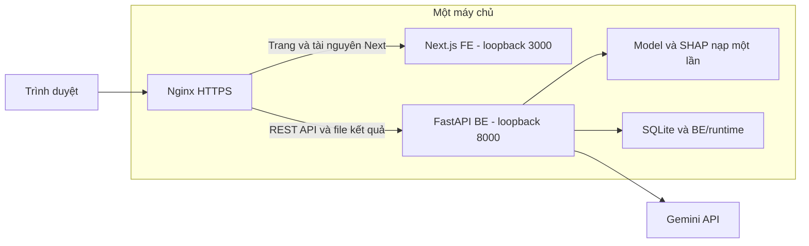

# Kế hoạch FE NIDR theo kiến trúc P-150

Ngày lập: **29/10/2026**. Nhánh thực hiện: **`duong`**.

**Cập nhật giao diện 03/11/2026:** người dùng chọn [Adminator](https://preview.colorlib.com/theme/adminator/index.html) làm tham chiếu diện mạo. Giữ kiến trúc Next.js/React/TypeScript và các tác vụ Miro; thay nền, sidebar/header, bảng/card/form và token màu theo thiết kế mới. Xem [design/DESIGN.md](design/DESIGN.md) và [design/README.md](design/README.md). Quyết định này thay thế mô tả nhận diện Miro/tím cũ bên dưới khi có khác biệt.

**Mục tiêu:** chuyển FE HTML/CSS/JavaScript hiện tại sang **Next.js App Router + React + TypeScript**, tổ chức mã nguồn giống frontend P-150; giữ giao diện NIDR trên [Miro](https://miro.com/app/board/uXjVEU3YmTc=/?moveToWidget=3458764688660488795) và kết nối REST API FastAPI đã có.

**Trạng thái cập nhật 01/11/2026:** đã thực hiện trên `duong`. FE chuyển sang Next.js/React/TypeScript, giữ Miro, kết nối REST API; bỏ frontend cũ và mount FE trong BE. Bổ sung đăng nhập/đăng xuất bằng form theo lựa chọn người dùng. Lint/typecheck/build đạt, 24 test FE, 43 test BE và 26 nhóm Chrome/Nginx/Next production đạt. Xem [VERIFICATION.md](VERIFICATION.md) và [README.md](README.md). Cổng Nginx production mới được thử bằng instance tạm, chưa triển khai vào dịch vụ của người dùng; BE vận hành không bị khởi động lại.

## 1. Cơ sở tham chiếu và quyết định kiến trúc

Đã đọc source tại `/home/admin123/Desktop/dataocubuntu/P-150/P-150/frontend`, gồm:

| Tệp/thư mục P-150 | Kiến trúc quan sát được | Áp dụng vào NIDR |
|---|---|---|
| `package.json`, `next.config.ts` | Next.js, React, npm; App Router; `output: "standalone"`; rewrites tới BE | Next.js cho FE; giữ FastAPI là nơi cung cấp API |
| `tsconfig.json` | TypeScript strict, alias `@/*` → `src/*` | Kiểu dữ liệu rõ ràng; tránh `any` |
| `src/app/layout.tsx`, các `page.tsx` | Layout chung, route theo thư mục, provider cho state | Layout dashboard và các trang theo run/mẫu |
| `src/components/shared/operational-shell.tsx` | Tách shell vận hành khỏi nội dung trang | Sidebar, breadcrumb, trạng thái kết nối, sáng/tối |
| `src/components/admin/turn-trace-panel.tsx` | Component tương tác đọc API, mở chi tiết bằng chứng | Bảng dự đoán, khung xem nhanh và cây Predict → SHAP → Gemini |
| `src/lib/api/`, `src/types/` | Hàm gọi API có kiểu; types tách riêng | Module API cho runs, predictions, explanations, alerts |
| `src/store/demo-store.tsx`, `auth-store.tsx` | React Context và hooks | Context nhỏ cho trạng thái UI; state nghiệp vụ lấy từ BE |
| `src/mocks/` | Fixture phục vụ demo/kiểm thử | Chỉ dùng trong test; ứng dụng chạy thật đọc API |
| `globals.css`, CSS Modules, PostCSS | Tailwind kết hợp CSS riêng | Giữ token Miro, dùng Tailwind/CSS Modules cho component |
| `vitest.config.mts`, `vitest.setup.ts` | Vitest, jsdom, React Testing Library, tự tìm test | Kiểm thử component và các luồng tương tác quan trọng |

P-150 khai báo Next.js **16.3.0**, React **19.2.8**, Tailwind **4.3.3**, TypeScript **6.0.3**; bản Next.js đã cài tại đó cũng là 16.3.0. Đây là số liệu tham chiếu đã đọc, không phải kết quả build của DATN. Chốt các phiên bản tương thích và `package-lock.json` ở bước khởi tạo; đọc tài liệu của đúng phiên bản Next.js trước khi viết code.

Áp dụng **cấu trúc và cách chia trách nhiệm** của P-150. NIDR tiếp tục dùng thiết kế Miro, tám lớp CICIoT2023 và tài khoản quản trị BE. Từ 01/11/2026, người dùng chọn đăng nhập/đăng xuất bằng form và phiên cookie; HTTP Basic giữ cho Swagger/CLI. Các chức năng riêng của P-150 như catalog xe, bản đồ, model 3D, phân vai khách hàng/tư vấn viên, JWT/refresh-token không thuộc kế hoạch này.

## 2. Phạm vi và các nguyên tắc giữ nguyên

- Chỉ làm trên nhánh `duong`; source FE nằm trong `FE/`, source Python trong `BE/`.
- Một máy chủ chạy FE, BE và lưu trữ local. Gemini là API ngoài. Một process BE nạp model/background một lần; Next.js không nạp model Python.
- Tái sử dụng model `XGB_d4_n200`, SHAP và prompt đã chốt. Không xử lý dataset, fit tiền xử lý hoặc train lại trên local.
- Dùng các API hiện có trong [BE/main.py](../BE/main.py) và schema ở [BE/schemas.py](../BE/schemas.py). Các thay đổi BE của kế hoạch tập trung vào bỏ phần phục vụ FE cũ sau khi chuyển đổi.
- Nội dung UI, thông báo lỗi và diễn giải bằng tiếng Việt. Giữ tên lớp/đặc trưng gốc và thứ tự tám lớp.
- Code rõ ràng, hàm nhỏ, state có tên cụ thể. Dùng React hooks/Context; chưa cần bổ sung Redux, Zustand hoặc một lớp repository cho FE.
- Giữ giới hạn CSV 1.000 dòng / 10 MiB, giải thích tối đa 50 dòng/yêu cầu, bao gồm Normal.
- Giữ các trạng thái dự đoán, SHAP, Gemini, cảnh báo và kết nối độc lập. Đổi tab, mở trang hoặc polling chỉ đọc dữ liệu.
- Khóa Gemini và mật khẩu nằm ở BE; không đưa vào `NEXT_PUBLIC_*`, JavaScript bundle hoặc browser storage.

## 3. Cấu trúc source đích

```text
FE/
├── PLAN.md
├── README.md
├── VERIFICATION.md
├── package.json
├── package-lock.json
├── tsconfig.json
├── next-env.d.ts
├── next.config.ts
├── eslint.config.mjs
├── postcss.config.mjs
├── vitest.config.mts
├── vitest.setup.ts
├── .env.example
├── public/
│   └── icon.svg
├── scripts/
│   └── prepare-standalone.mjs
├── deploy/
│   ├── nginx.conf
│   └── README.md
├── src/
│   ├── app/
│   │   ├── layout.tsx
│   │   ├── page.tsx                     # Chuyển tới /runs
│   │   ├── globals.css
│   │   ├── not-found.tsx
│   │   └── (dashboard)/
│   │       ├── layout.tsx               # Dùng OperationalShell
│   │       ├── loading.tsx
│   │       ├── error.tsx
│   │       ├── runs/
│   │       │   ├── page.tsx             # Lịch sử
│   │       │   ├── new/page.tsx         # Upload CSV
│   │       │   └── [runId]/
│   │       │       ├── page.tsx         # Chuyển tới monitor
│   │       │       ├── monitor/page.tsx
│   │       │       ├── predictions/page.tsx
│   │       │       ├── rows/[rowIndex]/page.tsx
│   │       │       └── export/page.tsx
│   │       └── alerts/page.tsx
│   ├── components/
│   │   ├── shared/                     # Shell, heading, badge, dialog, JSON viewer
│   │   ├── runs/                       # History, upload, monitor, export
│   │   ├── predictions/                # Filters, table, bulk action, peek
│   │   ├── explanations/               # Stage tree, SHAP, Gemini, debug tabs
│   │   └── alerts/                     # List, detail, note, history, playbook
│   ├── lib/
│   │   ├── api/
│   │   │   ├── client.ts               # Fetch, ApiError, download
│   │   │   ├── model.ts
│   │   │   ├── runs.ts
│   │   │   ├── predictions.ts
│   │   │   ├── explanations.ts
│   │   │   └── alerts.ts
│   │   ├── format.ts
│   │   ├── navigation.ts
│   │   └── use-polling.ts
│   ├── store/
│   │   └── ui-store.tsx
│   ├── types/                          # Model, run, prediction, explanation, alert
│   └── mocks/                          # Fixture cho test
├── design/                             # Miro, token, hai ảnh tham chiếu đang có
└── tests/
    └── browser_check.py                # Chuyển các ca Chrome sang route Next.js
```

Các component có thể đặt test `.test.tsx` cạnh source theo cách P-150. Chỉ tạo component/hàm thực sự dùng; cây trên là cách phân chia trách nhiệm, không yêu cầu mỗi nút nhỏ phải có một file.

### Ranh giới các phần

1. `app/`: khai báo route, metadata, layout và ghép component; không chứa một trang JSX lớn kèm toàn bộ logic API.
2. `components/`: render và tương tác. Component gọi hàm từ `lib/api/`; không rải URL/fetch giống nhau trong nhiều trang.
3. `lib/api/`: kiểu request/response, lỗi HTTP, upload multipart, tải blob. Dùng `/api`, phù hợp BE DATN; không sao chép tiền tố `/api/v1` của P-150.
4. `store/`: theme, lần chạy hiện tại, dòng đang xem, lựa chọn dòng và ngữ cảnh UI. BE là nguồn lưu kết quả dự đoán, giải thích và cảnh báo.
5. `types/`: các union/type khớp OpenAPI, phân biệt giá trị thiếu với số 0. JSON tự do dùng `unknown` rồi kiểm tra hình dạng khi cần.
6. `mocks/`: chỉ import trong test. Mất kết nối không được tự chuyển sang dữ liệu giả.

Layout/page giữ dạng Server Component khi chỉ ghép bố cục. Bảng, upload, polling, Context và browser storage nằm trong Client Component. Không gọi model hoặc Gemini trong render, `useEffect` khởi tạo hay Server Action. Route động xử lý `params` theo API của đúng phiên bản Next.js; phần dùng `useSearchParams` cần ranh giới Suspense phù hợp để build được. [Tài liệu Server/Client Components](https://nextjs.org/docs/app/getting-started/server-and-client-components).

## 4. UI và route bám bản Miro

| Màn hình | Route Next.js | Component chính / hành vi |
|---|---|---|
| Lịch sử lần chạy | `/runs` | Danh sách, trạng thái, phân trang, trạng thái trống |
| Tạo lần chạy | `/runs/new` | Upload/drop CSV, Batch/Replay, CSV mẫu, lỗi giữ form |
| Theo dõi | `/runs/[runId]/monitor` | Tiến độ, phân bố tám lớp, kết quả mới, điều khiển Replay |
| Bảng dự đoán | `/runs/[runId]/predictions` | Lọc, phân trang, chọn nhiều dòng, xem nhanh bên phải |
| Giải thích một mẫu | `/runs/[runId]/rows/[rowIndex]` | Cây bước; Đầu vào / Đầu ra / Metadata / Lỗi |
| Cảnh báo | `/alerts?alert=...&run_id=...` | Bảng và panel chi tiết, ghi chú, tiếp nhận/đóng/mở lại |
| Xuất kết quả | `/runs/[runId]/export` | CSV/ZIP toàn run; trạng thái đang chuẩn bị/lỗi |

Thiết kế đích đọc từ [bảng dự đoán](https://miro.com/app/board/uXjVEU3YmTc=/?moveToWidget=3458764688660488795), [chi tiết mẫu](https://miro.com/app/board/uXjVEU3YmTc=/?moveToWidget=3458764688660488796) và [cảnh báo](https://miro.com/app/board/uXjVEU3YmTc=/?moveToWidget=3458764688669949786). Quy tắc local nằm trong [design/DESIGN.md](design/DESIGN.md).

- Giữ sidebar desktop khoảng 200 px, topbar khoảng 48 px, khung xem nhanh khoảng 334 px, cây bước khoảng 218 px. Mobile chuyển vùng làm việc thành một cột, bảng chỉ cuộn trong vùng riêng.
- Giữ nền sáng/tối, Inter/JetBrains Mono, nội dung chính 14 px và chữ phụ tối thiểu 12 px. Dùng `lucide-react` cho icon nét nhất quán như cấu trúc component P-150; giữ nhận diện NIDR.
- Các trạng thái prototype được render bằng state của component, không tạo riêng 19 trang HTML hoặc 19 route cho cùng một màn.
- Checkbox chọn nhiều dòng khác với dòng đang xem nhanh. Đóng khung không bỏ lựa chọn; đổi bộ lọc không tự yêu cầu giải thích.
- SHAP hiển thị top-5 và phần 41 đặc trưng còn lại; xem nhanh dùng top-3, ghi rõ còn 43 đặc trưng. Các số lấy từ đúng mẫu/run, không gắn cố định số liệu mẫu Miro.
- Gemini không đạt kiểm tra phải hiện nhãn bản nháp/trạng thái. Trường chưa có API hiện `—` kèm lý do; giữ phân biệt thời gian artifact với latency runtime.
- Thứ tự lớp: Normal, BruteForce, DDoS, DoS, Mirai, Recon, Spoofing, Web-Based.

## 5. API, state và polling

| Nhu cầu FE | API BE đang có |
|---|---|
| Schema, cấu hình model/SHAP, CSV header | `GET /api/schema`, `/api/model`, `/api/input-template` |
| Upload/lịch sử/tiến độ | `POST /api/runs`, `GET /api/runs`, `GET /api/runs/{run_id}` |
| Thống kê/điều khiển | `GET /api/runs/{run_id}/summary`, `POST /api/runs/{run_id}/control` |
| Bảng dự đoán | `GET /api/runs/{run_id}/predictions` với bộ lọc/phân trang |
| 46 đặc trưng một dòng | `GET /api/runs/{run_id}/inputs/{row_index}` |
| Gửi/đọc giải thích | `POST` và `GET /api/runs/{run_id}/explanations`; `GET .../explanations/{row_index}` |
| File mẫu/CSV/ZIP | URL trong `files` của giải thích; `GET /api/runs/{run_id}/export` |
| Cảnh báo và hướng dẫn | `GET /api/alerts`, `GET/PATCH /api/alerts/{alert_id}`, `GET /api/playbooks/{class_name}` |

Quy tắc thực hiện:

1. `fetch` cùng origin, `credentials: "same-origin"`, dữ liệu động dùng `cache: "no-store"`. Upload bằng `FormData`, không tự gán multipart Content-Type. Chỉ nhận URL tải tệp thuộc API cùng origin.
2. Polling khoảng 2,5 giây khi cần; chờ request trước xong mới lên lịch request sau. Hủy bằng AbortController khi đổi route/run/mẫu/mức; tạm ngừng khi tab ẩn và dọn timer khi unmount.
3. React Strict Mode không được tạo thêm POST/PATCH. Các yêu cầu ghi chỉ nằm trong event handler của thao tác người dùng; không tự retry lời gọi Gemini hoặc upload khi mất mạng.
4. Mỗi phản hồi gắn với `run_id + row_index + audience_level`; loại phản hồi cũ khi người dùng chuyển mẫu để tránh trộn bằng chứng.
5. URL giữ bộ lọc lớp/trạng thái, offset/limit, audience, dòng xem nhanh, bước/tab và đường quay về nội bộ. Dùng `next/link`, `next/navigation`; không giữ router hash làm router chính.
6. Context/sessionStorage giữ tối đa 50 dòng được chọn và vị trí cuộn theo run; localStorage chỉ giữ theme/ID gần nhất khi phù hợp. Đọc storage phía client sau hydration, không gây lệch HTML server/client.
7. Kết quả BE vẫn giữ khi đổi kiến trúc FE. Browser storage ở origin/port cũ không tự chuyển sang origin/port mới; ghi rõ điều này khi bàn giao. Trong FE mới, quay về bảng phải phục hồi ngữ cảnh vừa xem.
8. Đổi mức basic/technical chỉ đọc kết quả mức đó. Người dùng bấm yêu cầu mới gửi POST; retry Gemini là thao tác riêng có xác nhận.
9. HTTP 202 là đã tiếp nhận; 404 chưa có giải thích khác với run không tồn tại; 409/413/422/429 có thông báo tiếng Việt. Mất kết nối giữ dữ liệu cuối.

## 6. Chạy trên một server

Kiến trúc đích dùng một máy chủ với các process riêng: Nginx làm cổng HTTPS, Next.js phục vụ FE và một process FastAPI xử lý nghiệp vụ. Đây vẫn là một node; model chỉ nằm trong process Python.



| Đường dẫn từ trình duyệt khi triển khai | Nơi phục vụ |
|---|---|
| `/`, `/runs/...`, `/alerts`, `/_next/...`, tài nguyên public | Next.js |
| `/api/...`, `/docs`, `/openapi.json`, `/health` | FastAPI; giữ nguyên đường dẫn/query/header |

### Xác thực và proxy

- Form `/login` dùng lại tài khoản quản trị BE, nhận cookie HttpOnly/Strict (Secure trên HTTPS), phiên tối đa tám giờ. Không dùng JWT, lưu password/token vào storage hoặc tự gọi refresh-token. Swagger/CLI giữ HTTP Basic.
- Trên cổng triển khai, Nginx bảo vệ các route FE bằng `auth_request` tới location nội bộ gọi **GET `/api/schema`** của BE. Chuyển tiếp Cookie/Authorization; thiếu phiên chuyển tới `/login`. Login, bundle `/_next/static/` và icon công khai; dữ liệu lần chạy không nằm trong bundle. Location xác thực là `internal`, không chuyển body hoặc cache kết quả xác thực. API/Swagger vẫn được BE kiểm tra quyền.
- Kiểm tra bản Nginx có `http_auth_request_module` trước khi cấu hình. Cách này dùng lại tài khoản BE, không tạo thêm bản sao mật khẩu trong FE. [Tài liệu Nginx auth_request](https://nginx.org/en/docs/http/ngx_http_auth_request_module.html).
- Next.js và BE chỉ bind loopback; TLS đặt ở Nginx khi truy cập LAN. Giữ host/protocol gốc và Authorization khi proxy; không cache dữ liệu API theo nhóm người dùng.
- Nginx cho body tối đa khoảng 11 MiB để chứa multipart; BE vẫn quyết định giới hạn file 10 MiB. Kiểm tra upload sát giới hạn, JSON, download PNG/CSV/ZIP và timeout; không tự retry POST/PATCH ở proxy.

### Phát triển local

Node.js 22 và npm là môi trường dự kiến, cùng hướng với Dockerfile P-150. Khi đã tạo project/lockfile, chạy từ `FE/`:

```bash
cd /home/admin123/Desktop/dataocubuntu/do_an/DATN/FE
npm ci
npm run dev -- --hostname 127.0.0.1 --port 3000
```

Script `dev` dự kiến là `next dev --webpack`, như P-150. BE vẫn chạy ở terminal riêng tại cổng 8000; không mở thêm process dùng chung `BE/runtime/` nếu BE đang hoạt động.

`next.config.ts` dùng rewrites cho `/api/:path*`, `/docs`, `/openapi.json`, `/health` tới BE loopback. FE dùng base URL `/api`; biến server-only `API_PROXY_TARGET` ghi địa chỉ BE, không chứa credential. Chốt cả rewrites và target trước khi build. Mở `http://127.0.0.1:3000/login` để đăng nhập bằng form; BE cần bản 1.3.0. [Tài liệu rewrites](https://nextjs.org/docs/app/api-reference/config/next-config-js/rewrites).

Không thêm `proxy.ts` đọc/clone body hoặc Server Action cho upload. Kiểm tra transport dev với multipart sát 10 MiB; không mặc định cho rằng giới hạn của Next.js giống BE. Production chuyển `/api` trực tiếp từ Nginx tới BE nên upload không đi qua Next.js.

### Build và chạy bản triển khai

Các lệnh sau là mục tiêu sau khi hoàn thiện cấu hình:

```bash
cd /home/admin123/Desktop/dataocubuntu/do_an/DATN/FE
npm ci
npm run lint
npm run typecheck
npm run test
npm run build
HOSTNAME=127.0.0.1 PORT=3000 npm run start
```

- Chọn `output: "standalone"` như P-150; không dùng static export cho các route run/mẫu được tạo lúc runtime.
- `postbuild` gọi `scripts/prepare-standalone.mjs` để đưa `public/` và `.next/static/` vào bundle. `start` chạy `node .next/standalone/server.js`. Kiểm tra đủ JS/CSS/font trong bản production, không chỉ trang HTML. [Tài liệu standalone](https://nextjs.org/docs/app/api-reference/config/next-config-js/output).
- Sau đó áp dụng cấu hình Nginx trong `FE/deploy/` và truy cập một địa chỉ HTTPS của máy chủ. Kiểm tra `nginx -t` trước khi reload trong giai đoạn triển khai thực tế.

## 7. Các bước triển khai và điều kiện chuyển bước

| Bước | Công việc và tệp chịu tác động | Điều kiện đạt |
|---|---|---|
| 1. Khởi tạo nền Next.js — đã đạt | Tạo package/config/lock, `src/app`, Vitest. Cập nhật `.gitignore` cho FE | Cài bằng npm ci; trang khung build được; TS strict; không ghi đè `PLAN.md`, `design/` hoặc BE/.env |
| 2. Shell và token Miro — đã đạt | `app/layout.tsx`, dashboard layout, `globals.css`, component shared, `ui-store.tsx` | Sidebar/topbar, sáng/tối, font 14/12 px, responsive; không hydration error |
| 3. Types và API — đã đạt | `types/*`, `lib/api/*`, `format.ts`, `navigation.ts`, `use-polling.ts` | Khớp OpenAPI, đọc API có xác thực, lỗi/abort/download; chưa tạo tác vụ khi mount |
| 4. Lịch sử, CSV, monitor — đã đạt | Các page và component `runs/` | Upload và phân trang thật; Batch/Replay đúng trạng thái; pause/resume/stop theo BE |
| 5. Bảng và xem nhanh — đã đạt | `components/predictions/`, page predictions | Chọn độc lập với peek; giới hạn 50; bộ lọc, run/dòng và ngữ cảnh quay về đúng |
| 6. Giải thích mẫu — đã đạt | `components/explanations/`, page rows | Đủ 46 trường, tám xác suất, top SHAP/phần còn lại, bốn tab; Gemini draft/partial vẫn xem được SHAP |
| 7. Cảnh báo và xuất — đã đạt | `components/alerts/`, page alerts/export | Tiếp nhận/đóng/mở lại/lịch sử thật; CSV/ZIP/Markdown/PNG đúng run/mức |
| 8. Kiểm thử và build — đã đạt | Test Vitest/RTL, chuyển `tests/browser_check.py` sang route/component Next | Các ca nghiệm thu bên dưới đạt trên FE mới; build production và deep-link hoạt động |
| 9. Chuyển serving/source — đã đạt trên instance kiểm thử | `BE/main.py`, test serving, `FE/deploy/`, README/VERIFICATION, tài liệu hệ thống | Cổng chính dùng Next + API BE; bỏ mount FE cũ; xóa entry/assets cũ sau khi các bước trước đạt |

Lưu ý cho bước 1: `.gitignore` hiện bỏ qua `*.json`, nên phải cho phép riêng `FE/package.json`, `FE/package-lock.json`, `FE/tsconfig.json`; cho phép `FE/.env.example`. Bỏ qua `FE/node_modules/`, `FE/.next/`, `FE/*.tsbuildinfo`, file môi trường riêng và kết quả kiểm thử sinh ra. Không sao chép node_modules, `.next`, secret hoặc Dockerfile phụ thuộc dữ liệu xe từ P-150.

Lưu ý cho bước 9:

- Trước chuyển đổi, `BE/main.py` trả `FE/index.html` ở `/` và mount `FE/assets/`. Chỉ bỏ hai phần này sau khi FE Next.js đã chạy qua kiểm thử; root BE có thể trả về Swagger để phân biệt cổng API.
- Xóa `FE/index.html` và `FE/assets/` cũ sau khi logic đã chuyển hết sang React. Giữ tài liệu/ảnh Miro, kế hoạch và test còn dùng; không duy trì hai frontend sản phẩm song song.
- Cập nhật test phục vụ FE cũ trong `BE/tests/test_frontend.py`; giữ các ca đầu vào 46 trường/checksum/xác thực. Kiểm tra FE/SSR và proxy ở lớp kiểm thử tích hợp mới.
- Ghi rõ URL Next thay cho `#/...`; cập nhật đường quay về và README. Dữ liệu run/model/runtime ở BE được giữ nguyên, không có migration database trong phạm vi kế hoạch.
- Cập nhật `docs/PLAN_HE_THONG_1_SERVER.md`, hướng dẫn BE/FE và tiến độ theo kiến trúc mới khi chuyển đổi thực sự hoàn tất. Không dùng kết quả test bản JavaScript thuần để ghi Next.js đã đạt.

## 8. Kịch bản nghiệm thu

### Component và state — Vitest/React Testing Library

- [x] Route/page ghép component đúng; state và phép định dạng nằm ngoài các biểu thức JSX phức tạp.
- [x] Chọn/bỏ chọn/tất cả trang, giới hạn 50 dòng, đóng/mở peek và giữ dòng hiện tại.
- [x] Lọc/phân trang không nhầm offset với row_index; quay về giữ query và vị trí cuộn.
- [x] Strict Mode, đổi tab và đổi audience không phát sinh POST/Gemini ngoài thao tác chủ động.
- [x] Abort hoặc loại phản hồi mẫu cũ; không trộn run/mẫu/mức khi đổi nhanh.
- [x] Polling không chồng request, dọn timer, giữ dữ liệu cuối khi lỗi và không fallback sang fixture.
- [x] Đúng đơn vị xác suất/điểm %, null không thành 0; không dùng thời gian artifact làm latency hiện tại.
- [x] Văn bản CSV/Gemini/ghi chú được render an toàn; không dùng HTML tùy ý để hiển thị phản hồi.

### Tích hợp — FE Next.js + BE/model thật, Gemini giả lập hoặc cache

- [x] Xác thực qua cổng chung; thiếu/sai tài khoản nhận 401 đúng; tải file cũng được bảo vệ.
- [x] Upload CSV hợp lệ, sai schema, quá số dòng/dung lượng và sát 10 MiB qua transport thực tế.
- [x] Dự đoán khớp golden; model_load_count vẫn bằng 1 sau điều hướng, polling và giải thích.
- [x] Batch, Replay pause/resume/stop; giữ dòng đã lưu, không nhân đôi cảnh báo hoặc dự đoán.
- [x] Giải thích Normal/BruteForce/Web-Based; đủ 46 trường đúng thứ tự, không chứa label.
- [x] Hai mức Gemini dùng chung SHAP; lỗi 429/timeout/không có key vẫn đọc được bằng chứng; retry chỉ theo nút xác nhận.
- [x] Tiếp nhận, ghi chú, đóng có lý do, mở lại và lịch sử cảnh báo đúng BE; không gán nhãn thật.
- [x] CSV/ZIP/PNG/Markdown tải được qua cổng chung và đúng run/mẫu/mức.
- [x] Refresh/deep-link tới run/mẫu hoạt động ở bản production; không chỉ điều hướng client mới chạy được.
- [x] Desktop 1280 × 720, mobile 390 × 844, sáng/tối; chữ nhỏ nhất 12 px, focus và tab bàn phím rõ, không tràn ngang cấp trang.
- [x] Lint, typecheck, Vitest, build, kiểm thử BE và browser suite đều có kết quả thực tế được ghi trong VERIFICATION.

Các kiểm thử dùng runtime/cổng tạm, không dừng BE của người dùng và không gọi Google trả phí mặc định. Validation/test nguồn đã từng được xem; đây là nghiệm thu ứng dụng, không phải phép đánh giá model độc lập. Human review vẫn tạm hoãn.

## 9. Trạng thái của bản kế hoạch

- [x] Đọc kiến trúc/code P-150 và cấu hình Next.js cục bộ.
- [x] Đọc lại hai màn bảng/chi tiết trên Miro và hợp đồng API DATN hiện tại.
- [x] Xác định cấu trúc Next.js, đường chuyển đổi từ FE hiện tại, cách chạy một server và điều kiện nghiệm thu.
- [x] Khởi tạo hoặc cài dependencies Next.js trong DATN.
- [x] Chuyển source FE sang React/TypeScript.
- [x] Kiểm thử/build Next.js và chuyển cách phục vụ FE.

Các mục đã đánh dấu dựa trên kiểm thử FE mới trong [VERIFICATION.md](VERIFICATION.md). Kiểm tra state/selection/Strict Mode/polling/keyboard dùng Vitest; quay về bảng/scroll, routing, tải file và gateway dùng Chrome production; thiếu key/timeout được kiểm tra ở BE. Cấu hình triển khai đã kiểm tra với Nginx tạm, chưa cài/reload dịch vụ thật. Human review và các giới hạn đã ghi không thuộc trạng thái hoàn tất này.

## 10. Điều chỉnh UI theo ảnh người dùng ngày 30/10/2026

- [x] Ẩn run ID ở lịch sử CSV và bỏ trạng thái kết nối thành công trên topbar.
- [x] Đổi màn tạo lần chạy theo ảnh 3: file picker tiếng Việt, chọn/bỏ file, Batch/Replay và nhãn tám lớp.
- [x] Thiết kế lại thanh chọn mẫu, dùng nút X cho khung xem nhanh.
- [x] Gemini mặc định tóm tắt, Xem thêm/Thu gọn; panel giới hạn chiều cao/cuộn riêng, không gọi API mới.
- [x] Trang cảnh báo theo ảnh 8: bộ lọc, màu lớp/trạng thái, chọn dòng, panel có nút X, timeline và hành động bằng chứng.
- [x] Kiểm tra desktop/mobile, đơn vị dữ liệu, dữ liệu dài và hành vi đóng/mở; cập nhật bằng chứng trong VERIFICATION.md.

## 11. Cân lại trang Theo dõi lần chạy ngày 01/11/2026

- [x] Gộp tiến độ vào thẻ file và tách bốn ô thống kê có màu/icon nhẹ.
- [x] Thu gọn cột phân bố, thêm số dòng/tỷ lệ và cân đáy với panel kết quả mới nhất.
- [x] Đưa liên kết Xem bảng dự đoán lên tiêu đề, giữ tối đa năm dòng và trạng thái chờ.
- [x] Kiểm tra Batch hoàn tất, Replay đang chạy/tạm dừng/tiếp tục/dừng, bố cục rộng/nhỏ và sáng/tối bằng browser suite; 24 nhóm đạt.

## 12. Đăng nhập/đăng xuất ngày 01/11/2026

- [x] Form tiếng Việt tại `/login`, có hiện/ẩn mật khẩu, lỗi/chờ/trợ giúp và nền sáng/tối.
- [x] Dùng lại tài khoản BE với phiên cookie HttpOnly/Strict/Secure trên HTTPS, tối đa tám giờ, logout/restart thu hồi; giữ Basic cho Swagger/CLI.
- [x] SessionGate trước dashboard/metadata, quay về route hợp lệ, chặn open redirect, không lưu credentials vào storage.
- [x] Nginx chuyển trang riêng tư thiếu phiên về login, cho login/bundle tĩnh/icon tải công khai; API/file cần xác thực.
- [x] 23 test FE, 43 test BE, 26 nhóm browser và build đạt; cập nhật hướng dẫn sử dụng/restart đúng process, không restart dịch vụ vận hành trong lượt triển khai.

Các thay đổi bố cục chỉ ở FE; chức năng đăng nhập bổ sung API auth trong BE và routing Nginx. Giữ Next App Router và dữ liệu/model nguồn. Các mục giao diện mới được kiểm tra với model/SHAP thật, Gemini giả lập.

- [x] Sửa Origin qua Next rewrites bằng forwarded host từ proxy loopback tin cậy; thêm kiểm tra Next dev thật, không chỉ dựa vào gateway Nginx.

## 13. Chỉnh form đăng nhập theo góp ý UX ngày 01/11/2026

- [x] Thêm placeholder, checkbox Ghi nhớ phiên hoạt động với cookie và trợ giúp dạng nút chữ.
- [x] Spinner khi gửi, dành chỗ cho alert để lỗi thông thường không dịch chuyển nút.
- [x] CTA tím, nền radial nhẹ, card rộng 460 px/bóng mềm, thương hiệu trong card và footer gọn.
- [x] Tắt chỉ báo dev N bằng cấu hình Next, giữ theme switch.
- [x] API 1.4.0 nhận remember; 23 test FE, 43 test BE, dev proxy check và 26 nhóm browser đạt.

## 14. Tổng quan theo Adminator ngày 04/11/2026

- [x] Giữ kiến trúc Next.js App Router, component/domain và typed API; thêm `/dashboard` làm mục đầu menu và trang đích mặc định sau đăng nhập.
- [x] BE 1.7.0 cung cấp `GET /api/dashboard` có xác thực, tổng hợp SQLite/sự tồn tại artifact đã lưu, không chạy model/SHAP/Gemini mới.
- [x] Bộ lọc ngày UTC+7/lần chạy, bốn KPI, biểu đồ hoạt động/ngày và tám lớp, cảnh báo/lần chạy gần nhất, trạng thái giải thích/Gemini/phiếu đánh giá.
- [x] Giữ token Adminator hiện có, responsive từ 320 px, theme tối, biểu đồ bàn phím/bảng dữ liệu; không dùng số liệu demo hay gọi nghi vấn là tấn công đã xác nhận.
- [x] 56 test BE, 36 test FE, lint/TypeScript, build và dev/Fast Refresh đạt. Browser suite và kết quả review cuối ở `VERIFICATION.md`.

Chi tiết phạm vi/thực thi và kiểm chứng ở `../work_dir/Nguyen_Ngoc_Duong_13_dashboard.md`, `VERIFICATION.md` và `../BE/VERIFICATION.md`. Page Agent có thao tác bộ lọc trên trang dev; hai lượt đọc kết quả timeout, không tính là kiểm tra end-to-end đã đạt. Người dùng đã restart BE và đăng nhập; không tự restart dịch vụ vận hành.

## 15. Footer toàn website — 04/11/2026

- [x] Gỡ banner đề cương riêng dashboard và component/CSS cũ theo phản hồi người dùng.
- [x] Dùng `shared/site-footer.tsx` cho shell chức năng, login và 404; footer navy phẳng chia cột theo cách tổ chức của PTIT, không cố định đè dữ liệu.
- [x] Bốn cột NIDR, đơn vị đào tạo, nhóm thực hiện và liên kết nhanh; thông tin nhóm theo đề cương, không giả thông tin liên hệ.
- [x] Lint/typecheck/38 test FE, build và 41 nhóm Chrome; xác nhận đúng một footer trên các route, điều hướng thật và mobile 320/390 px.

Thiết kế hiện tại thay footer dạng thẻ của đợt thử trước. Bằng chứng tại `VERIFICATION.md`, direction contract và trạng thái handoff tại `../work_dir/Nguyen_Ngoc_Duong_15_site_footer.md`.


## 16. Hoàn thiện cách đọc bằng chứng theo video demo — 04/11/2026

- [x] Kiểm chứng `shap_seconds` là giây từ `perf_counter`; ghi rõ PermutationExplainer toàn stacking và định dạng thời lượng phù hợp, không tự chia 1.000.
- [x] Markdown có Bản trình bày / Văn bản gốc; CSV hiển thị tối đa 6 chữ số thập phân, tác động 4, giữ số rất nhỏ khác 0 và tệp gốc.
- [x] Giữ bộ chọn bước XAI; thêm mục lục tự sáng khi cuộn tới nội dung bước, tệp và đánh giá, không đổi URL hoặc gọi giải thích.
- [x] Tóm tắt run thật khi chỉ có một run gần nhất; thêm thời điểm xử lý/thời gian suy luận ở bảng, ghi rõ bình quân Batch; căn nhãn pie theo centroid.
- [x] Tablet ≤1000 px đặt điều hướng bước phía trên nội dung; desktop giữ thanh bước và mục lục bên cạnh.
- [x] Chốt kiểm chứng cuối và review độc lập; xem `VERIFICATION.md` và `../work_dir/Nguyen_Ngoc_Duong_16_video_polish.md`.


## 18. Dashboard nền sáng và cách đọc thân thiện — 04/11/2026

- [x] Bỏ metadata model sidebar, giữ menurộng/gọn vàAPIshortcut.
- [x] Footer dùng màu theme sáng/tối thay Navy cố định.
- [x] Ba phần bằng chứng/diễn giải/đánh giá có số thật, progress và chi tiết mở theo nhu cầu.
- [x] Pie giữ hình quạt, nhãn/tỷ lệ rõ ở chú giải; cột ngày kèm GaussianKDE khi đủ ngày, không vẽ đường giả.
- [x] 56testFE, lint/typecheck, buildbảnsaotạm,43nhóm Chrome và PageAgentđọc live đạt.
- [x] Review độc lập và documenter khớp thiết kế cuối; xem VERIFICATION.md và work_dir task18.
