# Báo cáo tích hợp model → SHAP → Gemini

Run: `integration_20261022_075217_0b67d48f`. Chế độ đầu vào: `user_csv`.

## mau_001 — dòng CSV 0

**Trạng thái Gemini: accepted**

Đạt kiểm tra bằng chứng có cấu trúc và quy tắc văn bản; chưa đánh giá ngữ nghĩa thủ công.

### Dự đoán và số liệu do chương trình dựng

- Model: `XGB_d4_n200`; dự đoán: **DDoS**, xác suất **99.9981%**.
- Lớp đứng thứ hai: **DoS**, xác suất **0.0011%**.
- Chênh lệch hai lớp: **99.9971 điểm phần trăm**.
- Quy tắc khoảng cách nhỏ: không quá 5 điểm phần trăm, chỉ để trình bày.
- Xác suất nền SHAP: 62.506627%.
- Tổng SHAP: +37.491513 điểm phần trăm; ngoài top 5: +3.934622 điểm phần trăm.
- Hỗ trợ mạnh nhất trong top 5: **IAT**.
- Phản đối mạnh nhất trong top 5: **Không có tác động âm trong top 5**.

| Đặc trưng | Giá trị gốc | SHAP | Tác động (điểm %) |
|---|---:|---:|---:|
| IAT | 83034072 | +0.27957829 | +27.957829 |
| Protocol Type | 5.9400001 | +0.02736563 | +2.736563 |
| Magnitue | 10.39565 | +0.01470310 | +1.470310 |
| Min | 54 | +0.00721162 | +0.721162 |
| Number | 9.5 | +0.00671026 | +0.671026 |

### Diễn giải Gemini

Hệ thống phân loại mô hình đã dự đoán mẫu thuộc lớp DDoS với mức xác suất cao và vượt trội hoàn toàn so với lớp đứng thứ hai là DoS. Các đặc trưng trong top năm đều đóng vai trò hỗ trợ nâng cao đầu ra của lớp này so với giá trị nền tham chiếu.

**So sánh hai lớp:** Cờ khoảng cách nhỏ đang tắt vì chênh lệch giữa hai đầu ra lớn, nhưng việc này không bảo đảm dự đoán chắc chắn đúng do chưa có nhãn thật.

**Tổng hợp SHAP:** Đặc trưng IAT là yếu tố hỗ trợ mạnh nhất đẩy đầu ra tăng lên, trong khi không có yếu tố nào trong top năm tạo ra tác động phản đối mang giá trị âm.

- **IAT**: Đây là yếu tố hỗ trợ nổi bật nhất trong top năm, đóng góp mức tăng lớn nhất vào điểm số của lớp dự đoán.
- **Protocol Type**: Đặc trưng này cung cấp sự hỗ trợ bổ sung cùng chiều với mức tác động nhỏ hơn vị trí dẫn đầu.
- **Magnitue**: Sự đóng góp dương tiếp tục xuất hiện với biên độ thấp hơn để đẩy giá trị đầu ra lên.
- **Min**: Đặc trưng này mang lại một mức tác động dương nhỏ trong nhóm năm yếu tố hàng đầu.
- **Number**: Đây là yếu tố có đóng góp dương nhỏ nhất trong top năm đặc trưng được liệt kê.

### Gợi ý kiểm tra có điều kiện

- **Nhật ký lưu lượng mạng**: Kiểm tra sự đồng thời của nhiều nguồn đến cùng dịch vụ nếu có địa chỉ và thời gian Mục đích: Đối chiếu đặc trưng lưu lượng với diễn biến thực tế trên hệ thống mạng nếu hệ thống có lưu trữ nhật ký này.
- **Nhật ký tài nguyên dịch vụ**: Đối chiếu lưu lượng với tình trạng tài nguyên và khả năng phục vụ, không tự đặt ngưỡng Mục đích: Kiểm tra khả năng chịu tải và phản ứng của hệ thống nhằm bổ sung bằng chứng đối chiếu nếu có log tài nguyên.

### Giới hạn do Gemini nêu

- Giá trị SHAP chỉ giải thích đầu ra của mô hình đối với mẫu này và không chứng minh được quan hệ nhân quả hay hành vi tấn công thực tế.
- Xác suất dự đoán chưa được kiểm chứng hay hiệu chỉnh độ tin cậy tuyệt đối.
- Tổng các giá trị SHAP trong top năm chưa phải toàn bộ sự thay đổi vì vẫn còn phần đóng góp từ các đặc trưng nằm ngoài nhóm.

SHAP giải thích đầu ra model, chưa chứng minh hành vi tấn công hoặc quan hệ nhân quả. Đánh giá con người tạm hoãn.

---

## mau_002 — dòng CSV 1

**Trạng thái Gemini: accepted**

Đạt kiểm tra bằng chứng có cấu trúc và quy tắc văn bản; chưa đánh giá ngữ nghĩa thủ công.

### Dự đoán và số liệu do chương trình dựng

- Model: `XGB_d4_n200`; dự đoán: **DDoS**, xác suất **99.9981%**.
- Lớp đứng thứ hai: **DoS**, xác suất **0.0011%**.
- Chênh lệch hai lớp: **99.9971 điểm phần trăm**.
- Quy tắc khoảng cách nhỏ: không quá 5 điểm phần trăm, chỉ để trình bày.
- Xác suất nền SHAP: 62.506627%.
- Tổng SHAP: +37.491501 điểm phần trăm; ngoài top 5: +3.423365 điểm phần trăm.
- Hỗ trợ mạnh nhất trong top 5: **IAT**.
- Phản đối mạnh nhất trong top 5: **Không có tác động âm trong top 5**.

| Đặc trưng | Giá trị gốc | SHAP | Tác động (điểm %) |
|---|---:|---:|---:|
| IAT | 83076112 | +0.27487559 | +27.487559 |
| Magnitue | 10.392304 | +0.02471108 | +2.471108 |
| Protocol Type | 6 | +0.02039206 | +2.039206 |
| Tot size | 54 | +0.01215702 | +1.215702 |
| Min | 54 | +0.00854561 | +0.854561 |

### Diễn giải Gemini

Mô hình dự đoán mẫu thuộc lớp DDoS với xác suất áp đảo nhờ sự hỗ trợ mạnh mẽ từ các đặc trưng như IAT và Magnitue. Lớp đứng thứ hai là DoS có khoảng cách chênh lệch rất lớn và không tạo ra sự cạnh tranh đáng kể trong trường hợp này.

**So sánh hai lớp:** Cờ khoảng cách nhỏ đang tắt cho thấy khoảng cách giữa hai lớp đứng đầu là rất lớn, tuy nhiên sự chênh lệch lớn này không được coi là bảo đảm tuyệt đối rằng dự đoán đã chính xác.

**Tổng hợp SHAP:** Trong top năm đặc trưng, IAT đóng vai trò hỗ trợ mạnh nhất đẩy giá trị đầu ra lên cao, trong khi không ghi nhận bất kỳ tác động phản đối nào do toàn bộ đặc trưng trong nhóm đều mang chiều hướng tăng.

- **IAT**: Đây là yếu tố hỗ trợ nổi bật nhất trong top năm, góp phần đáng kể vào kết quả phân loại của mô hình.
- **Magnitue**: Tác động này cùng chiều nhưng nhỏ hơn yếu tố dẫn đầu, đóng vai trò là nguồn hỗ trợ bổ sung cho lớp dự đoán.
- **Protocol Type**: Đặc trưng này tiếp tục cung cấp lực đẩy dương củng cố cho đầu ra của mô hình.
- **Tot size**: Sự hiện diện của giá trị này mang lại một mức đóng góp dương nhỏ hơn trong nhóm.
- **Min**: Đóng góp này tạo ra tác động dương nhẹ và thấp nhất trong số năm đặc trưng được xem xét.

### Gợi ý kiểm tra có điều kiện

- **Nhật ký lưu lượng mạng**: Kiểm tra sự đồng thời của nhiều nguồn đến cùng dịch vụ nếu có địa chỉ và thời gian. Mục đích: Đối chiếu sự đồng thời của các nguồn truy cập để có thêm góc nhìn về cấu trúc lưu lượng thực tế.
- **Nhật ký tài nguyên dịch vụ**: Đối chiếu lưu lượng với tình trạng tài nguyên và khả năng phục vụ, không tự đặt ngưỡng. Mục đích: So sánh lưu lượng hiện tại với khả năng đáp ứng của hệ thống nhằm kiểm chứng bối cảnh vận hành.

### Giới hạn do Gemini nêu

- Giá trị SHAP chỉ thể hiện mức độ đóng góp của đặc trưng vào đầu ra của mô hình đối với mẫu hiện tại, không chứng minh mối quan hệ nhân quả hay xác nhận sự tồn tại của một cuộc tấn công thực tế.
- Xác suất dự đoán của mô hình chưa được kiểm chứng hay hiệu chỉnh độc lập, do đó không đại diện cho độ tin cậy tuyệt đối.
- Tổng hợp SHAP chỉ giới hạn trong top năm đặc trưng được liệt kê và phần ngoài nhóm, chưa phản ánh toàn bộ không gian dữ liệu của mô hình.

SHAP giải thích đầu ra model, chưa chứng minh hành vi tấn công hoặc quan hệ nhân quả. Đánh giá con người tạm hoãn.

---

## mau_003 — dòng CSV 2

**Trạng thái Gemini: accepted**

Đạt kiểm tra bằng chứng có cấu trúc và quy tắc văn bản; chưa đánh giá ngữ nghĩa thủ công.

### Dự đoán và số liệu do chương trình dựng

- Model: `XGB_d4_n200`; dự đoán: **DDoS**, xác suất **99.9981%**.
- Lớp đứng thứ hai: **DoS**, xác suất **0.0011%**.
- Chênh lệch hai lớp: **99.9971 điểm phần trăm**.
- Quy tắc khoảng cách nhỏ: không quá 5 điểm phần trăm, chỉ để trình bày.
- Xác suất nền SHAP: 62.506627%.
- Tổng SHAP: +37.491501 điểm phần trăm; ngoài top 5: +3.127248 điểm phần trăm.
- Hỗ trợ mạnh nhất trong top 5: **IAT**.
- Phản đối mạnh nhất trong top 5: **Không có tác động âm trong top 5**.

| Đặc trưng | Giá trị gốc | SHAP | Tác động (điểm %) |
|---|---:|---:|---:|
| IAT | 83127776 | +0.27978975 | +27.978975 |
| Magnitue | 9.1774025 | +0.03345408 | +3.345408 |
| Protocol Type | 0.98000002 | +0.01642456 | +1.642456 |
| Header_Length | 0 | +0.00731986 | +0.731986 |
| Min | 42 | +0.00665428 | +0.665428 |

### Diễn giải Gemini

Hệ thống dự đoán mẫu thuộc lớp DDoS với xác suất rất cao, trong đó đặc trưng IAT đóng vai trò hỗ trợ mạnh mẽ nhất trong top năm. Lớp đứng thứ hai là DoS nhưng có khoảng cách xác suất rất lớn so với lớp dẫn đầu.

**So sánh hai lớp:** Cờ khoảng cách nhỏ đang tắt, cho thấy sự chênh lệch giữa lớp dự đoán và lớp đứng thứ hai là lớn. Tuy nhiên, việc chênh lệch lớn không bảo đảm dự đoán chắc chắn đúng nhãn thật.

**Tổng hợp SHAP:** Trong top năm đặc trưng, IAT là yếu tố hỗ trợ mạnh nhất đẩy giá trị đầu ra lên, trong khi không có đặc trưng nào trong nhóm này mang tác động phản đối. Các đóng góp còn lại cùng phần ngoài nhóm phối hợp tạo nên kết quả cuối cùng.

- **IAT**: Đây là yếu tố hỗ trợ nổi bật nhất trong top năm, góp phần đáng kể nâng cao đầu ra của mô hình.
- **Magnitue**: Tác động này cùng chiều nhưng nhỏ hơn yếu tố dẫn đầu, đóng vai trò hỗ trợ bổ sung cho dự đoán.
- **Protocol Type**: Đặc trưng này cung cấp thêm một lực đẩy dương mức độ vừa phải vào tổng giá trị SHAP.
- **Header_Length**: Sự hiện diện của tác động dương này tiếp tục củng cố hướng đi của lớp được giải thích.
- **Min**: Đây là yếu tố có đóng góp dương nhỏ nhất trong nhóm năm đặc trưng hàng đầu.

### Gợi ý kiểm tra có điều kiện

- **Nhật ký lưu lượng mạng**: Kiểm tra sự đồng thời của nhiều nguồn đến cùng dịch vụ nếu hệ thống có ghi nhận địa chỉ và thời gian. Mục đích: Đối chiếu mô hình với các dấu hiệu lưu lượng thực tế đi qua hệ thống mạng.
- **Nhật ký tài nguyên dịch vụ**: Đối chiếu lưu lượng với tình trạng tài nguyên và khả năng phục vụ của hệ thống. Mục đích: Xác thực mức độ ảnh hưởng của tải lưu lượng lên các dịch vụ đích một cách khách quan.

### Giới hạn do Gemini nêu

- Các giá trị SHAP chỉ thể hiện mức độ đóng góp vào đầu ra của mô hình đối với mẫu hiện tại, không chứng minh được quan hệ nhân quả hay mô tả một cuộc tấn công thực tế.
- Xác suất của mô hình chưa được kiểm chứng về độ hiệu chỉnh và không phản ánh tỷ lệ chính xác tuyệt đối.
- Phạm vi phân tích chỉ giới hạn trong top năm đặc trưng và phần dư ngoài nhóm, chưa bao quát toàn bộ không gian dữ liệu phức tạp.

SHAP giải thích đầu ra model, chưa chứng minh hành vi tấn công hoặc quan hệ nhân quả. Đánh giá con người tạm hoãn.

---

## mau_004 — dòng CSV 3

**Trạng thái Gemini: accepted**

Đạt kiểm tra bằng chứng có cấu trúc và quy tắc văn bản; chưa đánh giá ngữ nghĩa thủ công.

### Dự đoán và số liệu do chương trình dựng

- Model: `XGB_d4_n200`; dự đoán: **DDoS**, xác suất **99.9981%**.
- Lớp đứng thứ hai: **DoS**, xác suất **0.0011%**.
- Chênh lệch hai lớp: **99.9971 điểm phần trăm**.
- Quy tắc khoảng cách nhỏ: không quá 5 điểm phần trăm, chỉ để trình bày.
- Xác suất nền SHAP: 62.506627%.
- Tổng SHAP: +37.491513 điểm phần trăm; ngoài top 5: +2.355845 điểm phần trăm.
- Hỗ trợ mạnh nhất trong top 5: **IAT**.
- Phản đối mạnh nhất trong top 5: **Không có tác động âm trong top 5**.

| Đặc trưng | Giá trị gốc | SHAP | Tác động (điểm %) |
|---|---:|---:|---:|
| IAT | 83094080 | +0.28494729 | +28.494729 |
| Protocol Type | 6 | +0.02960885 | +2.960885 |
| Min | 54 | +0.01661683 | +1.661683 |
| Number | 9.5 | +0.01101139 | +1.101139 |
| Tot size | 54 | +0.00917232 | +0.917232 |

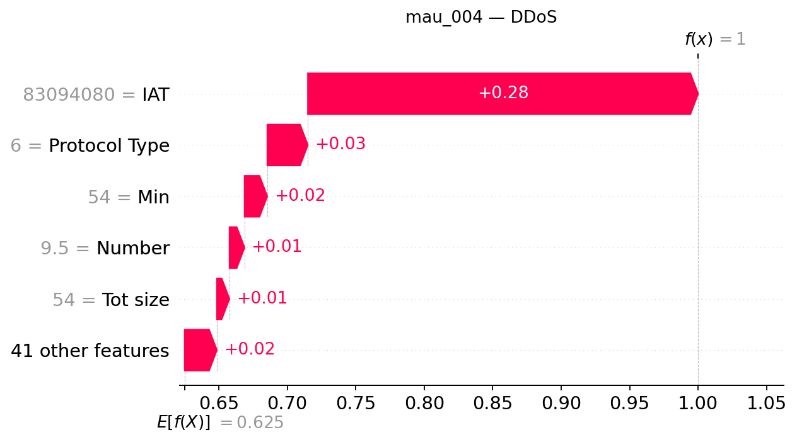

### Diễn giải Gemini

Mẫu dữ liệu được mô hình dự đoán là lớp DDoS với xác suất rất cao, trong đó đặc trưng IAT đóng vai trò hỗ trợ mạnh mẽ nhất. Khoảng cách giữa lớp đứng đầu và lớp đứng thứ hai là rất lớn, cho thấy sự áp đảo rõ rệt của lớp dự đoán trong trường hợp này.

**So sánh hai lớp:** Cờ khoảng cách nhỏ đang tắt, thể hiện sự chênh lệch lớn giữa lớp DDoS và lớp đứng thứ hai là DoS. Tuy nhiên, mức chênh lệch cao này không được xem là sự bảo đảm tuyệt đối về tính chính xác của dự đoán.

**Tổng hợp SHAP:** Trong top năm đặc trưng, IAT là yếu tố hỗ trợ mạnh nhất làm tăng đầu ra của lớp dự đoán, trong khi không ghi nhận bất kỳ tác động phản đối nào từ các đặc trưng còn lại.

- **IAT**: Đây là yếu tố hỗ trợ nổi bật nhất trong top năm, đóng góp lớn vào việc đẩy giá trị đầu ra của lớp được giải thích.
- **Protocol Type**: Tác động này cùng chiều với yếu tố dẫn đầu nhưng mang lại mức hỗ trợ bổ sung ở quy mô nhỏ hơn.
- **Min**: Đặc trưng này thể hiện một hướng đóng góp dương tiếp theo nhằm củng cố kết quả phân loại của mô hình.
- **Number**: Sự hiện diện của đặc trưng này tiếp tục tạo ra một lực đẩy dương nhỏ hơn để nâng cao đầu ra.
- **Tot size**: Đây là yếu tố có tác động nhỏ nhất trong nhóm năm đặc trưng hàng đầu nhưng vẫn duy trì xu hướng hỗ trợ.

### Gợi ý kiểm tra có điều kiện

- **Nhật ký lưu lượng mạng**: Kiểm tra sự đồng thời của nhiều nguồn đến cùng dịch vụ nếu hệ thống có ghi nhận địa chỉ và thời gian. Mục đích: Đối chiếu sự biến động lưu lượng để xác thực thêm bối cảnh ghi nhận của mẫu.
- **Nhật ký tài nguyên dịch vụ**: Đối chiếu lưu lượng với tình trạng tài nguyên và khả năng phục vụ của hệ thống. Mục đích: Kiểm tra mức độ đáp ứng và trạng thái hoạt động thực tế nhằm phục vụ việc phân tích đối chiếu.

### Giới hạn do Gemini nêu

- Kết quả SHAP chỉ giải thích giá trị đầu ra của mô hình cho mẫu hiện tại và không thể dùng để chứng minh quan hệ nhân quả hay sự tồn tại của một cuộc tấn công thực tế.
- Xác suất dự đoán của mô hình chưa được kiểm chứng hay hiệu chỉnh để đảm bảo độ tin cậy tuyệt đối.
- Phạm vi phân tích chỉ giới hạn trong top năm đặc trưng được cung cấp và không đại diện cho toàn bộ các yếu tố bên ngoài.

SHAP giải thích đầu ra model, chưa chứng minh hành vi tấn công hoặc quan hệ nhân quả. Đánh giá con người tạm hoãn.

---

## mau_005 — dòng CSV 4

**Trạng thái Gemini: accepted**

Đạt kiểm tra bằng chứng có cấu trúc và quy tắc văn bản; chưa đánh giá ngữ nghĩa thủ công.

### Dự đoán và số liệu do chương trình dựng

- Model: `XGB_d4_n200`; dự đoán: **Normal**, xác suất **99.2367%**.
- Lớp đứng thứ hai: **Spoofing**, xác suất **0.3880%**.
- Chênh lệch hai lớp: **98.8487 điểm phần trăm**.
- Quy tắc khoảng cách nhỏ: không quá 5 điểm phần trăm, chỉ để trình bày.
- Xác suất nền SHAP: 5.920577%.
- Tổng SHAP: +93.316132 điểm phần trăm; ngoài top 5: +21.095353 điểm phần trăm.
- Hỗ trợ mạnh nhất trong top 5: **urg_count**.
- Phản đối mạnh nhất trong top 5: **Không có tác động âm trong top 5**.

| Đặc trưng | Giá trị gốc | SHAP | Tác động (điểm %) |
|---|---:|---:|---:|
| urg_count | 90 | +0.23424347 | +23.424347 |
| rst_count | 2126.5 | +0.18010461 | +18.010461 |
| IAT | 0.0049007894 | +0.13012446 | +13.012446 |
| Number | 5.5 | +0.10711341 | +10.711341 |
| flow_duration | 53.269356 | +0.07062183 | +7.062183 |

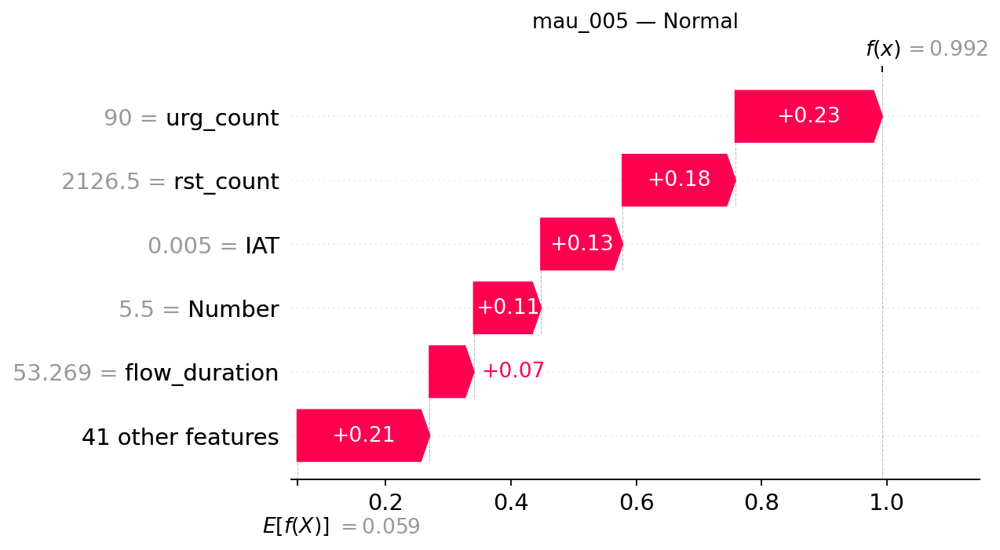

### Diễn giải Gemini

Mẫu được dự đoán là lớp Normal với xác suất cao, trong đó đặc trưng urg_count đóng vai trò hỗ trợ mạnh nhất và không ghi nhận yếu tố phản đối nào trong top năm. Lớp đứng thứ hai là Spoofing có khoảng cách chênh lệch lớn so với lớp dẫn đầu và cờ khoảng cách nhỏ không bật.

**So sánh hai lớp:** Cờ khoảng cách nhỏ đang tắt và chênh lệch giữa hai đầu ra lớn. Tuy nhiên, việc không bật cờ này không bảo đảm dự đoán chắc chắn là đúng nhãn thật.

**Tổng hợp SHAP:** Trong nhóm năm đặc trưng hàng đầu, urg_count là yếu tố hỗ trợ mạnh nhất đẩy giá trị đầu ra lên cao, trong khi không có yếu tố nào mang giá trị âm để phản đối trong nhóm này.

- **urg_count**: Đây là yếu tố hỗ trợ nổi bật nhất trong top năm, đóng góp tích cực vào đầu ra của lớp được dự đoán.
- **rst_count**: Tác động này cùng chiều nhưng có độ lớn nhỏ hơn yếu tố dẫn đầu trong nhóm.
- **IAT**: Đặc trưng này cung cấp thêm một mức hỗ trợ dương với mức đóng góp ở ngưỡng trung bình.
- **Number**: Sự hiện diện của đặc trưng này tiếp tục củng cố đầu ra theo chiều hướng tăng.
- **flow_duration**: Đây là yếu tố có mức tác động nhỏ nhất trong top năm nhưng vẫn duy trì chiều hướng đóng góp dương.

### Gợi ý kiểm tra có điều kiện

- **Nhật ký kết nối**: Đối chiếu đích kết nối, dịch vụ và thời điểm với hoạt động được phép Mục đích: Xác định xem lưu lượng có tuân thủ các quy tắc truy cập chuẩn hay không nếu hệ thống có lưu trữ log này.
- **Nhật ký thiết bị**: Kiểm tra lỗi hoặc cảnh báo đồng thời; dự đoán Normal không bảo đảm an toàn Mục đích: Kiểm tra các dấu hiệu bất thường tiềm ẩn ở tầng thiết bị nếu hệ thống ghi nhận.

### Giới hạn do Gemini nêu

- Giá trị SHAP chỉ giải thích đầu ra của mô hình đối với mẫu hiện tại, không chứng minh quan hệ nhân quả hay hành vi tấn công thực tế.
- Dự đoán lớp Normal không bảo đảm hệ thống hoàn toàn an toàn hay không có rủi ro tiềm ẩn.
- Tổng giá trị SHAP của top năm chưa bao trùm toàn bộ các đặc trưng và xác suất chưa được hiệu chỉnh chính thức.

SHAP giải thích đầu ra model, chưa chứng minh hành vi tấn công hoặc quan hệ nhân quả. Đánh giá con người tạm hoãn.

---

## mau_006 — dòng CSV 5

**Trạng thái Gemini: accepted**

Đạt kiểm tra bằng chứng có cấu trúc và quy tắc văn bản; chưa đánh giá ngữ nghĩa thủ công.

### Dự đoán và số liệu do chương trình dựng

- Model: `XGB_d4_n200`; dự đoán: **DDoS**, xác suất **99.9981%**.
- Lớp đứng thứ hai: **DoS**, xác suất **0.0011%**.
- Chênh lệch hai lớp: **99.9971 điểm phần trăm**.
- Quy tắc khoảng cách nhỏ: không quá 5 điểm phần trăm, chỉ để trình bày.
- Xác suất nền SHAP: 62.506627%.
- Tổng SHAP: +37.491513 điểm phần trăm; ngoài top 5: +2.746824 điểm phần trăm.
- Hỗ trợ mạnh nhất trong top 5: **IAT**.
- Phản đối mạnh nhất trong top 5: **Không có tác động âm trong top 5**.

| Đặc trưng | Giá trị gốc | SHAP | Tác động (điểm %) |
|---|---:|---:|---:|
| IAT | 83076176 | +0.26778991 | +26.778991 |
| Magnitue | 10.392304 | +0.02972431 | +2.972431 |
| Tot size | 54 | +0.02012855 | +2.012855 |
| Protocol Type | 6 | +0.01855630 | +1.855630 |
| Min | 54 | +0.01124783 | +1.124783 |

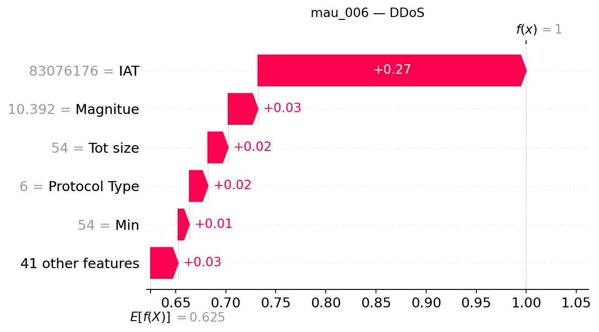

### Diễn giải Gemini

Mô hình dự đoán mẫu dữ liệu thuộc lớp DDoS với xác suất rất cao, trong đó đặc trưng IAT đóng vai trò hỗ trợ nổi bật nhất. Khoảng cách giữa lớp DDoS và lớp đứng thứ hai là DoS rất lớn, cho thấy không có sự cạnh tranh đáng kể trong trường hợp này.

**So sánh hai lớp:** Cờ khoảng cách nhỏ đang tắt, thể hiện chênh lệch lớn giữa hai đầu ra nhưng không coi đây là bảo đảm tuyệt đối cho dự đoán đúng.

**Tổng hợp SHAP:** Trong top năm đặc trưng, IAT là yếu tố hỗ trợ mạnh nhất đẩy giá trị đầu ra lên, trong khi không có yếu tố nào mang giá trị âm trong nhóm này.

- **IAT**: Đây là yếu tố hỗ trợ nổi bật nhất trong top năm đối với lớp được dự đoán.
- **Magnitue**: Tác động này cùng chiều nhưng có mức đóng góp nhỏ hơn yếu tố dẫn đầu.
- **Tot size**: Đặc trưng này duy trì xu hướng hỗ trợ bổ sung cho kết quả phân loại.
- **Protocol Type**: Sự góp mặt của đặc trưng này mang lại thêm một phần tác động dương nhỏ hơn.
- **Min**: Đây là yếu tố có đóng góp dương thấp nhất trong số năm đặc trưng hàng đầu.

### Gợi ý kiểm tra có điều kiện

- **Nhật ký lưu lượng mạng**: Kiểm tra sự đồng thời của nhiều nguồn đến cùng dịch vụ nếu có địa chỉ và thời gian Mục đích: Đối chiếu sự xuất hiện đồng thời của các nguồn lưu lượng.
- **Nhật ký tài nguyên dịch vụ**: Đối chiếu lưu lượng với tình trạng tài nguyên và khả năng phục vụ, không tự đặt ngưỡng Mục đích: Kiểm tra tương quan giữa lưu lượng và trạng thái tài nguyên hệ thống.

### Giới hạn do Gemini nêu

- Giải thích SHAP chỉ phản ánh đầu ra của mô hình đối với mẫu hiện tại, không chứng minh quan hệ nhân quả hay sự tồn tại của tấn công thực tế.
- Xác suất của mô hình chưa được kiểm chứng hiệu chuẩn và không thể coi là độ chắc chắn tuyệt đối.
- Tổng giá trị SHAP trong top năm chưa bao trùm toàn bộ các thành phần thay đổi từ giá trị nền tham chiếu.

SHAP giải thích đầu ra model, chưa chứng minh hành vi tấn công hoặc quan hệ nhân quả. Đánh giá con người tạm hoãn.

---

## mau_007 — dòng CSV 6

**Trạng thái Gemini: accepted**

Đạt kiểm tra bằng chứng có cấu trúc và quy tắc văn bản; chưa đánh giá ngữ nghĩa thủ công.

### Dự đoán và số liệu do chương trình dựng

- Model: `XGB_d4_n200`; dự đoán: **DoS**, xác suất **99.9953%**.
- Lớp đứng thứ hai: **DDoS**, xác suất **0.0034%**.
- Chênh lệch hai lớp: **99.9918 điểm phần trăm**.
- Quy tắc khoảng cách nhỏ: không quá 5 điểm phần trăm, chỉ để trình bày.
- Xác suất nền SHAP: 21.878189%.
- Tổng SHAP: +78.117067 điểm phần trăm; ngoài top 5: +1.786710 điểm phần trăm.
- Hỗ trợ mạnh nhất trong top 5: **IAT**.
- Phản đối mạnh nhất trong top 5: **Không có tác động âm trong top 5**.

| Đặc trưng | Giá trị gốc | SHAP | Tác động (điểm %) |
|---|---:|---:|---:|
| IAT | 82985616 | +0.72209427 | +72.209427 |
| Number | 9.5 | +0.01299066 | +1.299066 |
| Protocol Type | 6 | +0.01053786 | +1.053786 |
| Magnitue | 10.39527 | +0.01037405 | +1.037405 |
| Weight | 141.55 | +0.00730674 | +0.730674 |

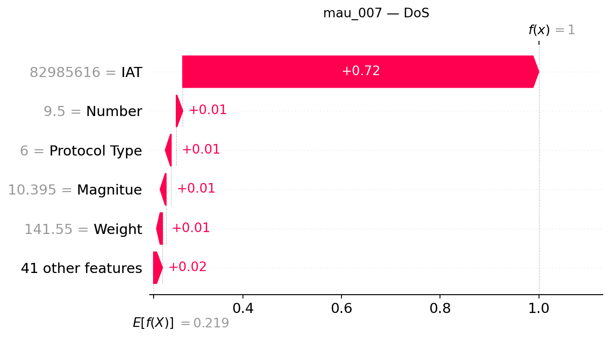

### Diễn giải Gemini

Mẫu dữ liệu được mô hình dự đoán là lớp DoS với sự hỗ trợ áp đảo từ đặc trưng IAT trong top năm đặc trưng hàng đầu. Khoảng cách giữa lớp DoS và lớp đứng thứ hai là rất lớn, cho thấy mô hình phân loại rõ rệt mà không có sự cạnh tranh đáng kể từ các lớp khác.

**So sánh hai lớp:** Cờ khoảng cách nhỏ đang tắt, cho thấy sự chênh lệch lớn giữa lớp đứng đầu và lớp đứng thứ hai không có nghĩa là sự đảm bảo tuyệt đối về nhãn thật do chưa có thông tin xác thực.

**Tổng hợp SHAP:** Trong nhóm năm đặc trưng đang xét, IAT đóng vai trò hỗ trợ mạnh nhất cho lựa chọn của mô hình, trong khi không có yếu tố nào trong top năm mang lại tác động phản đối.

- **IAT**: Đây là yếu tố hỗ trợ nổi bật nhất trong top năm, đóng góp lớn nhất vào đầu ra của mô hình.
- **Number**: Tác động này cùng chiều nhưng nhỏ hơn đáng kể so với yếu tố dẫn đầu.
- **Protocol Type**: Đóng góp bổ sung một lượng nhỏ theo chiều làm tăng giá trị đầu ra.
- **Magnitue**: Ghi nhận mức hỗ trợ theo chiều dương với quy mô tương đương nhóm đóng góp phụ.
- **Weight**: Đây là tác động có độ lớn thấp nhất trong số năm đặc trưng hàng đầu.

### Gợi ý kiểm tra có điều kiện

- **Nhật ký kết nối**: Kiểm tra kết nối lặp đến dịch vụ đích và nguồn liên quan nếu có metadata. Mục đích: Đối chiếu sự xuất hiện của các kết nối lặp nhằm làm rõ bối cảnh mạng.
- **Nhật ký tài nguyên dịch vụ**: Tìm lỗi, gián đoạn hoặc thay đổi tài nguyên cùng thời điểm để xác minh thêm. Mục đích: Xác định tình trạng hệ thống có khớp với các dấu hiệu bất thường hay không.

### Giới hạn do Gemini nêu

- Giá trị SHAP chỉ phản ánh cách mô hình đưa ra quyết định dựa trên mẫu hiện tại, không chứng minh mối quan hệ nhân quả hay hành vi tấn công thực tế.
- Xác suất dự đoán từ mô hình chưa được kiểm chứng hay hiệu chỉnh để đảm bảo độ chính xác tuyệt đối.
- Phần giá trị SHAP nằm ngoài top năm tuy nhỏ nhưng vẫn góp phần cấu thành đầu ra cuối cùng của mô hình.

SHAP giải thích đầu ra model, chưa chứng minh hành vi tấn công hoặc quan hệ nhân quả. Đánh giá con người tạm hoãn.

---

## mau_008 — dòng CSV 7

**Trạng thái Gemini: accepted**

Đạt kiểm tra bằng chứng có cấu trúc và quy tắc văn bản; chưa đánh giá ngữ nghĩa thủ công.

### Dự đoán và số liệu do chương trình dựng

- Model: `XGB_d4_n200`; dự đoán: **DDoS**, xác suất **99.9981%**.
- Lớp đứng thứ hai: **DoS**, xác suất **0.0011%**.
- Chênh lệch hai lớp: **99.9971 điểm phần trăm**.
- Quy tắc khoảng cách nhỏ: không quá 5 điểm phần trăm, chỉ để trình bày.
- Xác suất nền SHAP: 62.506627%.
- Tổng SHAP: +37.491501 điểm phần trăm; ngoài top 5: +3.551705 điểm phần trăm.
- Hỗ trợ mạnh nhất trong top 5: **IAT**.
- Phản đối mạnh nhất trong top 5: **Không có tác động âm trong top 5**.

| Đặc trưng | Giá trị gốc | SHAP | Tác động (điểm %) |
|---|---:|---:|---:|
| IAT | 83150040 | +0.28293688 | +28.293688 |
| Min | 42 | +0.02066006 | +2.066006 |
| Protocol Type | 1 | +0.01209792 | +1.209792 |
| Tot size | 42 | +0.01192357 | +1.192357 |
| Magnitue | 9.1651516 | +0.01177952 | +1.177952 |

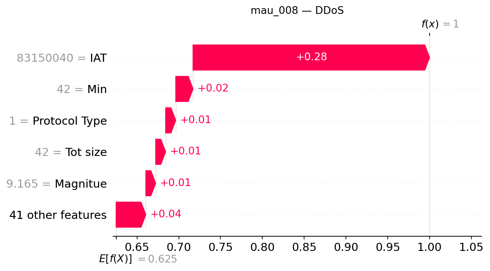

### Diễn giải Gemini

Mẫu được dự đoán là lớp DDoS với xác suất rất cao, trong đó đặc trưng IAT đóng vai trò hỗ trợ mạnh mẽ nhất và không có yếu tố phản đối nào trong nhóm hàng đầu. Khoảng cách với lớp đứng thứ hai là DoS rất lớn, cho thấy sự áp đảo rõ rệt của lớp dự đoán trong lần phân loại này.

**So sánh hai lớp:** Cờ khoảng cách nhỏ đang tắt, cho thấy sự chênh lệch lớn giữa hai đầu ra. Tuy nhiên, điều này không được coi là bảo đảm dự đoán chính xác và không xác định nhãn thật.

**Tổng hợp SHAP:** Đặc trưng IAT là yếu tố hỗ trợ mạnh nhất làm tăng đầu ra của lớp DDoS, trong khi không có yếu tố nào trong top năm mang giá trị âm để phản đối kết quả này.

- **IAT**: Đây là yếu tố hỗ trợ nổi bật nhất trong top năm, đóng góp lớn nhất vào việc đẩy giá trị đầu ra của lớp được giải thích.
- **Min**: Tác động này mang chiều hướng hỗ trợ bổ sung cho lớp dự đoán nhưng ở mức nhỏ hơn nhiều so với yếu tố dẫn đầu.
- **Protocol Type**: Đặc trưng này cung cấp thêm một đóng góp dương nhằm củng cố kết quả phân loại hiện tại.
- **Tot size**: Sự hiện diện của giá trị này tiếp tục đẩy nhẹ điểm số đầu ra của mô hình về phía lớp DDoS.
- **Magnitue**: Đây là tác động có độ lớn thấp nhất trong nhóm năm đặc trưng hàng đầu nhưng vẫn duy trì xu hướng hỗ trợ.

### Gợi ý kiểm tra có điều kiện

- **Nhật ký lưu lượng mạng**: Kiểm tra sự đồng thời của nhiều nguồn đến cùng dịch vụ nếu có địa chỉ và thời gian. Mục đích: Đối chiếu sự xuất hiện đồng thời từ nhiều nguồn nhằm phục vụ công tác phân tích lưu lượng.
- **Nhật ký tài nguyên dịch vụ**: Đối chiếu lưu lượng với tình trạng tài nguyên và khả năng phục vụ, không tự đặt ngưỡng. Mục đích: Đánh giá mức độ ảnh hưởng của lưu lượng đối với hệ thống mà không đưa ra kết luận về hành vi tấn công thực tế.

### Giới hạn do Gemini nêu

- Đây là giải thích đầu ra mô hình, không chứng minh cuộc tấn công thực tế hoặc quan hệ nhân quả.
- Giá trị SHAP chỉ phản ánh tác động đến lớp được dự đoán và chưa bao gồm toàn bộ phần còn lại ngoài top năm.
- Xác suất dự đoán từ mô hình chưa được xác minh là đã hiệu chỉnh và không bảo đảm tuyệt đối.

SHAP giải thích đầu ra model, chưa chứng minh hành vi tấn công hoặc quan hệ nhân quả. Đánh giá con người tạm hoãn.

---

## mau_009 — dòng CSV 8

**Trạng thái Gemini: accepted**

Đạt kiểm tra bằng chứng có cấu trúc và quy tắc văn bản; chưa đánh giá ngữ nghĩa thủ công.

### Dự đoán và số liệu do chương trình dựng

- Model: `XGB_d4_n200`; dự đoán: **DDoS**, xác suất **99.9981%**.
- Lớp đứng thứ hai: **DoS**, xác suất **0.0011%**.
- Chênh lệch hai lớp: **99.9971 điểm phần trăm**.
- Quy tắc khoảng cách nhỏ: không quá 5 điểm phần trăm, chỉ để trình bày.
- Xác suất nền SHAP: 62.506627%.
- Tổng SHAP: +37.491501 điểm phần trăm; ngoài top 5: +3.192733 điểm phần trăm.
- Hỗ trợ mạnh nhất trong top 5: **IAT**.
- Phản đối mạnh nhất trong top 5: **Không có tác động âm trong top 5**.

| Đặc trưng | Giá trị gốc | SHAP | Tác động (điểm %) |
|---|---:|---:|---:|
| IAT | 83089304 | +0.26644841 | +26.644841 |
| Protocol Type | 6 | +0.02782970 | +2.782970 |
| Magnitue | 10.392304 | +0.02663752 | +2.663752 |
| Min | 54 | +0.01170307 | +1.170307 |
| Number | 9.5 | +0.01036899 | +1.036899 |

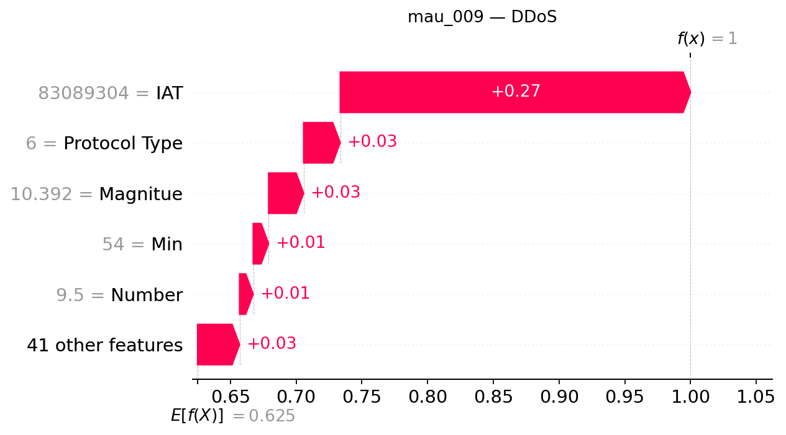

### Diễn giải Gemini

Mẫu được mô hình dự đoán là DDoS với xác suất rất cao vượt trội so với lớp đứng thứ hai là DoS. Đặc trưng IAT đóng vai trò hỗ trợ mạnh mẽ nhất, trong khi tất cả các đặc trưng trong top năm đều có chiều hướng tăng giá trị đầu ra.

**So sánh hai lớp:** Cờ khoảng cách nhỏ đang tắt do khoảng cách giữa hai lớp lớn, cho thấy mô hình phân định rõ ràng nhưng không coi đây là sự bảo đảm tuyệt đối về nhãn thật.

**Tổng hợp SHAP:** Trong top năm đặc trưng, IAT là yếu tố hỗ trợ mạnh nhất đẩy giá trị dự đoán lên cao, không có yếu tố nào mang chiều phản đối.

- **IAT**: Đây là yếu tố hỗ trợ nổi bật nhất trong top năm, đóng góp lớn nhất vào việc nâng cao giá trị đầu ra.
- **Protocol Type**: Tác động này cùng chiều nhưng có quy mô nhỏ hơn yếu tố dẫn đầu trong nhóm.
- **Magnitue**: Đóng góp dương mang tính bổ sung, góp phần củng cố thêm xu hướng dự đoán.
- **Min**: Yếu tố này mang lại mức tác động dương ở mức độ thấp hơn.
- **Number**: Đây là đóng góp dương nhỏ nhất trong nhóm top năm đặc trưng đang xem xét.

### Gợi ý kiểm tra có điều kiện

- **Nhật ký lưu lượng mạng**: Kiểm tra sự đồng thời của nhiều nguồn đến cùng dịch vụ nếu có địa chỉ và thời gian Mục đích: Đối chiếu hành vi lưu lượng thực tế phát sinh trong hệ thống.
- **Nhật ký tài nguyên dịch vụ**: Đối chiếu lưu lượng với tình trạng tài nguyên và khả năng phục vụ Mục đích: Đánh giá mức độ ảnh hưởng đến hạ tầng ứng dụng.

### Giới hạn do Gemini nêu

- Giá trị SHAP chỉ phản ánh mức độ đóng góp của đặc trưng đối với đầu ra của mô hình, không chứng minh quan hệ nhân quả.
- Xác suất dự đoán chưa được hiệu chỉnh chính thức và không thể coi là độ chính xác tuyệt đối.
- Phạm vi giải thích chỉ giới hạn trong top năm đặc trưng, chưa bao gồm toàn bộ tác động ngoại vi.

SHAP giải thích đầu ra model, chưa chứng minh hành vi tấn công hoặc quan hệ nhân quả. Đánh giá con người tạm hoãn.

---

## mau_010 — dòng CSV 9

**Trạng thái Gemini: accepted**

Đạt kiểm tra bằng chứng có cấu trúc và quy tắc văn bản; chưa đánh giá ngữ nghĩa thủ công.

### Dự đoán và số liệu do chương trình dựng

- Model: `XGB_d4_n200`; dự đoán: **DDoS**, xác suất **99.9981%**.
- Lớp đứng thứ hai: **DoS**, xác suất **0.0011%**.
- Chênh lệch hai lớp: **99.9971 điểm phần trăm**.
- Quy tắc khoảng cách nhỏ: không quá 5 điểm phần trăm, chỉ để trình bày.
- Xác suất nền SHAP: 62.506627%.
- Tổng SHAP: +37.491501 điểm phần trăm; ngoài top 5: +3.555466 điểm phần trăm.
- Hỗ trợ mạnh nhất trong top 5: **IAT**.
- Phản đối mạnh nhất trong top 5: **Không có tác động âm trong top 5**.

| Đặc trưng | Giá trị gốc | SHAP | Tác động (điểm %) |
|---|---:|---:|---:|
| IAT | 83124056 | +0.28903767 | +28.903767 |
| Magnitue | 9.1651516 | +0.02434608 | +2.434608 |
| Protocol Type | 1 | +0.01057661 | +1.057661 |
| ICMP | 1 | +0.00882845 | +0.882845 |
| Min | 42 | +0.00657154 | +0.657154 |

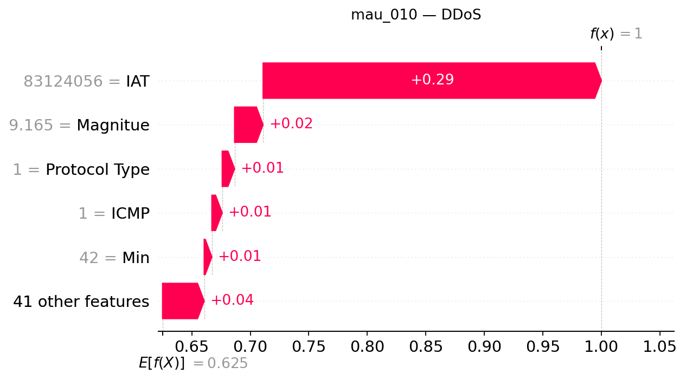

### Diễn giải Gemini

Hệ thống dự đoán mẫu này thuộc lớp DDoS với xác suất rất cao, trong đó yếu tố IAT đóng vai trò hỗ trợ mạnh mẽ nhất còn không có yếu tố nào phản đối trong top năm đặc trưng. Khoảng cách với lớp đứng thứ hai DoS rất lớn nên sự cạnh tranh giữa hai lớp này không đáng kể.

**So sánh hai lớp:** Lớp đứng thứ hai là DoS nhưng có khoảng cách rất lớn so với lớp dự đoán và cờ khoảng cách nhỏ đang tắt. Điều này không có nghĩa là chênh lệch lớn bảo đảm tuyệt đối dự đoán là đúng, đồng thời đây chỉ là kết quả phân tích đầu ra model chứ không phải nhãn thật.

**Tổng hợp SHAP:** Trong top năm đặc trưng được xét, IAT là yếu tố hỗ trợ mạnh nhất đẩy giá trị đầu ra tăng cao, trong khi không ghi nhận bất kỳ yếu tố phản đối nào có tác động âm. Phần thay đổi còn lại được đóng góp bởi các đặc trưng ngoài top năm và giá trị nền tham chiếu.

- **IAT**: Đây là yếu tố hỗ trợ nổi bật nhất trong top năm, góp phần đẩy mạnh đầu ra của lớp được dự đoán.
- **Magnitue**: Tác động này cùng chiều hướng tăng nhưng có mức đóng góp nhỏ hơn yếu tố dẫn đầu.
- **Protocol Type**: Đặc trưng này cung cấp thêm một lực hỗ trợ bổ sung theo chiều hướng làm tăng điểm số dự đoán.
- **ICMP**: Sự hiện diện của đặc trưng này tiếp tục duy trì xu hướng đồng thuận với lớp được chọn.
- **Min**: Đây là thành phần có tác động nhỏ hơn trong nhóm, đóng góp một phần khiêm tốn vào đầu ra tổng thể.

### Gợi ý kiểm tra có điều kiện

- **Nhật ký lưu lượng mạng**: Kiểm tra sự đồng thời của nhiều nguồn đến cùng dịch vụ nếu có địa chỉ và thời gian Mục đích: Đối chiếu sự biến động lưu lượng thực tế theo thời gian với mô hình giải thích.
- **Nhật ký tài nguyên dịch vụ**: Đối chiếu lưu lượng với tình trạng tài nguyên và khả năng phục vụ, không tự đặt ngưỡng Mục đích: Kiểm tra xem hệ thống có chịu áp lực tương ứng hay không trước khi đưa ra nhận định.

### Giới hạn do Gemini nêu

- Giá trị SHAP chỉ phản ánh mức độ đóng góp của đặc trưng đối với đầu ra của mô hình tại thời điểm này, không phải là bằng chứng nhân quả về một cuộc tấn công thực tế.
- Xác suất của mô hình chưa được kiểm chứng hay hiệu chỉnh độ tin cậy thực tế.
- Phạm vi giải thích chỉ giới hạn trong top năm đặc trưng và giá trị nền tham chiếu, chưa bao quát toàn bộ không gian dữ liệu.

SHAP giải thích đầu ra model, chưa chứng minh hành vi tấn công hoặc quan hệ nhân quả. Đánh giá con người tạm hoãn.

---

## mau_011 — dòng CSV 10

**Trạng thái Gemini: accepted**

Đạt kiểm tra bằng chứng có cấu trúc và quy tắc văn bản; chưa đánh giá ngữ nghĩa thủ công.

### Dự đoán và số liệu do chương trình dựng

- Model: `XGB_d4_n200`; dự đoán: **DDoS**, xác suất **99.9981%**.
- Lớp đứng thứ hai: **DoS**, xác suất **0.0011%**.
- Chênh lệch hai lớp: **99.9971 điểm phần trăm**.
- Quy tắc khoảng cách nhỏ: không quá 5 điểm phần trăm, chỉ để trình bày.
- Xác suất nền SHAP: 62.506627%.
- Tổng SHAP: +37.491501 điểm phần trăm; ngoài top 5: +2.395018 điểm phần trăm.
- Hỗ trợ mạnh nhất trong top 5: **IAT**.
- Phản đối mạnh nhất trong top 5: **Không có tác động âm trong top 5**.

| Đặc trưng | Giá trị gốc | SHAP | Tác động (điểm %) |
|---|---:|---:|---:|
| IAT | 83487480 | +0.29570100 | +29.570100 |
| Protocol Type | 5.9400001 | +0.02213594 | +2.213594 |
| Magnitue | 10.392912 | +0.01487454 | +1.487454 |
| Number | 9.5 | +0.00958054 | +0.958054 |
| Min | 54 | +0.00867281 | +0.867281 |

### Diễn giải Gemini

Mẫu được mô hình dự đoán là lớp DDoS với độ tự tin áp đảo, trong khi lớp đứng thứ hai là DoS có khoảng cách chênh lệch cực lớn. Yếu tố IAT đóng góp hỗ trợ mạnh mẽ nhất, và không có đặc trưng nào trong top năm mang lại tác động phản đối.

**So sánh hai lớp:** Cờ khoảng cách nhỏ tắt cho thấy hai đầu ra có khoảng cách lớn, tuy nhiên mức chênh lệch cao này không được xem là bảo đảm dự đoán đúng hay thay thế nhãn thật.

**Tổng hợp SHAP:** Đặc trưng IAT là yếu tố hỗ trợ mạnh nhất trong nhóm top năm làm tăng giá trị đầu ra, trong khi không ghi nhận yếu tố nào có tác động phản đối dương hoặc âm trong nhóm này.

- **IAT**: Đây là yếu tố hỗ trợ nổi bật nhất trong top năm, góp phần đẩy mạnh đầu ra của lớp dự đoán so với nền tham chiếu.
- **Protocol Type**: Tác động này cùng chiều nhưng nhỏ hơn yếu tố dẫn đầu, đóng vai trò hỗ trợ bổ sung cho mô hình.
- **Magnitue**: Đặc trưng này mang lại mức đóng góp dương ở mức vừa phải, tiếp tục củng cố thêm xu hướng dự đoán.
- **Number**: Sự hiện diện của yếu tố này tạo ra một lực đẩy nhỏ cùng chiều với đầu ra được giải thích.
- **Min**: Đóng góp dương nhỏ nhất trong nhóm top năm, thể hiện tác động bổ trợ thấp hơn các đặc trưng phía trên.

### Gợi ý kiểm tra có điều kiện

- **Nhật ký lưu lượng mạng**: Kiểm tra sự đồng thời của nhiều nguồn đến cùng dịch vụ nếu có địa chỉ và thời gian. Mục đích: Đối chiếu với các biểu hiện thực tế từ nguồn lưu lượng để xem xét bối cảnh gói tin.
- **Nhật ký tài nguyên dịch vụ**: Đối chiếu lưu lượng với tình trạng tài nguyên và khả năng phục vụ, không tự đặt ngưỡng. Mục đích: Đánh giá mức độ đáp ứng của hệ thống dựa trên thông tin tài nguyên ghi nhận được.

### Giới hạn do Gemini nêu

- Giải thích này phản ánh đầu ra của mô hình tại thời điểm phân tích, không chứng minh quan hệ nhân quả hay cuộc tấn công thực tế.
- Các giá trị SHAP chỉ thể hiện sự thay đổi so với nền tham chiếu của riêng mô hình và chưa được hiệu chỉnh xác suất tuyệt đối.
- Phạm vi phân tích chỉ giới hạn trong top năm đặc trưng và phần dư còn lại, chưa phản ánh toàn bộ các yếu tố có thể có trong hệ thống.

SHAP giải thích đầu ra model, chưa chứng minh hành vi tấn công hoặc quan hệ nhân quả. Đánh giá con người tạm hoãn.

---

## mau_012 — dòng CSV 11

**Trạng thái Gemini: accepted**

Đạt kiểm tra bằng chứng có cấu trúc và quy tắc văn bản; chưa đánh giá ngữ nghĩa thủ công.

### Dự đoán và số liệu do chương trình dựng

- Model: `XGB_d4_n200`; dự đoán: **DoS**, xác suất **99.9953%**.
- Lớp đứng thứ hai: **DDoS**, xác suất **0.0034%**.
- Chênh lệch hai lớp: **99.9918 điểm phần trăm**.
- Quy tắc khoảng cách nhỏ: không quá 5 điểm phần trăm, chỉ để trình bày.
- Xác suất nền SHAP: 21.878189%.
- Tổng SHAP: +78.117067 điểm phần trăm; ngoài top 5: +1.622307 điểm phần trăm.
- Hỗ trợ mạnh nhất trong top 5: **IAT**.
- Phản đối mạnh nhất trong top 5: **Không có tác động âm trong top 5**.

| Đặc trưng | Giá trị gốc | SHAP | Tác động (điểm %) |
|---|---:|---:|---:|
| IAT | 82943424 | +0.73586673 | +73.586673 |
| Number | 9.5 | +0.00893431 | +0.893431 |
| Weight | 141.55 | +0.00781267 | +0.781267 |
| Min | 54 | +0.00638679 | +0.638679 |
| Tot sum | 567 | +0.00594710 | +0.594710 |

### Diễn giải Gemini

Mô hình dự đoán mẫu dữ liệu thuộc lớp DoS với xác suất rất cao, trong đó đặc trưng IAT đóng vai trò hỗ trợ nổi bật nhất làm tăng mạnh giá trị đầu ra. Lớp đứng thứ hai là DDoS có xác suất vô cùng nhỏ, cho thấy sự chênh lệch rõ rệt và không có sự cạnh tranh đáng kể trong trường hợp này.

**So sánh hai lớp:** Cờ khoảng cách nhỏ đang tắt và chênh lệch giữa hai lớp rất lớn, tuy nhiên điều này không bảo đảm dự đoán hoàn toàn chính xác. Lớp DDoS đứng thứ hai nhưng có đầu ra thấp hơn nhiều so với lớp được dự đoán.

**Tổng hợp SHAP:** Trong top năm đặc trưng, IAT là yếu tố hỗ trợ mạnh nhất đẩy giá trị đầu ra lên cao, trong khi không ghi nhận bất kỳ tác động phản đối nào do toàn bộ đặc trưng trong nhóm đều mang chiều hướng tăng.

- **IAT**: Đây là yếu tố hỗ trợ nổi bật nhất trong top năm, đóng góp mức tăng lớn nhất cho đầu ra của lớp được giải thích.
- **Number**: Tác động này mang chiều hướng cùng chiều nhưng có độ lớn nhỏ hơn đáng kể so với yếu tố dẫn đầu.
- **Weight**: Đặc trưng này cung cấp thêm một mức hỗ trợ bổ sung với giá trị đóng góp ở mức trung bình trong nhóm.
- **Min**: Sự hiện diện của đặc trưng này tạo ra một tác động dương nhỏ hơn để thúc đẩy đầu ra dự đoán.
- **Tot sum**: Đóng góp này mang lại ảnh hưởng dương thấp nhất trong số năm đặc trưng được xem xét của mẫu.

### Gợi ý kiểm tra có điều kiện

- **Nhật ký kết nối**: Kiểm tra kết nối lặp đến dịch vụ đích và nguồn liên quan nếu có metadata. Mục đích: Đối chiếu xem hệ thống có ghi nhận các lượt truy cập lặp lại tương ứng hay không.
- **Nhật ký tài nguyên dịch vụ**: Tìm lỗi, gián đoạn hoặc thay đổi tài nguyên cùng thời điểm để xác minh thêm. Mục đích: Kiểm tra xem dịch vụ có dấu hiệu quá tải hoặc gián đoạn tài nguyên hay không.

### Giới hạn do Gemini nêu

- Các giá trị SHAP chỉ thể hiện mức độ đóng góp của đặc trưng đối với đầu ra của mô hình cho mẫu này và không chứng minh quan hệ nhân quả hay sự tồn tại chắc chắn của một cuộc tấn công thực tế.
- Xác suất dự đoán từ mô hình chưa qua bước hiệu chỉnh xác suất, do đó không đại diện cho độ tin cậy tuyệt đối.
- Tổng hợp SHAP chỉ giới hạn trong top năm đặc trưng được liệt kê và không phản ánh toàn bộ các yếu tố khác ngoài nhóm.

SHAP giải thích đầu ra model, chưa chứng minh hành vi tấn công hoặc quan hệ nhân quả. Đánh giá con người tạm hoãn.

---

## mau_013 — dòng CSV 12

**Trạng thái Gemini: accepted**

Đạt kiểm tra bằng chứng có cấu trúc và quy tắc văn bản; chưa đánh giá ngữ nghĩa thủ công.

### Dự đoán và số liệu do chương trình dựng

- Model: `XGB_d4_n200`; dự đoán: **DDoS**, xác suất **99.9981%**.
- Lớp đứng thứ hai: **DoS**, xác suất **0.0011%**.
- Chênh lệch hai lớp: **99.9971 điểm phần trăm**.
- Quy tắc khoảng cách nhỏ: không quá 5 điểm phần trăm, chỉ để trình bày.
- Xác suất nền SHAP: 62.506627%.
- Tổng SHAP: +37.491501 điểm phần trăm; ngoài top 5: +2.960217 điểm phần trăm.
- Hỗ trợ mạnh nhất trong top 5: **IAT**.
- Phản đối mạnh nhất trong top 5: **Không có tác động âm trong top 5**.

| Đặc trưng | Giá trị gốc | SHAP | Tác động (điểm %) |
|---|---:|---:|---:|
| IAT | 83093200 | +0.27882852 | +27.882852 |
| Magnitue | 10.402575 | +0.03461878 | +3.461878 |
| Protocol Type | 6.0500002 | +0.01707940 | +1.707940 |
| Header_Length | 53.82 | +0.00825582 | +0.825582 |
| Min | 54 | +0.00653033 | +0.653033 |

### Diễn giải Gemini

Mẫu được mô hình XGB_d4_n200 phân loại vào lớp DDoS với mức xác suất rất cao, vượt trội hoàn toàn so với lớp đứng thứ hai là DoS. Các đặc trưng trong top năm đều thể hiện chiều hướng củng cố kết quả này mà không có yếu tố phản đối trực tiếp.

**So sánh hai lớp:** Lớp đứng thứ hai là DoS có xác suất vô cùng nhỏ so với lớp dự đoán và cờ khoảng cách nhỏ đang tắt, cho thấy khoảng cách giữa hai đầu ra rất lớn. Tuy nhiên, chênh lệch lớn này không phải là sự bảo đảm tuyệt đối rằng dự đoán là đúng.

**Tổng hợp SHAP:** Yếu tố IAT đóng vai trò hỗ trợ mạnh nhất đẩy giá trị đầu ra lên cao, trong khi không có yếu tố nào trong top năm mang giá trị âm để tạo ra tác động phản đối.

- **IAT**: Đây là yếu tố hỗ trợ nổi bật nhất trong top năm, góp phần đáng kể vào việc gia tăng đầu ra của lớp được dự đoán.
- **Magnitue**: Tác động này cùng chiều hướng tăng nhưng có quy mô nhỏ hơn yếu tố dẫn đầu.
- **Protocol Type**: Đặc trưng này cung cấp một mức hỗ trợ bổ sung với giá trị đóng góp ở mức trung bình trong nhóm.
- **Header_Length**: Sự góp mặt của đặc trưng này mang lại thêm một phần tác động dương nhỏ hơn để củng cố đầu ra.
- **Min**: Đây là thành phần có đóng góp dương thấp nhất trong top năm đặc trưng đang xét.

### Gợi ý kiểm tra có điều kiện

- **Nhật ký lưu lượng mạng**: Kiểm tra sự đồng thời của nhiều nguồn đến cùng dịch vụ nếu có địa chỉ và thời gian Mục đích: Đối chiếu mô hình với dữ liệu ghi nhận thực tế trên hệ thống mạng nếu log này tồn tại.
- **Nhật ký tài nguyên dịch vụ**: Đối chiếu lưu lượng với tình trạng tài nguyên và khả năng phục vụ, không tự đặt ngưỡng Mục đích: Xem xét trạng thái tải của hệ thống để hỗ trợ quá trình phân tích nếu hệ thống lưu trữ log này.

### Giới hạn do Gemini nêu

- Giá trị SHAP chỉ giải thích đầu ra của mô hình đối với mẫu hiện tại, không chứng minh được quan hệ nhân quả hay hành vi tấn công thực tế.
- Tổng giá trị SHAP trong top năm chưa bao trùm toàn bộ các thành phần thay đổi từ giá trị nền tham chiếu.
- Xác suất dự đoán của mô hình chưa được kiểm chứng về độ hiệu chỉnh và không thể xem là độ tin cậy tuyệt đối.

SHAP giải thích đầu ra model, chưa chứng minh hành vi tấn công hoặc quan hệ nhân quả. Đánh giá con người tạm hoãn.

---

## mau_014 — dòng CSV 13

**Trạng thái Gemini: accepted**

Đạt kiểm tra bằng chứng có cấu trúc và quy tắc văn bản; chưa đánh giá ngữ nghĩa thủ công.

### Dự đoán và số liệu do chương trình dựng

- Model: `XGB_d4_n200`; dự đoán: **DDoS**, xác suất **99.9981%**.
- Lớp đứng thứ hai: **DoS**, xác suất **0.0011%**.
- Chênh lệch hai lớp: **99.9971 điểm phần trăm**.
- Quy tắc khoảng cách nhỏ: không quá 5 điểm phần trăm, chỉ để trình bày.
- Xác suất nền SHAP: 62.506627%.
- Tổng SHAP: +37.491501 điểm phần trăm; ngoài top 5: +4.200794 điểm phần trăm.
- Hỗ trợ mạnh nhất trong top 5: **IAT**.
- Phản đối mạnh nhất trong top 5: **Không có tác động âm trong top 5**.

| Đặc trưng | Giá trị gốc | SHAP | Tác động (điểm %) |
|---|---:|---:|---:|
| IAT | 83149320 | +0.26549649 | +26.549649 |
| Protocol Type | 1 | +0.02288696 | +2.288696 |
| Magnitue | 9.1651516 | +0.01776957 | +1.776957 |
| Max | 42 | +0.01606101 | +1.606101 |
| Min | 42 | +0.01069304 | +1.069304 |

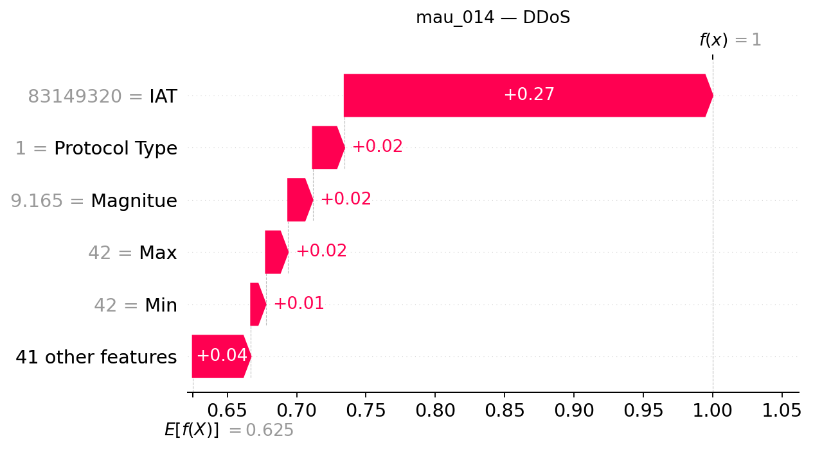

### Diễn giải Gemini

Mô hình dự đoán lớp DDoS với sự hỗ trợ mạnh mẽ từ đặc trưng IAT trong top năm đặc trưng quan trọng. Trong khi đó, lớp DoS đứng ở vị trí thứ hai nhưng có khoảng cách rất xa so với đầu ra hàng đầu.

**So sánh hai lớp:** Lớp đứng thứ hai là DoS. Cờ khoảng cách nhỏ đang tắt cho thấy chênh lệch giữa hai đầu ra lớn, tuy nhiên điều này không được coi là bảo đảm dự đoán chính xác tuyệt đối.

**Tổng hợp SHAP:** Yếu tố hỗ trợ mạnh nhất trong top năm đặc trưng là IAT, trong khi không có tác động phản đối nào xuất hiện trong nhóm này.

- **IAT**: Đây là yếu tố hỗ trợ nổi bật nhất trong top năm của mẫu này.
- **Protocol Type**: Tác động này cùng chiều nhưng đóng góp ở mức hỗ trợ bổ sung nhỏ hơn.
- **Magnitue**: Đặc trưng này thể hiện một sự thúc đẩy bổ sung có giá trị thấp hơn các yếu tố trước.
- **Max**: Sự đóng góp theo chiều tăng tiếp tục xuất hiện với mức độ thu hẹp dần.
- **Min**: Đây là tác động có xu hướng cùng chiều nhỏ nhất trong nhóm năm đặc trưng.

### Gợi ý kiểm tra có điều kiện

- **Nhật ký lưu lượng mạng**: Kiểm tra sự đồng thời của nhiều nguồn đến cùng dịch vụ nếu có địa chỉ và thời gian. Mục đích: Đối chiếu thông tin lưu lượng thực tế phát sinh trong hệ thống.
- **Nhật ký tài nguyên dịch vụ**: Đối chiếu lưu lượng với tình trạng tài nguyên và khả năng phục vụ, không tự đặt ngưỡng. Mục đích: Xác thực khả năng đáp ứng và tải hiện tại của dịch vụ.

### Giới hạn do Gemini nêu

- Kết quả giải thích chỉ phản ánh đầu ra của mô hình đối với mẫu hiện tại, không chứng minh quan hệ nhân quả hay cuộc tấn công thực tế.
- Giá trị SHAP và xác suất chưa được hiệu chỉnh chính thức để đảm bảo độ tin cậy tuyệt đối.
- Tổng các đặc trưng trong top năm chưa bao trùm toàn bộ mức thay đổi của toàn bộ tập đặc trưng.

SHAP giải thích đầu ra model, chưa chứng minh hành vi tấn công hoặc quan hệ nhân quả. Đánh giá con người tạm hoãn.

---

## mau_015 — dòng CSV 14

**Trạng thái Gemini: accepted**

Đạt kiểm tra bằng chứng có cấu trúc và quy tắc văn bản; chưa đánh giá ngữ nghĩa thủ công.

### Dự đoán và số liệu do chương trình dựng

- Model: `XGB_d4_n200`; dự đoán: **DDoS**, xác suất **99.9981%**.
- Lớp đứng thứ hai: **DoS**, xác suất **0.0011%**.
- Chênh lệch hai lớp: **99.9969 điểm phần trăm**.
- Quy tắc khoảng cách nhỏ: không quá 5 điểm phần trăm, chỉ để trình bày.
- Xác suất nền SHAP: 62.506627%.
- Tổng SHAP: +37.491430 điểm phần trăm; ngoài top 5: +2.092131 điểm phần trăm.
- Hỗ trợ mạnh nhất trong top 5: **IAT**.
- Phản đối mạnh nhất trong top 5: **Không có tác động âm trong top 5**.

| Đặc trưng | Giá trị gốc | SHAP | Tác động (điểm %) |
|---|---:|---:|---:|
| IAT | 83123680 | +0.29237648 | +29.237648 |
| Magnitue | 10 | +0.02341188 | +2.341188 |
| Min | 50 | +0.02087632 | +2.087632 |
| Number | 9.5 | +0.00881280 | +0.881280 |
| Tot size | 50 | +0.00851550 | +0.851550 |

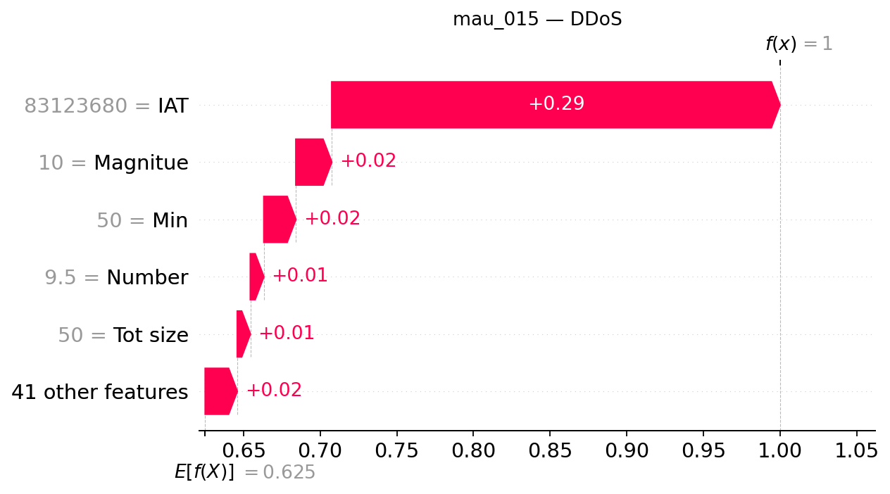

### Diễn giải Gemini

Mô hình dự đoán mẫu dữ liệu thuộc lớp DDoS với sự hỗ trợ mạnh mẽ từ đặc trưng IAT trong top năm, trong khi các đặc trưng còn lại đều theo chiều hướng tăng. Lớp đứng thứ hai là DoS có xác suất rất nhỏ, tạo khoảng cách lớn với lớp dẫn đầu và không có cờ khoảng cách nhỏ bật.

**So sánh hai lớp:** Cờ khoảng cách nhỏ đang tắt và chênh lệch xác suất rất lớn, cho thấy mô hình ưu tiên mạnh cho lớp đứng đầu, tuy nhiên điều này không bảo đảm đây là nhãn thật hay khẳng định tính đúng đắn của dự đoán.

**Tổng hợp SHAP:** Trong nhóm top năm, IAT đóng vai trò hỗ trợ mạnh nhất đẩy giá trị đầu ra lên cao, trong khi không có đặc trưng nào trong nhóm này tạo ra tác động phản đối mang giá trị âm.

- **IAT**: Đây là yếu tố hỗ trợ nổi bật nhất trong top năm, góp phần đáng kể làm tăng giá trị đầu ra của lớp được giải thích so với nền tham chiếu.
- **Magnitue**: Đóng góp này mang chiều hướng tăng nhưng có mức độ ảnh hưởng nhỏ hơn rõ rệt so với yếu tố dẫn đầu ở trên.
- **Min**: Tác động này tiếp tục hỗ trợ tăng đầu ra của mô hình với một mức đóng góp bổ sung trong nhóm đặc trưng.
- **Number**: Đây là một thành phần hỗ trợ bổ sung với mức tác động thấp hơn các đặc trưng đứng trước.
- **Tot size**: Đặc trưng này mang lại tác động dương nhỏ nhất trong top năm, bổ sung vào tổng lượng thay đổi đầu ra.

### Gợi ý kiểm tra có điều kiện

- **Nhật ký lưu lượng mạng**: Kiểm tra sự đồng thời của nhiều nguồn đến cùng dịch vụ nếu hệ thống có ghi nhận địa chỉ và thời gian. Mục đích: Đối chiếu mô hình với dữ liệu thực tế để xem xét bối cảnh lưu lượng mạng.
- **Nhật ký tài nguyên dịch vụ**: Đối chiếu lưu lượng với tình trạng tài nguyên và khả năng phục vụ của hệ thống. Mục đích: Kiểm tra sự biến động tài nguyên nhằm hỗ trợ việc xem xét ngữ cảnh hoạt động.

### Giới hạn do Gemini nêu

- Các giá trị SHAP chỉ giải thích đầu ra của mô hình đối với mẫu hiện tại, không chứng minh quan hệ nhân quả hay xác nhận cuộc tấn công thực tế.
- Tổng các giá trị SHAP trong top năm chưa bao gồm toàn bộ phần thay đổi ngoài nhóm, và xác suất của mô hình chưa được kiểm chứng là đã hiệu chỉnh.
- Phân tích này không đại diện cho nhãn thực tế của dữ liệu và không dùng để đưa ra các hành động tự động như chặn IP hay thay đổi cấu hình.

SHAP giải thích đầu ra model, chưa chứng minh hành vi tấn công hoặc quan hệ nhân quả. Đánh giá con người tạm hoãn.

---

## mau_016 — dòng CSV 15

**Trạng thái Gemini: accepted**

Đạt kiểm tra bằng chứng có cấu trúc và quy tắc văn bản; chưa đánh giá ngữ nghĩa thủ công.

### Dự đoán và số liệu do chương trình dựng

- Model: `XGB_d4_n200`; dự đoán: **DDoS**, xác suất **99.9981%**.
- Lớp đứng thứ hai: **DoS**, xác suất **0.0011%**.
- Chênh lệch hai lớp: **99.9971 điểm phần trăm**.
- Quy tắc khoảng cách nhỏ: không quá 5 điểm phần trăm, chỉ để trình bày.
- Xác suất nền SHAP: 62.506627%.
- Tổng SHAP: +37.491501 điểm phần trăm; ngoài top 5: +1.431623 điểm phần trăm.
- Hỗ trợ mạnh nhất trong top 5: **IAT**.
- Phản đối mạnh nhất trong top 5: **Không có tác động âm trong top 5**.

| Đặc trưng | Giá trị gốc | SHAP | Tác động (điểm %) |
|---|---:|---:|---:|
| IAT | 83106448 | +0.28428393 | +28.428393 |
| Min | 50 | +0.04877121 | +4.877121 |
| Tot size | 50 | +0.01410406 | +1.410406 |
| Magnitue | 10 | +0.00833341 | +0.833341 |
| Max | 50 | +0.00510617 | +0.510617 |

### Diễn giải Gemini

Mô hình dự đoán mẫu dữ liệu thuộc lớp DDoS với xác suất rất cao, trong đó đặc trưng IAT đóng vai trò hỗ trợ mạnh mẽ nhất còn các đặc trưng khác trong top năm đều cùng chiều tăng. Khoảng cách với lớp đứng thứ hai là rất lớn và không có cờ khoảng cách nhỏ bật sáng.

**So sánh hai lớp:** Cờ khoảng cách nhỏ đang tắt, cho thấy sự chênh lệch giữa lớp dự đoán và lớp đứng thứ hai là đáng kể nhưng điều này không được xem là bảo đảm dự đoán chính xác tuyệt đối.

**Tổng hợp SHAP:** Trong top năm đặc trưng, IAT là yếu tố hỗ trợ mạnh nhất đẩy đầu ra tăng, trong khi không ghi nhận yếu tố nào có tác động phản đối trong nhóm này.

- **IAT**: Đây là yếu tố hỗ trợ nổi bật nhất trong top năm, làm gia tăng đáng kể giá trị đầu ra của lớp được giải thích so với nền tham chiếu.
- **Min**: Đặc trưng này cung cấp sự hỗ trợ bổ sung cùng chiều với mức tác động nhỏ hơn so với yếu tố dẫn đầu.
- **Tot size**: Đóng góp tiếp theo theo chiều tăng giá trị đầu ra, góp phần củng cố kết quả phân loại.
- **Magnitue**: Tác động này tiếp tục đẩy đầu ra tăng nhưng ở mức độ thấp hơn các đặc trưng trước đó.
- **Max**: Đây là yếu tố có đóng góp dương nhỏ nhất trong nhóm top năm đặc trưng đang xét.

### Gợi ý kiểm tra có điều kiện

- **Nhật ký lưu lượng mạng**: Kiểm tra sự đồng thời của nhiều nguồn đến cùng dịch vụ nếu hệ thống ghi nhận địa chỉ và thời gian. Mục đích: Đối chiếu mô hình với các dấu hiệu lưu lượng thực tế trên mạng.
- **Nhật ký tài nguyên dịch vụ**: Đối chiếu lưu lượng với tình trạng tài nguyên và khả năng phục vụ. Mục đích: Kiểm tra ảnh hưởng của tải lưu lượng lên hệ thống dịch vụ.

### Giới hạn do Gemini nêu

- Giá trị SHAP chỉ thể hiện sự đóng góp của đặc trưng vào đầu ra của mô hình đối với mẫu này và không chứng minh quan hệ nhân quả hay cuộc tấn công thực tế.
- Các giá trị xác suất từ mô hình chưa được hiệu chỉnh và chỉ phản ánh kết quả tính toán dựa trên tập dữ liệu huấn luyện.
- Phân tích SHAP trong top năm chưa bao gồm toàn bộ các yếu tố thay đổi vì vẫn còn phần đóng góp nằm ngoài nhóm này.

SHAP giải thích đầu ra model, chưa chứng minh hành vi tấn công hoặc quan hệ nhân quả. Đánh giá con người tạm hoãn.

---

## mau_017 — dòng CSV 16

**Trạng thái Gemini: accepted**

Đạt kiểm tra bằng chứng có cấu trúc và quy tắc văn bản; chưa đánh giá ngữ nghĩa thủ công.

### Dự đoán và số liệu do chương trình dựng

- Model: `XGB_d4_n200`; dự đoán: **DDoS**, xác suất **99.9981%**.
- Lớp đứng thứ hai: **DoS**, xác suất **0.0011%**.
- Chênh lệch hai lớp: **99.9971 điểm phần trăm**.
- Quy tắc khoảng cách nhỏ: không quá 5 điểm phần trăm, chỉ để trình bày.
- Xác suất nền SHAP: 62.506627%.
- Tổng SHAP: +37.491501 điểm phần trăm; ngoài top 5: +3.273012 điểm phần trăm.
- Hỗ trợ mạnh nhất trong top 5: **IAT**.
- Phản đối mạnh nhất trong top 5: **Không có tác động âm trong top 5**.

| Đặc trưng | Giá trị gốc | SHAP | Tác động (điểm %) |
|---|---:|---:|---:|
| IAT | 83089232 | +0.27088547 | +27.088547 |
| Protocol Type | 6 | +0.02846786 | +2.846786 |
| Magnitue | 10.450931 | +0.02104908 | +2.104908 |
| Tot size | 54.240002 | +0.01093869 | +1.093869 |
| Number | 9.5 | +0.01084379 | +1.084379 |

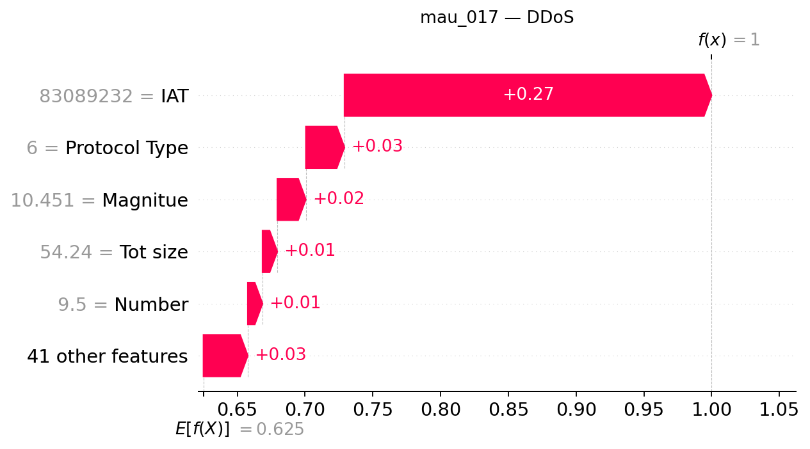

### Diễn giải Gemini

Mô hình dự đoán mẫu thuộc lớp DDoS với mức độ tin cậy áp đảo, trong đó yếu tố IAT dẫn đầu nhóm hỗ trợ mạnh mẽ. Lớp đứng thứ hai là DoS nhưng có khoảng cách xác suất rất lớn so với lớp dẫn đầu.

**So sánh hai lớp:** Cờ khoảng cách nhỏ đang tắt, cho thấy sự chênh lệch lớn giữa lớp DDoS và lớp DoS; tuy nhiên, điều này không được xem là bảo đảm dự đoán chính xác vì chưa có nhãn thật.

**Tổng hợp SHAP:** Trong top năm đặc trưng, IAT đóng vai trò hỗ trợ mạnh nhất đẩy giá trị đầu ra của lớp dự đoán tăng lên so với nền tham chiếu, trong khi không ghi nhận yếu tố nào mang tác động phản đối trong nhóm này.

- **IAT**: Đây là yếu tố hỗ trợ nổi bật nhất trong top năm, góp phần đáng kể vào kết quả phân loại của mô hình.
- **Protocol Type**: Tác động này cùng chiều nhưng nhỏ hơn yếu tố dẫn đầu, đóng vai trò hỗ trợ bổ sung cho dự đoán.
- **Magnitue**: Sự đóng góp theo chiều dương tiếp tục củng cố kết quả đầu ra với mức độ thấp hơn các đặc trưng trước đó.
- **Tot size**: Đặc trưng này thể hiện một lực đẩy dương nhỏ nhằm duy trì xu hướng nghiêng về lớp dự đoán.
- **Number**: Đây là yếu tố có tác động dương nhỏ nhất trong nhóm top năm được phân tích.

### Gợi ý kiểm tra có điều kiện

- **Nhật ký lưu lượng mạng**: Kiểm tra sự đồng thời của nhiều nguồn đến cùng dịch vụ nếu có địa chỉ và thời gian. Mục đích: Đối chiếu xem có dấu hiệu lưu lượng bất thường từ các nguồn hay không.
- **Nhật ký tài nguyên dịch vụ**: Đối chiếu lưu lượng với tình trạng tài nguyên và khả năng phục vụ, không tự đặt ngưỡng. Mục đích: Kiểm tra tác động thực tế của lưu lượng lên hệ thống.

### Giới hạn do Gemini nêu

- Các giá trị SHAP chỉ giải thích đầu ra của mô hình đối với mẫu hiện tại và không chứng minh quan hệ nhân quả hay cuộc tấn công thực tế.
- Tổng giá trị SHAP trong top năm chưa phải là toàn bộ mức thay đổi, phần còn lại đến từ các đặc trưng ngoài nhóm.
- Xác suất dự đoán của mô hình chưa được xác minh là đã hiệu chỉnh hoàn toàn.

SHAP giải thích đầu ra model, chưa chứng minh hành vi tấn công hoặc quan hệ nhân quả. Đánh giá con người tạm hoãn.

---

## mau_018 — dòng CSV 17

**Trạng thái Gemini: accepted**

Đạt kiểm tra bằng chứng có cấu trúc và quy tắc văn bản; chưa đánh giá ngữ nghĩa thủ công.

### Dự đoán và số liệu do chương trình dựng

- Model: `XGB_d4_n200`; dự đoán: **DDoS**, xác suất **99.9981%**.
- Lớp đứng thứ hai: **DoS**, xác suất **0.0011%**.
- Chênh lệch hai lớp: **99.9971 điểm phần trăm**.
- Quy tắc khoảng cách nhỏ: không quá 5 điểm phần trăm, chỉ để trình bày.
- Xác suất nền SHAP: 62.506627%.
- Tổng SHAP: +37.491501 điểm phần trăm; ngoài top 5: +3.216975 điểm phần trăm.
- Hỗ trợ mạnh nhất trong top 5: **IAT**.
- Phản đối mạnh nhất trong top 5: **Không có tác động âm trong top 5**.

| Đặc trưng | Giá trị gốc | SHAP | Tác động (điểm %) |
|---|---:|---:|---:|
| IAT | 83349160 | +0.28058629 | +28.058629 |
| Magnitue | 10.392304 | +0.02463178 | +2.463178 |
| Protocol Type | 6 | +0.01632291 | +1.632291 |
| Tot size | 54 | +0.01083319 | +1.083319 |
| Number | 9.5 | +0.01037110 | +1.037110 |

### Diễn giải Gemini

Mô hình dự đoán mẫu dữ liệu thuộc lớp DDoS với sự hỗ trợ nổi bật từ đặc trưng IAT trong top năm đặc trưng quan trọng. Khoảng cách giữa lớp đứng đầu và lớp đứng thứ hai khá lớn, thể hiện sự chênh lệch rõ rệt trong kết quả phân loại.

**So sánh hai lớp:** Cờ khoảng cách nhỏ đang tắt, cho thấy sự chênh lệch lớn giữa lớp đứng đầu và lớp đứng thứ hai. Tuy nhiên, mức chênh lệch lớn này không được coi là sự bảo đảm tuyệt đối cho độ chính xác của dự đoán.

**Tổng hợp SHAP:** Trong top năm đặc trưng được phân tích, IAT đóng vai trò hỗ trợ mạnh mẽ nhất làm tăng giá trị đầu ra của lớp DDoS, trong khi không có đặc trưng nào trong nhóm này tạo ra tác động phản đối mang giá trị âm.

- **IAT**: Đây là yếu tố hỗ trợ nổi bật nhất trong top năm, góp phần đáng kể làm tăng đầu ra của lớp dự đoán.
- **Magnitue**: Tác động này cùng chiều nhưng nhỏ hơn yếu tố dẫn đầu, đóng vai trò hỗ trợ bổ sung cho kết quả phân loại.
- **Protocol Type**: Đặc trưng này thể hiện xu hướng đóng góp dương, tiếp tục củng cố thêm cho đầu ra của mô hình.
- **Tot size**: Sự hiện diện của đặc trưng này mang lại một mức tác động dương nhỏ hơn trong nhóm.
- **Number**: Đây là thành phần có đóng góp dương ở mức độ thấp nhất trong số năm đặc trưng hàng đầu được xem xét.

### Gợi ý kiểm tra có điều kiện

- **Nhật ký lưu lượng mạng**: Kiểm tra sự đồng thời của nhiều nguồn đến cùng dịch vụ nếu hệ thống có ghi nhận địa chỉ và thời gian. Mục đích: Đối chiếu hành vi lưu lượng thực tế với kết quả dự đoán của mô hình.
- **Nhật ký tài nguyên dịch vụ**: Đối chiếu lưu lượng với tình trạng tài nguyên và khả năng phục vụ của hệ thống dựa trên dữ liệu nhật ký sẵn có. Mục đích: Kiểm tra mức độ ảnh hưởng đến tài nguyên hệ thống nhằm phục vụ công tác rà soát.

### Giới hạn do Gemini nêu

- Kết quả giải thích này chỉ phản ánh đầu ra của mô hình đối với mẫu dữ liệu hiện tại và không chứng minh được quan hệ nhân quả hay sự tồn tại của một cuộc tấn công thực tế.
- Giá trị xác suất từ mô hình chưa được kiểm chứng về độ hiệu chỉnh và các giá trị SHAP chỉ thuộc về lớp được dự đoán.
- Tổng các đặc trưng trong top năm chưa bao trùm toàn bộ sự thay đổi, phần còn lại được đóng góp bởi các đặc trưng ngoài top.

SHAP giải thích đầu ra model, chưa chứng minh hành vi tấn công hoặc quan hệ nhân quả. Đánh giá con người tạm hoãn.

---

## mau_019 — dòng CSV 18

**Trạng thái Gemini: accepted**

Đạt kiểm tra bằng chứng có cấu trúc và quy tắc văn bản; chưa đánh giá ngữ nghĩa thủ công.

### Dự đoán và số liệu do chương trình dựng

- Model: `XGB_d4_n200`; dự đoán: **Mirai**, xác suất **99.9931%**.
- Lớp đứng thứ hai: **DDoS**, xác suất **0.0040%**.
- Chênh lệch hai lớp: **99.9891 điểm phần trăm**.
- Quy tắc khoảng cách nhỏ: không quá 5 điểm phần trăm, chỉ để trình bày.
- Xác suất nền SHAP: 9.376009%.
- Tổng SHAP: +90.617053 điểm phần trăm; ngoài top 5: +11.292613 điểm phần trăm.
- Hỗ trợ mạnh nhất trong top 5: **Protocol Type**.
- Phản đối mạnh nhất trong top 5: **Không có tác động âm trong top 5**.

| Đặc trưng | Giá trị gốc | SHAP | Tác động (điểm %) |
|---|---:|---:|---:|
| Protocol Type | 47 | +0.25783366 | +25.783366 |
| IAT | 83650864 | +0.25061510 | +25.061510 |
| Magnitue | 34 | +0.18706486 | +18.706486 |
| Tot size | 578 | +0.06384029 | +6.384029 |
| Min | 578 | +0.03389049 | +3.389049 |

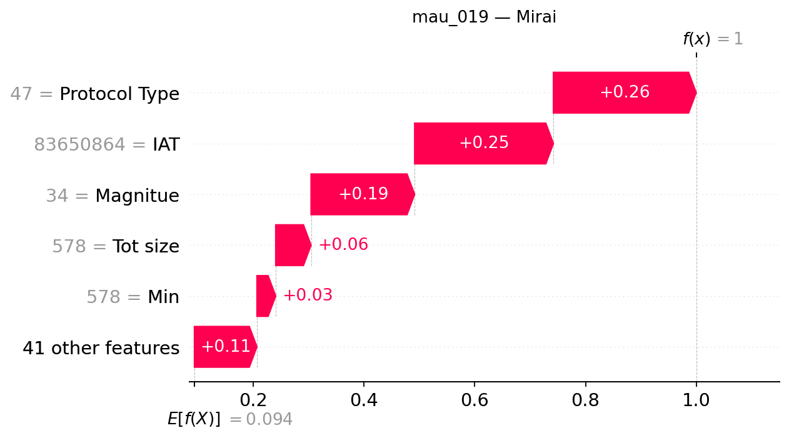

### Diễn giải Gemini

Mô hình dự đoán mẫu thuộc lớp Mirai với sự đóng góp tích cực từ toàn bộ các yếu tố trong top năm. Lớp đứng thứ hai là DDoS nhưng có khoảng cách rất lớn về đầu ra so với lớp dẫn đầu.

**So sánh hai lớp:** Cờ khoảng cách nhỏ đang tắt, cho thấy sự chênh lệch lớn giữa lớp Mirai và lớp DDoS. Tuy nhiên, chênh lệch lớn không bảo đảm dự đoán này hoàn toàn chính xác mà vẫn cần đối chiếu thêm.

**Tổng hợp SHAP:** Yếu tố Protocol Type mang lại tác động hỗ trợ mạnh nhất trong top năm, trong khi không có yếu tố nào đóng vai trò phản đối trong nhóm này. Các tác động còn lại cùng phần ngoài top năm kết hợp tạo nên đầu ra cuối.

- **Protocol Type**: Đây là yếu tố hỗ trợ nổi bật nhất trong top năm, làm tăng đáng kể giá trị đầu ra của lớp được giải thích so với nền tham chiếu.
- **IAT**: Đặc trưng này đóng vai trò hỗ trợ bổ sung với mức độ tác động lớn đứng thứ hai trong nhóm.
- **Magnitue**: Sự hiện diện của đặc trưng này tiếp tục củng cố đầu ra dự đoán theo chiều hướng tăng.
- **Tot size**: Đặc trưng này mang lại mức đóng góp dương ở mức độ nhỏ hơn các yếu tố dẫn đầu.
- **Min**: Đây là yếu tố có tác động dương nhỏ nhất trong top năm đặc trưng đang xem xét.

### Gợi ý kiểm tra có điều kiện

- **Nhật ký kết nối thiết bị**: Đối chiếu đích kết nối và hoạt động lặp với hành vi được phép của thiết bị IoT Mục đích: Nhằm xác định xem thiết bị có đang thực hiện các kết nối bất thường hay không nếu hệ thống lưu trữ log này.
- **Nhật ký tiến trình thiết bị**: Nếu truy cập được thiết bị, tìm tiến trình hoặc cảnh báo liên quan; chưa kết luận đã nhiễm mã độc Mục đích: Nhằm kiểm tra các tiến trình đang chạy bên trong thiết bị khi có quyền truy cập nhật ký.

### Giới hạn do Gemini nêu

- Giải thích này phản ánh đầu ra của mô hình máy học và không chứng minh cuộc tấn công thực tế hay quan hệ nhân quả.
- Các giá trị SHAP chỉ thể hiện sự thay đổi so với nền tham chiếu trong phạm vi top năm đặc trưng được cung cấp.
- Xác suất của mô hình chưa được xác minh là đã hiệu chỉnh và không thể coi là độ chắc chắn tuyệt đối.

SHAP giải thích đầu ra model, chưa chứng minh hành vi tấn công hoặc quan hệ nhân quả. Đánh giá con người tạm hoãn.

---

## mau_020 — dòng CSV 19

**Trạng thái Gemini: accepted**

Đạt kiểm tra bằng chứng có cấu trúc và quy tắc văn bản; chưa đánh giá ngữ nghĩa thủ công.

### Dự đoán và số liệu do chương trình dựng

- Model: `XGB_d4_n200`; dự đoán: **DDoS**, xác suất **99.9981%**.
- Lớp đứng thứ hai: **DoS**, xác suất **0.0011%**.
- Chênh lệch hai lớp: **99.9971 điểm phần trăm**.
- Quy tắc khoảng cách nhỏ: không quá 5 điểm phần trăm, chỉ để trình bày.
- Xác suất nền SHAP: 62.506627%.
- Tổng SHAP: +37.491501 điểm phần trăm; ngoài top 5: +2.364424 điểm phần trăm.
- Hỗ trợ mạnh nhất trong top 5: **IAT**.
- Phản đối mạnh nhất trong top 5: **Không có tác động âm trong top 5**.

| Đặc trưng | Giá trị gốc | SHAP | Tác động (điểm %) |
|---|---:|---:|---:|
| IAT | 83102336 | +0.26599439 | +26.599439 |
| Min | 50 | +0.03373025 | +3.373025 |
| Magnitue | 10 | +0.02820080 | +2.820080 |
| Tot sum | 525 | +0.01643970 | +1.643970 |
| Number | 9.5 | +0.00690562 | +0.690562 |

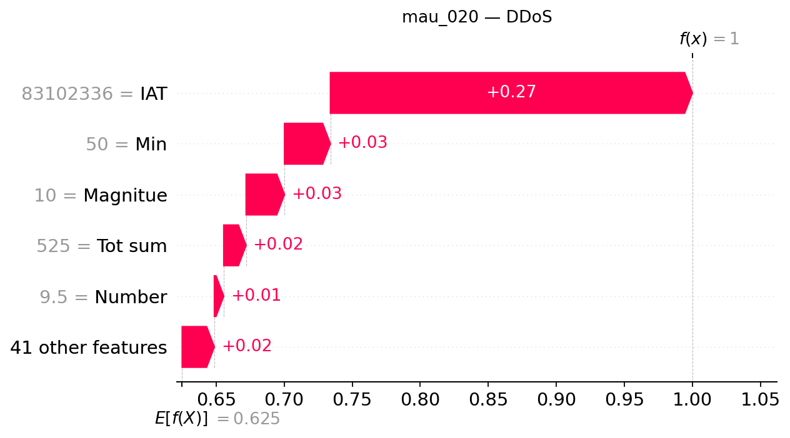

### Diễn giải Gemini

Mô hình dự đoán mẫu dữ liệu thuộc lớp DDoS dựa trên các đặc trưng lưu lượng mạng nổi bật. Yếu tố IAT đóng vai trò hỗ trợ mạnh nhất, trong khi các đặc trưng khác trong top năm đều góp phần củng cố cùng chiều hướng này mà không ghi nhận yếu tố phản đối. Sự chênh lệch giữa lớp đứng đầu và lớp DoS đứng thứ hai rất lớn.

**So sánh hai lớp:** Cờ khoảng cách nhỏ tắt, cho thấy khoảng cách giữa lớp DDoS đứng đầu và lớp DoS đứng thứ hai là khá lớn theo quy tắc trình bày. Tuy nhiên, việc chênh lệch lớn không bảo đảm dự đoán hoàn toàn chính xác do chưa có nhãn thật.

**Tổng hợp SHAP:** Trong năm đặc trưng hàng đầu, IAT là yếu tố hỗ trợ mạnh mẽ nhất làm tăng giá trị đầu ra của lớp dự đoán so với nền tham chiếu, hoàn toàn không có yếu tố nào mang giá trị SHAP âm trong nhóm này.

- **IAT**: Đây là yếu tố hỗ trợ nổi bật nhất trong top năm, đóng góp lớn nhất vào việc đẩy giá trị đầu ra của lớp dự đoán lên cao hơn so với tham chiếu.
- **Min**: Tác động này cùng chiều nhưng nhỏ hơn yếu tố dẫn đầu, đóng vai trò hỗ trợ bổ sung cho kết quả phân loại.
- **Magnitue**: Đóng góp theo chiều hướng tăng với mức ảnh hưởng tiếp theo trong nhóm năm đặc trưng quan trọng.
- **Tot sum**: Mang lại thêm một lực đẩy cùng chiều với mức tác động nhỏ hơn các đặc trưng đứng trước.
- **Number**: Thể hiện tác động dương ở mức nhỏ nhất trong top năm đặc trưng được tổng hợp.

### Gợi ý kiểm tra có điều kiện

- **Nhật ký lưu lượng mạng**: Kiểm tra sự đồng thời của nhiều nguồn đến cùng dịch vụ nếu có địa chỉ và thời gian Mục đích: Đối chiếu hành vi lưu lượng thực tế được ghi nhận trong hệ thống.
- **Nhật ký tài nguyên dịch vụ**: Đối chiếu lưu lượng với tình trạng tài nguyên và khả năng phục vụ Mục đích: Kiểm tra xem hệ thống có chịu áp lực tương ứng từ các đặc trưng đã phân tích hay không.

### Giới hạn do Gemini nêu

- Kết quả này chỉ là giải thích đầu ra của mô hình, không chứng minh cuộc tấn công thực tế hay quan hệ nhân quả.
- Giá trị xác suất chưa được kiểm chứng về độ hiệu chỉnh và chỉ phản ánh xu hướng học được từ dữ liệu.
- Phạm vi giải thích chỉ giới hạn trong các đặc trưng top năm và không đại diện cho toàn bộ hệ thống hay mọi biến động ngoài mô hình.

SHAP giải thích đầu ra model, chưa chứng minh hành vi tấn công hoặc quan hệ nhân quả. Đánh giá con người tạm hoãn.

---

## mau_021 — dòng CSV 20

**Trạng thái Gemini: accepted**

Đạt kiểm tra bằng chứng có cấu trúc và quy tắc văn bản; chưa đánh giá ngữ nghĩa thủ công.

### Dự đoán và số liệu do chương trình dựng

- Model: `XGB_d4_n200`; dự đoán: **DDoS**, xác suất **99.9981%**.
- Lớp đứng thứ hai: **DoS**, xác suất **0.0011%**.
- Chênh lệch hai lớp: **99.9971 điểm phần trăm**.
- Quy tắc khoảng cách nhỏ: không quá 5 điểm phần trăm, chỉ để trình bày.
- Xác suất nền SHAP: 62.506627%.
- Tổng SHAP: +37.491501 điểm phần trăm; ngoài top 5: +4.111914 điểm phần trăm.
- Hỗ trợ mạnh nhất trong top 5: **IAT**.
- Phản đối mạnh nhất trong top 5: **Không có tác động âm trong top 5**.

| Đặc trưng | Giá trị gốc | SHAP | Tác động (điểm %) |
|---|---:|---:|---:|
| IAT | 83128768 | +0.26616482 | +26.616482 |
| Protocol Type | 1 | +0.02080413 | +2.080413 |
| Magnitue | 9.1651516 | +0.01868376 | +1.868376 |
| Header_Length | 0 | +0.01544382 | +1.544382 |
| Tot size | 42 | +0.01269934 | +1.269934 |

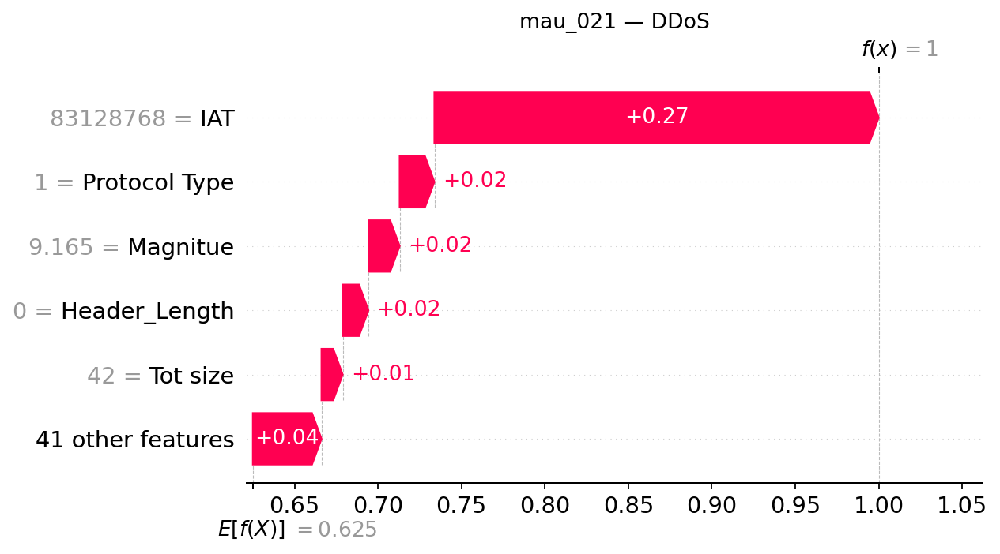

### Diễn giải Gemini

Mô hình dự đoán mẫu dữ liệu thuộc lớp DDoS với sự hỗ trợ mạnh mẽ từ đặc trưng IAT trong top năm đặc trưng quan trọng. Khoảng cách giữa lớp đứng đầu và lớp đứng thứ hai là rất lớn và cờ khoảng cách nhỏ đang tắt, cho thấy sự chênh lệch rõ rệt nhưng chưa khẳng định nhãn thật.

**So sánh hai lớp:** Lớp đứng thứ hai là DoS có xác suất rất thấp so với lớp dự đoán. Cờ khoảng cách nhỏ đang tắt và chênh lệch lớn không phải là bảo đảm dự đoán chính xác, do đó cần tiếp tục đối chiếu thêm các nguồn dữ liệu khác.

**Tổng hợp SHAP:** Trong top năm đặc trưng, IAT đóng vai trò hỗ trợ mạnh nhất đẩy giá trị đầu ra tăng cao, trong khi không ghi nhận yếu tố nào có tác động phản đối rõ rệt trong nhóm này.

- **IAT**: Đây là yếu tố hỗ trợ nổi bật nhất trong top năm, góp phần đáng kể làm tăng giá trị đầu ra của lớp được giải thích.
- **Protocol Type**: Tác động này cùng chiều nhưng nhỏ hơn yếu tố dẫn đầu, đóng vai trò hỗ trợ bổ sung cho mô hình.
- **Magnitue**: Đặc trưng này thể hiện mức đóng góp dương ở mức độ vừa phải trong nhóm các yếu tố hàng đầu.
- **Header_Length**: Ghi nhận sự gia tăng đầu ra với mức độ tác động nhỏ hơn các đặc trưng đứng trước.
- **Tot size**: Mang lại tác động dương thấp nhất trong top năm, hoàn thiện nhóm năm đặc trưng có chiều hướng tăng.

### Gợi ý kiểm tra có điều kiện

- **Nhật ký lưu lượng mạng**: Kiểm tra sự đồng thời của nhiều nguồn đến cùng dịch vụ nếu có địa chỉ và thời gian. Mục đích: Đối chiếu sự biến động của lưu lượng mạng thực tế với kết quả phân tích của mô hình.
- **Nhật ký tài nguyên dịch vụ**: Đối chiếu lưu lượng với tình trạng tài nguyên và khả năng phục vụ, không tự đặt ngưỡng. Mục đích: Xác minh khả năng chịu tải và phản ứng của hệ thống dưới các mẫu dữ liệu tương tự.

### Giới hạn do Gemini nêu

- Giải thích SHAP chỉ phản ánh đầu ra của mô hình đối với mẫu hiện tại và không chứng minh quan hệ nhân quả hay tấn công thực tế.
- Xác suất dự đoán từ mô hình chưa được kiểm chứng là đã hiệu chỉnh hoàn toàn.
- Tổng giá trị SHAP của top năm chưa bao gồm toàn bộ các đặc trưng khác ngoài nhóm.

SHAP giải thích đầu ra model, chưa chứng minh hành vi tấn công hoặc quan hệ nhân quả. Đánh giá con người tạm hoãn.

---

## mau_022 — dòng CSV 21

**Trạng thái Gemini: accepted**

Đạt kiểm tra bằng chứng có cấu trúc và quy tắc văn bản; chưa đánh giá ngữ nghĩa thủ công.

### Dự đoán và số liệu do chương trình dựng

- Model: `XGB_d4_n200`; dự đoán: **DDoS**, xác suất **99.9981%**.
- Lớp đứng thứ hai: **DoS**, xác suất **0.0011%**.
- Chênh lệch hai lớp: **99.9971 điểm phần trăm**.
- Quy tắc khoảng cách nhỏ: không quá 5 điểm phần trăm, chỉ để trình bày.
- Xác suất nền SHAP: 62.506627%.
- Tổng SHAP: +37.491501 điểm phần trăm; ngoài top 5: +2.528496 điểm phần trăm.
- Hỗ trợ mạnh nhất trong top 5: **IAT**.
- Phản đối mạnh nhất trong top 5: **Không có tác động âm trong top 5**.

| Đặc trưng | Giá trị gốc | SHAP | Tác động (điểm %) |
|---|---:|---:|---:|
| IAT | 83332152 | +0.26354237 | +26.354237 |
| Magnitue | 10.392304 | +0.03308238 | +3.308238 |
| Protocol Type | 6 | +0.03014220 | +3.014220 |
| Min | 54 | +0.01330408 | +1.330408 |
| Max | 54 | +0.00955901 | +0.955901 |

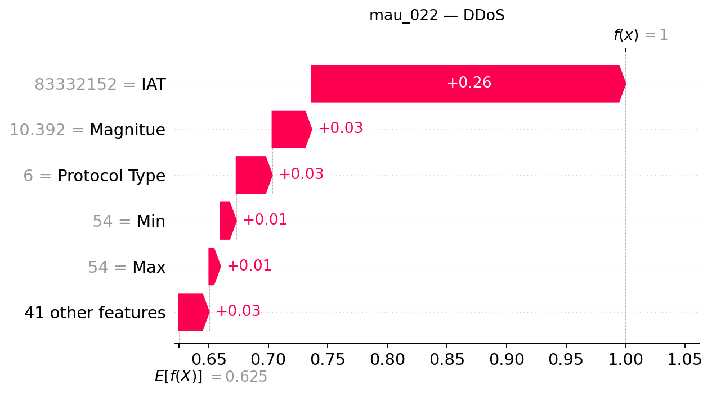

### Diễn giải Gemini

Mẫu dữ liệu được mô hình dự đoán thuộc lớp DDoS với xác suất áp đảo nhờ sự hỗ trợ mạnh mẽ từ các đặc trưng đầu bảng. Khoảng cách giữa lớp đứng đầu và lớp đứng thứ hai rất lớn, phản ánh mức độ phân hóa rõ rệt trong kết quả phân loại.

**So sánh hai lớp:** Cờ khoảng cách nhỏ đang tắt, cho thấy chênh lệch giữa hai lớp rất lớn; tuy nhiên điều này không bảo đảm dự đoán chắc chắn là đúng nhãn thật.

**Tổng hợp SHAP:** Trong nhóm năm đặc trưng đang xét, IAT đóng vai trò hỗ trợ mạnh nhất đẩy giá trị đầu ra lên cao, trong khi không ghi nhận yếu tố nào mang giá trị phản đối trong top năm.

- **IAT**: Đây là yếu tố hỗ trợ nổi bật nhất trong top năm, góp phần đáng kể làm tăng đầu ra của lớp được dự đoán so với nền tham chiếu.
- **Magnitue**: Tác động này cùng chiều nhưng nhỏ hơn yếu tố dẫn đầu, đóng vai trò bổ sung cho quá trình phân loại.
- **Protocol Type**: Sự hiện diện của đặc trưng này tiếp tục củng cố thêm bằng chứng dương cho lớp dự đoán.
- **Min**: Đặc trưng này thể hiện một mức đóng góp dương nhỏ hơn trong nhóm năm yếu tố hàng đầu.
- **Max**: Đây là thành phần có tác động nhỏ nhất trong top năm, hoàn thiện bức tranh giải thích của mô hình cho mẫu này.

### Gợi ý kiểm tra có điều kiện

- **Nhật ký lưu lượng mạng**: Kiểm tra sự đồng thời của nhiều nguồn đến cùng dịch vụ nếu hệ thống có ghi nhận địa chỉ và thời gian. Mục đích: Đối chiếu mô hình với phân phối thực tế của gói tin.
- **Nhật ký tài nguyên dịch vụ**: Đối chiếu lưu lượng với tình trạng tài nguyên và khả năng phục vụ của hệ thống. Mục đích: Kiểm tra sự biến động tải thực tế trên thiết bị mục tiêu.

### Giới hạn do Gemini nêu

- Giá trị SHAP chỉ giải thích đầu ra mô hình cho mẫu này và không chứng minh quan hệ nhân quả hay cuộc tấn công thực tế.
- Xác suất dự đoán từ mô hình chưa được kiểm chứng là đã hiệu chỉnh hoàn toàn.
- Tổng giá trị SHAP trong top năm chưa bao trùm toàn bộ các đặc trưng của mô hình.

SHAP giải thích đầu ra model, chưa chứng minh hành vi tấn công hoặc quan hệ nhân quả. Đánh giá con người tạm hoãn.

---

## mau_023 — dòng CSV 22

**Trạng thái Gemini: accepted**

Đạt kiểm tra bằng chứng có cấu trúc và quy tắc văn bản; chưa đánh giá ngữ nghĩa thủ công.

### Dự đoán và số liệu do chương trình dựng

- Model: `XGB_d4_n200`; dự đoán: **Mirai**, xác suất **99.9931%**.
- Lớp đứng thứ hai: **DDoS**, xác suất **0.0040%**.
- Chênh lệch hai lớp: **99.9891 điểm phần trăm**.
- Quy tắc khoảng cách nhỏ: không quá 5 điểm phần trăm, chỉ để trình bày.
- Xác suất nền SHAP: 9.376009%.
- Tổng SHAP: +90.617053 điểm phần trăm; ngoài top 5: +15.245427 điểm phần trăm.
- Hỗ trợ mạnh nhất trong top 5: **IAT**.
- Phản đối mạnh nhất trong top 5: **Không có tác động âm trong top 5**.

| Đặc trưng | Giá trị gốc | SHAP | Tác động (điểm %) |
|---|---:|---:|---:|
| IAT | 83651072 | +0.23416209 | +23.416209 |
| Protocol Type | 38.439999 | +0.19411302 | +19.411302 |
| Magnitue | 31.011297 | +0.17295307 | +17.295307 |
| Max | 578 | +0.09216753 | +9.216753 |
| Tot size | 475.79001 | +0.06032056 | +6.032056 |

### Diễn giải Gemini

Mẫu dữ liệu được mô hình dự đoán thuộc lớp Mirai với sự hỗ trợ từ các đặc trưng nổi bật trong top năm, trong đó IAT đóng vai trò đóng góp dương lớn nhất. Khoảng cách giữa hai lớp đứng đầu khá lớn và không kích hoạt cờ khoảng cách nhỏ, cho thấy sự chênh lệch rõ rệt về đầu ra trong lần phân loại này.

**So sánh hai lớp:** Lớp đứng thứ hai là DDoS với xác suất thấp hơn đáng kể so với lớp dẫn đầu. Cờ khoảng cách nhỏ đang tắt, do đó chênh lệch lớn không phải là sự đảm bảo tuyệt đối rằng dự đoán đã hoàn toàn chính xác.

**Tổng hợp SHAP:** Trong top năm đặc trưng, IAT là yếu tố hỗ trợ mạnh mẽ nhất làm tăng đầu ra của lớp dự đoán. Không có đặc trưng nào trong top năm mang lại tác động phản đối âm, đồng thời phần còn lại ngoài nhóm tiếp tục đóng góp vào kết quả chung.

- **IAT**: Đây là yếu tố hỗ trợ nổi bật nhất trong top năm, đóng góp giá trị dương lớn nhất vào đầu ra của lớp.
- **Protocol Type**: Tác động này mang chiều hướng hỗ trợ nhưng có mức đóng góp nhỏ hơn yếu tố dẫn đầu.
- **Magnitue**: Đặc trưng này thể hiện sự gia tăng đầu ra với mức đóng góp đứng ở vị trí thứ ba trong nhóm.
- **Max**: Sự hiện diện của đặc trưng này tiếp tục hỗ trợ bổ sung cho lớp được dự đoán với quy mô nhỏ hơn các yếu tố trước.
- **Tot size**: Đây là tác động có chiều hướng tăng nhỏ nhất trong top năm đặc trưng đang được xem xét.

### Gợi ý kiểm tra có điều kiện

- **Nhật ký kết nối thiết bị**: Đối chiếu đích kết nối và hoạt động lặp với hành vi được phép của thiết bị IoT. Mục đích: Nếu hệ thống có log này, việc đối chiếu giúp kiểm tra xem các phiên kết nối có khớp với cấu hình chuẩn hay không.
- **Nhật ký tiến trình thiết bị**: Nếu truy cập được thiết bị, tìm tiến trình hoặc cảnh báo liên quan; chưa kết luận đã nhiễm mã độc. Mục đích: Nếu hệ thống lưu trữ log tiến trình, việc kiểm tra nhằm tìm kiếm các dấu hiệu bất thường trên hệ thống mà không vội khẳng định sự tồn tại của mã độc.

### Giới hạn do Gemini nêu

- Giải thích này phản ánh đầu ra của mô hình máy học dựa trên các giá trị SHAP cục bộ, không chứng minh mối quan hệ nhân quả hay xác nhận một cuộc tấn công thực tế.
- Xác suất của mô hình chưa được kiểm chứng hay hiệu chỉnh độ tin cậy, do đó kết quả dự đoán chỉ mang tính tham khảo.
- Các giá trị SHAP trong top năm chưa bao trùm toàn bộ tổng mức thay đổi, và phần còn lại ngoài nhóm vẫn chiếm một tỷ trọng đáng kể trong kết quả.

SHAP giải thích đầu ra model, chưa chứng minh hành vi tấn công hoặc quan hệ nhân quả. Đánh giá con người tạm hoãn.

---

## mau_024 — dòng CSV 23

**Trạng thái Gemini: accepted**

Đạt kiểm tra bằng chứng có cấu trúc và quy tắc văn bản; chưa đánh giá ngữ nghĩa thủ công.

### Dự đoán và số liệu do chương trình dựng

- Model: `XGB_d4_n200`; dự đoán: **DDoS**, xác suất **99.9981%**.
- Lớp đứng thứ hai: **DoS**, xác suất **0.0011%**.
- Chênh lệch hai lớp: **99.9971 điểm phần trăm**.
- Quy tắc khoảng cách nhỏ: không quá 5 điểm phần trăm, chỉ để trình bày.
- Xác suất nền SHAP: 62.506627%.
- Tổng SHAP: +37.491501 điểm phần trăm; ngoài top 5: +1.800564 điểm phần trăm.
- Hỗ trợ mạnh nhất trong top 5: **IAT**.
- Phản đối mạnh nhất trong top 5: **Không có tác động âm trong top 5**.

| Đặc trưng | Giá trị gốc | SHAP | Tác động (điểm %) |
|---|---:|---:|---:|
| IAT | 83075928 | +0.28109085 | +28.109085 |
| Protocol Type | 6 | +0.03380246 | +3.380246 |
| Magnitue | 10.392304 | +0.02726307 | +2.726307 |
| rst_count | 0 | +0.00750749 | +0.750749 |
| Number | 9.5 | +0.00724551 | +0.724551 |

### Diễn giải Gemini

Mẫu dữ liệu được mô hình dự đoán là DDoS với xác suất rất cao, vượt trội hoàn toàn so với lớp đứng thứ hai là DoS. Đặc trưng IAT đóng vai trò hỗ trợ mạnh mẽ nhất, trong khi tất cả các yếu tố nằm trong top năm đều mang chiều hướng gia tăng đầu ra.

**So sánh hai lớp:** Khoảng cách xác suất giữa lớp DDoS và lớp DoS rất lớn và cờ khoảng cách nhỏ đang tắt, cho thấy hai đầu ra không nằm gần nhau. Tuy nhiên, điều này không được coi là sự bảo đảm tuyệt đối rằng dự đoán đã chính xác.

**Tổng hợp SHAP:** Trong nhóm năm đặc trưng đang xét, IAT là yếu tố hỗ trợ mạnh nhất cho lớp dự đoán, không ghi nhận tác động phản đối nào do toàn bộ các đặc trưng trong top năm đều cùng chiều tăng.

- **IAT**: Đây là yếu tố hỗ trợ nổi bật nhất trong top năm, đóng góp mức tăng đáng kể cho đầu ra của lớp.
- **Protocol Type**: Tác động này cùng chiều tăng nhưng có độ lớn nhỏ hơn đáng kể so với yếu tố dẫn đầu.
- **Magnitue**: Đặc trưng này cung cấp thêm một lực đẩy bổ sung cùng chiều với mức đóng góp ở mức trung bình trong nhóm.
- **rst_count**: Đóng góp mang chiều hướng thúc đẩy đầu ra với giá trị SHAP nhỏ hơn các đặc trưng trước đó.
- **Number**: Đây là yếu tố có tác động dương nhỏ nhất trong top năm đặc trưng được xem xét.

### Gợi ý kiểm tra có điều kiện

- **Nhật ký lưu lượng mạng**: Kiểm tra sự đồng thời của nhiều nguồn đến cùng dịch vụ nếu có địa chỉ và thời gian. Mục đích: Đối chiếu sự xuất hiện đồng thời của các nguồn lưu lượng để củng cố bối cảnh ghi nhận.
- **Nhật ký tài nguyên dịch vụ**: Đối chiếu lưu lượng với tình trạng tài nguyên và khả năng phục vụ, không tự đặt ngưỡng. Mục đích: Xem xét phản ứng của hệ thống và tài nguyên dịch vụ nhằm phục vụ cho việc kiểm chứng.

### Giới hạn do Gemini nêu

- Giá trị SHAP và xác suất chỉ phản ánh đầu ra của mô hình máy học đối với mẫu dữ liệu này, không phải là bằng chứng xác thực về một cuộc tấn công thực tế hay quan hệ nhân quả.
- Tổng giá trị SHAP của năm đặc trưng chưa bao phủ toàn bộ sự thay đổi, phần còn lại đến từ các yếu tố ngoài top năm và giá trị nền tham chiếu.
- Các mức xác suất chưa được kiểm chứng về độ hiệu chỉnh và không đại diện cho tỷ lệ chính xác tuyệt đối của mô hình.

SHAP giải thích đầu ra model, chưa chứng minh hành vi tấn công hoặc quan hệ nhân quả. Đánh giá con người tạm hoãn.

---

## mau_025 — dòng CSV 24

**Trạng thái Gemini: accepted**

Đạt kiểm tra bằng chứng có cấu trúc và quy tắc văn bản; chưa đánh giá ngữ nghĩa thủ công.

### Dự đoán và số liệu do chương trình dựng

- Model: `XGB_d4_n200`; dự đoán: **DoS**, xác suất **99.9953%**.
- Lớp đứng thứ hai: **DDoS**, xác suất **0.0034%**.
- Chênh lệch hai lớp: **99.9919 điểm phần trăm**.
- Quy tắc khoảng cách nhỏ: không quá 5 điểm phần trăm, chỉ để trình bày.
- Xác suất nền SHAP: 21.878189%.
- Tổng SHAP: +78.117079 điểm phần trăm; ngoài top 5: +1.400963 điểm phần trăm.
- Hỗ trợ mạnh nhất trong top 5: **IAT**.
- Phản đối mạnh nhất trong top 5: **Không có tác động âm trong top 5**.

| Đặc trưng | Giá trị gốc | SHAP | Tác động (điểm %) |
|---|---:|---:|---:|
| IAT | 82972640 | +0.73266740 | +73.266740 |
| Weight | 141.55 | +0.01095809 | +1.095809 |
| Variance | 0.19 | +0.00958675 | +0.958675 |
| syn_flag_number | 1 | +0.00790169 | +0.790169 |
| Number | 9.5 | +0.00604725 | +0.604725 |

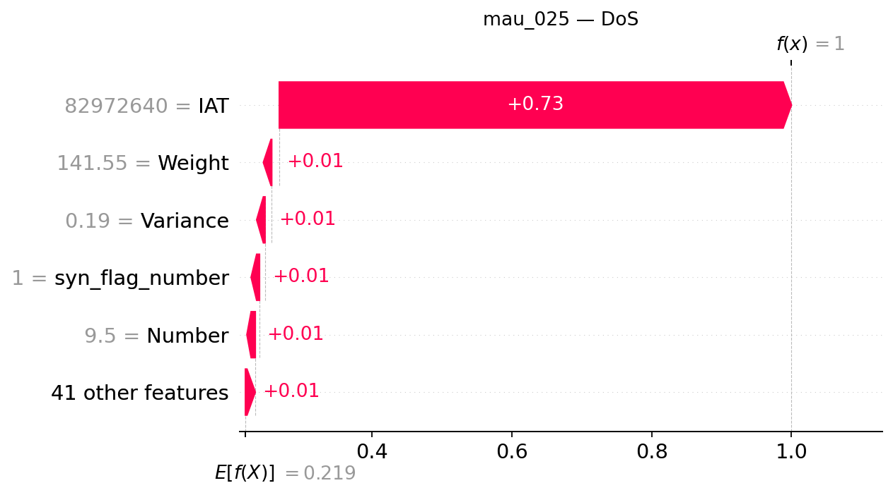

### Diễn giải Gemini

Mẫu được mô hình XGB_d4_n200 phân loại vào lớp DoS với mức độ tự tin rất cao. Đặc trưng IAT đóng vai trò hỗ trợ mạnh mẽ nhất, trong khi lớp đứng thứ hai là DDoS có khoảng cách xác suất rất lớn.

**So sánh hai lớp:** Cờ khoảng cách nhỏ đang tắt cho thấy chênh lệch giữa hai lớp rất lớn, nhưng điều này không được coi là bảo đảm tuyệt đối rằng dự đoán đã chính xác.

**Tổng hợp SHAP:** IAT là yếu tố hỗ trợ mạnh nhất trong top 5, không có đặc trưng nào trong top 5 mang giá trị phản đối âm.

- **IAT**: Đây là yếu tố hỗ trợ nổi bật nhất trong top năm, góp phần đáng kể vào đầu ra của mô hình.
- **Weight**: Tác động này cùng chiều nhưng nhỏ hơn yếu tố dẫn đầu.
- **Variance**: Đặc trưng này mang lại một mức hỗ trợ bổ sung với biên độ thấp hơn.
- **syn_flag_number**: Sự hiện diện của đặc trưng này đóng góp thêm một lực đẩy nhẹ cho dự đoán.
- **Number**: Đây là tác động có quy mô nhỏ nhất trong nhóm năm đặc trưng được xem xét.

### Gợi ý kiểm tra có điều kiện

- **Nhật ký kết nối**: Kiểm tra kết nối lặp đến dịch vụ đích và nguồn liên quan nếu có metadata. Mục đích: Đối chiếu tần suất và đặc điểm kết nối mạng thực tế.
- **Nhật ký tài nguyên dịch vụ**: Tìm lỗi, gián đoạn hoặc thay đổi tài nguyên cùng thời điểm để xác minh thêm. Mục đích: Kiểm tra xem hệ thống có chịu áp lực hoặc biểu hiện gián đoạn tương ứng hay không.

### Giới hạn do Gemini nêu

- Kết quả giải thích chỉ phản ánh đầu ra của mô hình đối với mẫu này, không chứng minh quan hệ nhân quả hay hành vi tấn công thực tế.
- Giá trị SHAP chỉ đại diện cho top 5 đặc trưng của lớp dự đoán và không bao gồm toàn bộ mọi yếu tố trong hệ thống.
- Xác suất dự đoán từ mô hình chưa qua bước kiểm định hiệu chỉnh xác suất thực tế.

SHAP giải thích đầu ra model, chưa chứng minh hành vi tấn công hoặc quan hệ nhân quả. Đánh giá con người tạm hoãn.

---

## mau_026 — dòng CSV 25

**Trạng thái Gemini: accepted**

Đạt kiểm tra bằng chứng có cấu trúc và quy tắc văn bản; chưa đánh giá ngữ nghĩa thủ công.

### Dự đoán và số liệu do chương trình dựng

- Model: `XGB_d4_n200`; dự đoán: **DDoS**, xác suất **99.9981%**.
- Lớp đứng thứ hai: **DoS**, xác suất **0.0011%**.
- Chênh lệch hai lớp: **99.9971 điểm phần trăm**.
- Quy tắc khoảng cách nhỏ: không quá 5 điểm phần trăm, chỉ để trình bày.
- Xác suất nền SHAP: 62.506627%.
- Tổng SHAP: +37.491501 điểm phần trăm; ngoài top 5: +1.586430 điểm phần trăm.
- Hỗ trợ mạnh nhất trong top 5: **IAT**.
- Phản đối mạnh nhất trong top 5: **Không có tác động âm trong top 5**.

| Đặc trưng | Giá trị gốc | SHAP | Tác động (điểm %) |
|---|---:|---:|---:|
| IAT | 83067368 | +0.28826675 | +28.826675 |
| Protocol Type | 6 | +0.03042855 | +3.042855 |
| Magnitue | 10.392304 | +0.02597244 | +2.597244 |
| Number | 9.5 | +0.00803594 | +0.803594 |
| rst_count | 0 | +0.00634704 | +0.634704 |

### Diễn giải Gemini

Mô hình dự đoán mẫu này thuộc lớp DDoS với mức độ tự tin rất cao, trong khi lớp DoS đứng ở vị trí thứ hai nhưng có khoảng cách chênh lệch rất lớn. Đặc trưng IAT đóng vai trò hỗ trợ mạnh nhất làm tăng giá trị đầu ra của lớp này.

**So sánh hai lớp:** Khoảng cách chênh lệch giữa hai lớp đứng đầu rất lớn và có cờ khoảng cách nhỏ tắt, tuy nhiên điều này không có nghĩa là đảm bảo dự đoán chính xác mà chỉ phản ánh đầu ra hiện tại của mô hình.

**Tổng hợp SHAP:** Trong năm đặc trưng hàng đầu, IAT là yếu tố hỗ trợ mạnh nhất làm tăng giá trị dự đoán, trong khi không có đặc trưng nào trong nhóm này mang lại tác động phản đối âm.

- **IAT**: Đây là yếu tố hỗ trợ nổi bật nhất trong top năm, đóng góp lớn vào việc thúc đẩy đầu ra của lớp được giải thích.
- **Protocol Type**: Tác động này cùng chiều nhưng có giá trị nhỏ hơn đáng kể so với yếu tố dẫn đầu.
- **Magnitue**: Đóng góp dương bổ sung giúp tăng cường xác suất dự đoán theo hướng tích cực.
- **Number**: Yếu tố này mang lại một sự hỗ trợ nhỏ hơn trong nhóm năm đặc trưng hàng đầu.
- **rst_count**: Đây là đặc trưng có tác động tăng nhỏ nhất trong nhóm các yếu tố đang được xem xét.

### Gợi ý kiểm tra có điều kiện

- **Nhật ký lưu lượng mạng**: Kiểm tra sự đồng thời của nhiều nguồn đến cùng dịch vụ nếu hệ thống có ghi nhận địa chỉ và thời gian. Mục đích: Đối chiếu biểu hiện của lưu lượng để làm rõ bộ phận dữ liệu đang được xử lý.
- **Nhật ký tài nguyên dịch vụ**: Đối chiếu lưu lượng với tình trạng tài nguyên và khả năng phục vụ của hệ thống. Mục đích: Đánh giá thêm ngữ cảnh hoạt động mà không tự đặt ra các ngưỡng phát hiện mới.

### Giới hạn do Gemini nêu

- Các giá trị SHAP chỉ giải thích đầu ra của mô hình cho mẫu hình này và không chứng minh quan hệ nhân quả hay tấn công thực tế.
- Xác suất của mô hình chưa được xác minh là đã hiệu chỉnh và tổng top năm đặc trưng chưa phải là toàn bộ sự thay đổi.
- Giải thích này không được dùng để thực hiện các hành động tự động như chặn IP hay thay đổi cấu hình hệ thống.

SHAP giải thích đầu ra model, chưa chứng minh hành vi tấn công hoặc quan hệ nhân quả. Đánh giá con người tạm hoãn.

---

## mau_027 — dòng CSV 26

**Trạng thái Gemini: accepted**

Đạt kiểm tra bằng chứng có cấu trúc và quy tắc văn bản; chưa đánh giá ngữ nghĩa thủ công.

### Dự đoán và số liệu do chương trình dựng

- Model: `XGB_d4_n200`; dự đoán: **DDoS**, xác suất **99.9981%**.
- Lớp đứng thứ hai: **DoS**, xác suất **0.0011%**.
- Chênh lệch hai lớp: **99.9971 điểm phần trăm**.
- Quy tắc khoảng cách nhỏ: không quá 5 điểm phần trăm, chỉ để trình bày.
- Xác suất nền SHAP: 62.506627%.
- Tổng SHAP: +37.491501 điểm phần trăm; ngoài top 5: +3.907056 điểm phần trăm.
- Hỗ trợ mạnh nhất trong top 5: **IAT**.
- Phản đối mạnh nhất trong top 5: **Không có tác động âm trong top 5**.

| Đặc trưng | Giá trị gốc | SHAP | Tác động (điểm %) |
|---|---:|---:|---:|
| IAT | 83150312 | +0.26863356 | +26.863356 |
| Protocol Type | 1 | +0.03785083 | +3.785083 |
| Number | 9.5 | +0.01148986 | +1.148986 |
| Header_Length | 0 | +0.00907236 | +0.907236 |
| Max | 42 | +0.00879785 | +0.879785 |

### Diễn giải Gemini

Mô hình dự đoán mẫu dữ liệu thuộc lớp DDoS với sự hỗ trợ nổi bật từ đặc trưng IAT trong top 5. Lớp đứng thứ hai là DoS có khoảng cách chênh lệch lớn và cờ khoảng cách nhỏ tắt, thể hiện sự phân tách rõ rệt trong đầu ra hiện tại.

**So sánh hai lớp:** Cờ khoảng cách nhỏ đang tắt, cho thấy hai đầu ra có sự chênh lệch rõ rệt và không nằm trong diện cần đối chiếu gần; tuy nhiên điều này không bảo đảm dự đoán là đúng.

**Tổng hợp SHAP:** Trong năm đặc trưng hàng đầu, IAT đóng vai trò hỗ trợ mạnh nhất đẩy giá trị đầu ra lên, trong khi không có yếu tố nào trong nhóm này tạo ra tác động phản đối mang giá trị âm.

- **IAT**: Đây là yếu tố hỗ trợ nổi bật nhất trong top năm, góp phần đáng kể vào việc đẩy giá trị dự đoán của lớp.
- **Protocol Type**: Tác động này cùng chiều nhưng nhỏ hơn yếu tố dẫn đầu, đóng vai trò hỗ trợ bổ sung cho mô hình.
- **Number**: Sự hiện diện của đặc trưng này mang lại thêm một mức đóng góp dương ở mức độ thấp hơn.
- **Header_Length**: Đặc trưng này tiếp tục cung cấp một hướng tác động tăng nhỏ đối với đầu ra của mô hình.
- **Max**: Đây là đóng góp dương nhỏ nhất trong nhóm năm đặc trưng hàng đầu được xem xét.

### Gợi ý kiểm tra có điều kiện

- **Nhật ký lưu lượng mạng**: Kiểm tra sự đồng thời của nhiều nguồn đến cùng dịch vụ nếu có địa chỉ và thời gian. Mục đích: Đối chiếu mô hình với các bản ghi lưu lượng thực tế nếu hệ thống có thu thập.
- **Nhật ký tài nguyên dịch vụ**: Đối chiếu lưu lượng với tình trạng tài nguyên và khả năng phục vụ, không tự đặt ngưỡng. Mục đích: So sánh đầu ra với trạng thái tải của hệ thống trong điều kiện có dữ liệu.

### Giới hạn do Gemini nêu

- Giải thích SHAP chỉ phản ánh cách mô hình XGBoost tính toán trên mẫu này, không chứng minh quan hệ nhân quả hay sự tồn tại của tấn công thực tế.
- Xác suất dự đoán chưa qua kiểm định hiệu chỉnh và các giá trị đặc trưng chỉ là dữ liệu đầu vào, không mang ý nghĩa chuẩn mực tuyệt đối.

SHAP giải thích đầu ra model, chưa chứng minh hành vi tấn công hoặc quan hệ nhân quả. Đánh giá con người tạm hoãn.

---

## mau_028 — dòng CSV 27

**Trạng thái Gemini: accepted**

Đạt kiểm tra bằng chứng có cấu trúc và quy tắc văn bản; chưa đánh giá ngữ nghĩa thủ công.

### Dự đoán và số liệu do chương trình dựng

- Model: `XGB_d4_n200`; dự đoán: **DoS**, xác suất **99.9953%**.
- Lớp đứng thứ hai: **DDoS**, xác suất **0.0034%**.
- Chênh lệch hai lớp: **99.9918 điểm phần trăm**.
- Quy tắc khoảng cách nhỏ: không quá 5 điểm phần trăm, chỉ để trình bày.
- Xác suất nền SHAP: 21.878189%.
- Tổng SHAP: +78.117067 điểm phần trăm; ngoài top 5: +1.681811 điểm phần trăm.
- Hỗ trợ mạnh nhất trong top 5: **IAT**.
- Phản đối mạnh nhất trong top 5: **Không có tác động âm trong top 5**.

| Đặc trưng | Giá trị gốc | SHAP | Tác động (điểm %) |
|---|---:|---:|---:|
| IAT | 82977024 | +0.72261263 | +72.261263 |
| Weight | 141.55 | +0.01225674 | +1.225674 |
| Protocol Type | 6 | +0.01047777 | +1.047777 |
| Number | 9.5 | +0.01020363 | +1.020363 |
| AVG | 54 | +0.00880178 | +0.880178 |

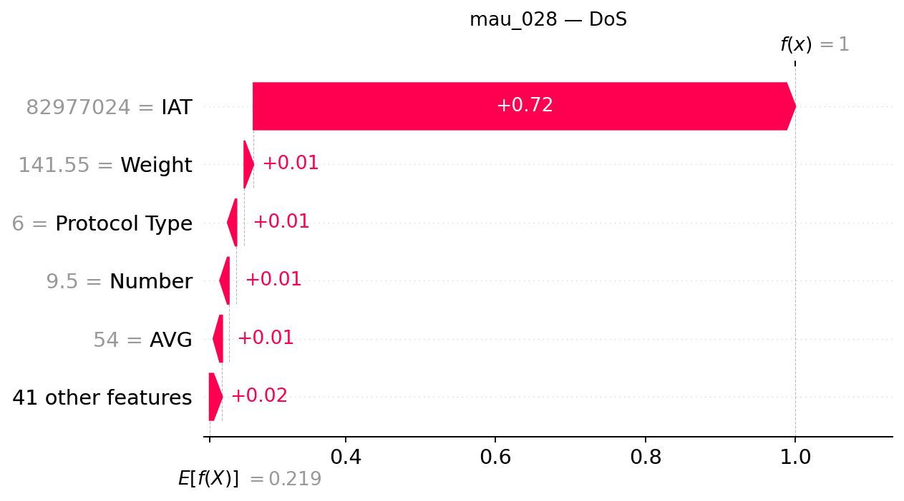

### Diễn giải Gemini

Mẫu dữ liệu được phân loại là DoS với sự đóng góp mạnh mẽ từ đặc trưng IAT trong top năm đặc trưng. Khoảng cách giữa lớp DoS và lớp đứng thứ hai là rất lớn, cho thấy mức độ tập trung cao của mô hình vào dự đoán này.

**So sánh hai lớp:** Cờ khoảng cách nhỏ đang tắt do chênh lệch xác suất giữa lớp DoS và lớp DDoS khá lớn. Tuy nhiên, việc không có khoảng cách nhỏ không bảo đảm dự đoán chắc chắn đúng, vì đây chỉ là kết quả suy luận từ mô hình.

**Tổng hợp SHAP:** Trong nhóm năm đặc trưng hàng đầu, IAT là yếu tố hỗ trợ mạnh mẽ nhất làm tăng đầu ra của lớp dự đoán. Không có đặc trưng nào trong top năm mang lại tác động âm để phản đối kết quả này.

- **IAT**: Đây là yếu tố hỗ trợ nổi bật nhất trong top năm, góp phần đẩy mạnh đầu ra của lớp được giải thích.
- **Weight**: Tác động này cùng chiều nhưng nhỏ hơn yếu tố dẫn đầu trong nhóm.
- **Protocol Type**: Đóng vai trò hỗ trợ bổ sung với mức ảnh hưởng dương vừa phải.
- **Number**: Ghi nhận thêm một đóng góp dương nhỏ nhằm củng cố kết quả dự đoán.
- **AVG**: Đặc trưng này mang lại tác động dương ở mức thấp nhất trong top năm đặc trưng.

### Gợi ý kiểm tra có điều kiện

- **Nhật ký kết nối**: Kiểm tra kết nối lặp đến dịch vụ đích và nguồn liên quan nếu có metadata. Mục đích: Đối chiếu xem có hiện tượng kết nối bất thường hay lặp lại trên hệ thống hay không nếu log này tồn tại.
- **Nhật ký tài nguyên dịch vụ**: Tìm lỗi, gián đoạn hoặc thay đổi tài nguyên cùng thời điểm để xác minh thêm. Mục đích: Xác định xem hệ thống có ghi nhận sự cố tài nguyên tương ứng với thời điểm của mẫu hay không nếu log này tồn tại.

### Giới hạn do Gemini nêu

- Các giá trị SHAP chỉ giải thích đầu ra của mô hình đối với mẫu hiện tại và không chứng minh được quan hệ nhân quả hay sự tồn tại của một cuộc tấn công thực tế.
- Xác suất dự đoán chưa được hiệu chỉnh chính thức và không phản ánh độ tin cậy tuyệt đối của nhãn.
- Phạm vi giải thích chỉ giới hạn ở top năm đặc trưng và phần còn lại ngoài top, chưa bao hàm toàn bộ không gian dữ liệu.

SHAP giải thích đầu ra model, chưa chứng minh hành vi tấn công hoặc quan hệ nhân quả. Đánh giá con người tạm hoãn.

---

## mau_029 — dòng CSV 28

**Trạng thái Gemini: accepted**

Đạt kiểm tra bằng chứng có cấu trúc và quy tắc văn bản; chưa đánh giá ngữ nghĩa thủ công.

### Dự đoán và số liệu do chương trình dựng

- Model: `XGB_d4_n200`; dự đoán: **DDoS**, xác suất **99.9981%**.
- Lớp đứng thứ hai: **DoS**, xác suất **0.0011%**.
- Chênh lệch hai lớp: **99.9971 điểm phần trăm**.
- Quy tắc khoảng cách nhỏ: không quá 5 điểm phần trăm, chỉ để trình bày.
- Xác suất nền SHAP: 62.506627%.
- Tổng SHAP: +37.491501 điểm phần trăm; ngoài top 5: +2.302940 điểm phần trăm.
- Hỗ trợ mạnh nhất trong top 5: **IAT**.
- Phản đối mạnh nhất trong top 5: **Không có tác động âm trong top 5**.

| Đặc trưng | Giá trị gốc | SHAP | Tác động (điểm %) |
|---|---:|---:|---:|
| IAT | 83097808 | +0.28328723 | +28.328723 |
| Min | 50 | +0.03357089 | +3.357089 |
| Magnitue | 10.015085 | +0.01722805 | +1.722805 |
| Tot sum | 526.59998 | +0.00951553 | +0.951553 |
| AVG | 50.15144 | +0.00828391 | +0.828391 |

### Diễn giải Gemini

Hệ thống dự đoán mẫu thuộc lớp DDoS với sự hỗ trợ nổi bật từ đặc trưng IAT trong top năm đặc trưng quan trọng. Khoảng cách giữa lớp dẫn đầu và lớp đứng thứ hai là rất lớn, cho thấy mô hình phân loại nghiêng hẳn về một hướng duy nhất.

**So sánh hai lớp:** Cờ khoảng cách nhỏ đang tắt, thể hiện sự chênh lệch lớn giữa hai lớp đứng đầu; tuy nhiên, điều này không được coi là sự bảo đảm tuyệt đối về độ chính xác của dự đoán.

**Tổng hợp SHAP:** Đặc trưng IAT đóng vai trò hỗ trợ mạnh mẽ nhất trong nhóm năm đặc trưng hàng đầu, trong khi không có yếu tố nào mang lại tác động phản đối trong nhóm này.

- **IAT**: Đây là yếu tố hỗ trợ nổi bật nhất trong top năm, đẩy mạnh giá trị đầu ra của lớp được giải thích.
- **Min**: Tác động này cùng chiều nhưng có mức độ nhỏ hơn yếu tố dẫn đầu.
- **Magnitue**: Đóng góp bổ sung làm tăng thêm giá trị đầu ra nhưng ở mức thấp hơn.
- **Tot sum**: Yếu tố này mang lại sự hỗ trợ ở mức độ nhẹ đối với lớp dự đoán.
- **AVG**: Đóng góp cuối cùng trong nhóm top năm có tác động nhỏ nhất nhưng vẫn cùng chiều tăng.

### Gợi ý kiểm tra có điều kiện

- **Nhật ký lưu lượng mạng**: Kiểm tra sự đồng thời của nhiều nguồn đến cùng dịch vụ nếu hệ thống có ghi nhận địa chỉ và thời gian. Mục đích: Đối chiếu sự gia tăng lưu lượng từ các nguồn khác nhau với kết quả dự đoán.
- **Nhật ký tài nguyên dịch vụ**: Đối chiếu lưu lượng với tình trạng tài nguyên và khả năng phục vụ của hệ thống. Mục đích: Xem xét ảnh hưởng của lưu lượng đến trạng thái hoạt động thực tế.

### Giới hạn do Gemini nêu

- Các giá trị SHAP chỉ giải thích đầu ra của mô hình đối với mẫu hiện tại, không chứng minh cuộc tấn công thực tế hay quan hệ nhân quả.
- Tổng các giá trị SHAP trong top năm chưa phải là toàn bộ mức thay đổi của toàn hệ thống đặc trưng.
- Xác suất dự đoán từ mô hình chưa được xác minh là đã hiệu chỉnh hoàn toàn.

SHAP giải thích đầu ra model, chưa chứng minh hành vi tấn công hoặc quan hệ nhân quả. Đánh giá con người tạm hoãn.

---

## mau_030 — dòng CSV 29

**Trạng thái Gemini: accepted**

Đạt kiểm tra bằng chứng có cấu trúc và quy tắc văn bản; chưa đánh giá ngữ nghĩa thủ công.

### Dự đoán và số liệu do chương trình dựng

- Model: `XGB_d4_n200`; dự đoán: **DDoS**, xác suất **99.9981%**.
- Lớp đứng thứ hai: **DoS**, xác suất **0.0011%**.
- Chênh lệch hai lớp: **99.9971 điểm phần trăm**.
- Quy tắc khoảng cách nhỏ: không quá 5 điểm phần trăm, chỉ để trình bày.
- Xác suất nền SHAP: 62.506627%.
- Tổng SHAP: +37.491501 điểm phần trăm; ngoài top 5: +3.007368 điểm phần trăm.
- Hỗ trợ mạnh nhất trong top 5: **IAT**.
- Phản đối mạnh nhất trong top 5: **Không có tác động âm trong top 5**.

| Đặc trưng | Giá trị gốc | SHAP | Tác động (điểm %) |
|---|---:|---:|---:|
| IAT | 83345200 | +0.26947099 | +26.947099 |
| Magnitue | 10.392304 | +0.03663543 | +3.663543 |
| Min | 54 | +0.01714817 | +1.714817 |
| Protocol Type | 6 | +0.01187145 | +1.187145 |
| Tot size | 54 | +0.00971531 | +0.971531 |

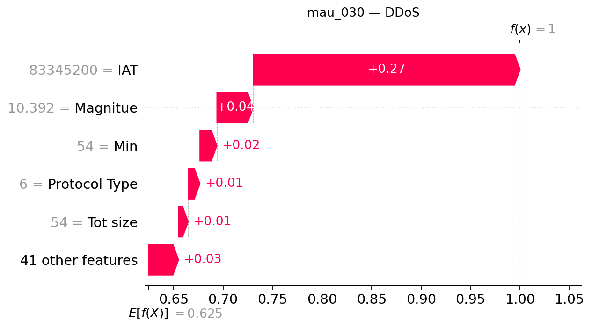

### Diễn giải Gemini

Mô hình dự đoán mẫu dữ liệu thuộc lớp DDoS với xác suất rất cao, trong đó đặc trưng IAT đóng vai trò hỗ trợ nổi bật nhất. Khoảng cách với lớp đứng thứ hai là DoS rất lớn và cờ khoảng cách nhỏ tắt, cho thấy không có sự cạnh tranh đáng kể giữa hai lớp này trong trường hợp này.

**So sánh hai lớp:** Lớp đứng thứ hai là DoS có xác suất vô cùng nhỏ so với lớp dự đoán và cờ khoảng cách nhỏ tắt. Chênh lệch lớn này không bảo đảm dự đoán hoàn toàn đúng mà chỉ phản ánh đầu ra của mô hình đối với mẫu đang xét.

**Tổng hợp SHAP:** Trong top năm đặc trưng, IAT là yếu tố hỗ trợ mạnh nhất đẩy đầu ra tăng lên, trong khi không có đặc trưng nào trong nhóm này mang giá trị âm để tạo tác động phản đối.

- **IAT**: Đây là yếu tố hỗ trợ nổi bật nhất trong top năm, góp phần đáng kể làm tăng giá trị đầu ra của lớp được giải thích so với nền tham chiếu.
- **Magnitue**: Tác động này cùng chiều nhưng có độ lớn nhỏ hơn đáng kể so với yếu tố dẫn đầu, đóng vai trò hỗ trợ bổ sung cho kết quả dự đoán.
- **Min**: Đặc trưng này thể hiện một mức đóng góp dương ở mức độ vừa phải trong nhóm năm đặc trưng hàng đầu.
- **Protocol Type**: Sự hiện diện của đặc trưng này mang lại một lực đẩy nhỏ cùng chiều với xu hướng chung của mô hình.
- **Tot size**: Đây là đóng góp dương có giá trị nhỏ nhất trong top năm đặc trưng, bổ sung một phần tác động vào đầu ra.

### Gợi ý kiểm tra có điều kiện

- **Nhật ký lưu lượng mạng**: Kiểm tra sự đồng thời của nhiều nguồn đến cùng dịch vụ nếu có địa chỉ và thời gian. Mục đích: Đối chiếu sự xuất hiện đồng thời từ nhiều nguồn trên hệ thống để có thêm thông tin ngữ cảnh.
- **Nhật ký tài nguyên dịch vụ**: Đối chiếu lưu lượng với tình trạng tài nguyên và khả năng phục vụ, không tự đặt ngưỡng. Mục đích: So sánh mức độ sử dụng tài nguyên thực tế của dịch vụ nhằm hỗ trợ quá trình phân tích.

### Giới hạn do Gemini nêu

- Các giá trị SHAP chỉ giải thích đầu ra của mô hình phân loại cho mẫu này và không chứng minh quan hệ nhân quả hay sự tồn tại của tấn công thực tế.
- Tổng giá trị SHAP trong top năm chưa phải là toàn bộ mức thay đổi vì vẫn còn phần đóng góp từ các đặc trưng nằm ngoài nhóm này.
- Xác suất dự đoán của mô hình chưa được kiểm chứng là đã hiệu chỉnh và không đại diện cho nhãn thật của dữ liệu.

SHAP giải thích đầu ra model, chưa chứng minh hành vi tấn công hoặc quan hệ nhân quả. Đánh giá con người tạm hoãn.

---

## mau_031 — dòng CSV 30

**Trạng thái Gemini: accepted**

Đạt kiểm tra bằng chứng có cấu trúc và quy tắc văn bản; chưa đánh giá ngữ nghĩa thủ công.

### Dự đoán và số liệu do chương trình dựng

- Model: `XGB_d4_n200`; dự đoán: **DDoS**, xác suất **99.9981%**.
- Lớp đứng thứ hai: **DoS**, xác suất **0.0011%**.
- Chênh lệch hai lớp: **99.9971 điểm phần trăm**.
- Quy tắc khoảng cách nhỏ: không quá 5 điểm phần trăm, chỉ để trình bày.
- Xác suất nền SHAP: 62.506627%.
- Tổng SHAP: +37.491501 điểm phần trăm; ngoài top 5: +3.549452 điểm phần trăm.
- Hỗ trợ mạnh nhất trong top 5: **IAT**.
- Phản đối mạnh nhất trong top 5: **Không có tác động âm trong top 5**.

| Đặc trưng | Giá trị gốc | SHAP | Tác động (điểm %) |
|---|---:|---:|---:|
| IAT | 83343856 | +0.27770421 | +27.770421 |
| Magnitue | 10.392304 | +0.02416340 | +2.416340 |
| Protocol Type | 6 | +0.01685037 | +1.685037 |
| Min | 54 | +0.01084579 | +1.084579 |
| Max | 54 | +0.00985672 | +0.985672 |

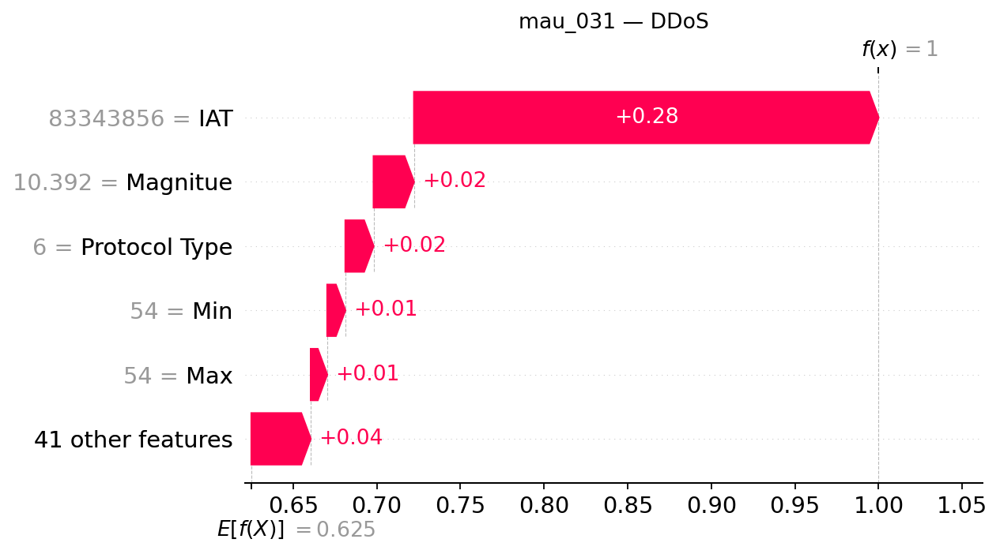

### Diễn giải Gemini

Mô hình dự đoán mẫu thuộc lớp DDoS với xác suất áp đảo nhờ sự hỗ trợ mạnh mẽ từ đặc trưng IAT. Cạnh tranh giữa hai lớp đứng đầu không quá gay gắt khi lớp đứng thứ hai là DoS có xác suất rất thấp.

**So sánh hai lớp:** Lớp đứng thứ hai là DoS với khoảng cách chênh lệch lớn và cờ khoảng cách nhỏ đang tắt, tuy nhiên việc chênh lệch lớn không coi là bảo đảm dự đoán đúng và không kết luận đã biết nhãn thật.

**Tổng hợp SHAP:** Trong nhóm năm đặc trưng hàng đầu, IAT đóng vai trò hỗ trợ mạnh nhất đẩy giá trị đầu ra tăng, trong khi không ghi nhận yếu tố nào có tác động phản đối trong top năm.

- **IAT**: Đây là yếu tố hỗ trợ nổi bật nhất trong top năm, đóng góp lớn vào việc tăng đầu ra của lớp được dự đoán.
- **Magnitue**: Tác động này cùng chiều nhưng nhỏ hơn yếu tố dẫn đầu, đóng vai trò hỗ trợ bổ sung cho mô hình.
- **Protocol Type**: Đặc trưng này thể hiện một hướng tác động đồng thuận tương tự nhưng với mức độ thấp hơn.
- **Min**: Sự góp mặt của yếu tố này tiếp tục củng cố đầu ra theo chiều hướng tăng với mức đóng góp khiêm tốn.
- **Max**: Đây là đặc trưng có tác động nhỏ hơn cả trong nhóm năm yếu tố hàng đầu xét về mức độ thay đổi.

### Gợi ý kiểm tra có điều kiện

- **Nhật ký lưu lượng mạng**: Kiểm tra sự đồng thời của nhiều nguồn đến cùng dịch vụ nếu có địa chỉ và thời gian. Mục đích: Đối chiếu hành vi lưu lượng để tìm bằng chứng liên quan đến mẫu đang xem xét.
- **Nhật ký tài nguyên dịch vụ**: Đối chiếu lưu lượng với tình trạng tài nguyên và khả năng phục vụ, không tự đặt ngưỡng. Mục đích: Xác thực trạng thái hệ thống nhằm hỗ trợ việc phân tích ngữ cảnh của dữ liệu.

### Giới hạn do Gemini nêu

- Đây là giải thích đầu ra model, không chứng minh cuộc tấn công thực tế hoặc quan hệ nhân quả.
- Xác suất dự đoán chưa được xác minh là đã hiệu chỉnh và tổng top 5 chưa phải toàn bộ mức thay đổi.
- Giá trị SHAP chỉ phản ánh mức đóng góp so với nền tham chiếu, không đại diện cho nhãn thực tế.

SHAP giải thích đầu ra model, chưa chứng minh hành vi tấn công hoặc quan hệ nhân quả. Đánh giá con người tạm hoãn.

---

## mau_032 — dòng CSV 31

**Trạng thái Gemini: accepted**

Đạt kiểm tra bằng chứng có cấu trúc và quy tắc văn bản; chưa đánh giá ngữ nghĩa thủ công.

### Dự đoán và số liệu do chương trình dựng

- Model: `XGB_d4_n200`; dự đoán: **Mirai**, xác suất **99.9931%**.
- Lớp đứng thứ hai: **DDoS**, xác suất **0.0040%**.
- Chênh lệch hai lớp: **99.9891 điểm phần trăm**.
- Quy tắc khoảng cách nhỏ: không quá 5 điểm phần trăm, chỉ để trình bày.
- Xác suất nền SHAP: 9.376009%.
- Tổng SHAP: +90.617053 điểm phần trăm; ngoài top 5: +10.711901 điểm phần trăm.
- Hỗ trợ mạnh nhất trong top 5: **Min**.
- Phản đối mạnh nhất trong top 5: **Không có tác động âm trong top 5**.

| Đặc trưng | Giá trị gốc | SHAP | Tác động (điểm %) |
|---|---:|---:|---:|
| Min | 554 | +0.28804681 | +28.804681 |
| Magnitue | 33.286633 | +0.20763133 | +20.763133 |
| Tot size | 554 | +0.13327400 | +13.327400 |
| IAT | 83789160 | +0.12965397 | +12.965397 |
| flow_duration | 1.6335063 | +0.04044540 | +4.044540 |

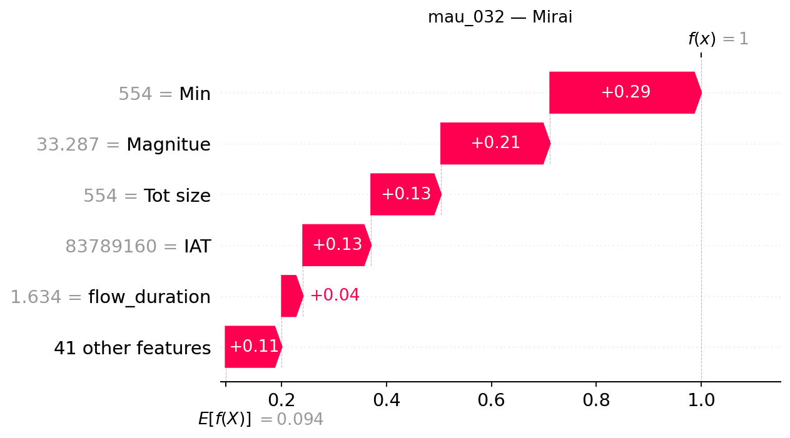

### Diễn giải Gemini

Mô hình dự đoán mẫu dữ liệu thuộc lớp Mirai với mức độ tự tin rất cao, vượt xa các lớp khác trong hệ thống. Các đặc trưng trong top năm đều đóng vai trò đẩy mạnh đầu ra của lớp được chọn. Sự cạnh tranh giữa lớp Mirai đứng đầu và lớp DDoS đứng thứ hai có khoảng cách rất lớn.

**So sánh hai lớp:** Lớp đứng thứ hai là DDoS có xác suất rất nhỏ so với lớp dẫn đầu. Cờ khoảng cách nhỏ đang tắt và chênh lệch điểm phần trăm giữa hai lớp rất lớn, tuy nhiên điều này không coi là bảo đảm tuyệt đối dự đoán là đúng.

**Tổng hợp SHAP:** Trong top năm đặc trưng xét đến, Min là yếu tố hỗ trợ mạnh nhất đẩy đầu ra tăng lên, trong khi không có đặc trưng nào nằm trong nhóm này tạo tác động phản đối. Các đóng góp dương khác cùng phần ngoài top năm tạo nên kết quả cuối cùng.

- **Min**: Đây là yếu tố hỗ trợ nổi bật nhất trong top năm, góp phần đáng kể làm tăng giá trị đầu ra của lớp được dự đoán.
- **Magnitue**: Tác động này cùng chiều nhưng có phần đóng góp nhỏ hơn yếu tố dẫn đầu trong nhóm.
- **Tot size**: Đặc trưng này mang lại một mức hỗ trợ bổ sung đáng chú ý để củng cố thêm cho kết quả phân loại.
- **IAT**: Sự hiện diện của yếu tố này tiếp tục đóng góp một lực đẩy dương với mức độ vừa phải vào tổng giá trị SHAP.
- **flow_duration**: Đây là tác động có chiều hướng đồng thuận nhưng mang lại mức thay đổi nhỏ nhất trong nhóm năm đặc trưng.

### Gợi ý kiểm tra có điều kiện

- **Nhật ký kết nối thiết bị**: Đối chiếu đích kết nối và hoạt động lặp với hành vi được phép của thiết bị IoT. Mục đích: Xem xét xem hệ thống có ghi nhận các kết nối mạng bất thường hay không nếu có dữ liệu nhật ký này.
- **Nhật ký tiến trình thiết bị**: Nếu truy cập được thiết bị, tìm tiến trình hoặc cảnh báo liên quan; chưa kết luận đã nhiễm mã độc. Mục đích: Kiểm tra tình trạng hoạt động thực tế bên trong thiết bị nếu hệ thống lưu trữ các bản ghi này.

### Giới hạn do Gemini nêu

- Kết quả này chỉ là giải thích đầu ra của mô hình máy học, không phải là bằng chứng chứng minh một cuộc tấn công thực tế hay quan hệ nhân quả.
- Giá trị SHAP phản ánh mức độ đóng góp so với nền tham chiếu của mô hình chứ không suy ra thay đổi giá trị đặc trưng sẽ sửa đổi được dự đoán.
- Xác suất dự đoán hiện tại chưa được xác minh là đã hiệu chỉnh và tổng top năm chưa bao trùm toàn bộ các yếu tố của mô hình.

SHAP giải thích đầu ra model, chưa chứng minh hành vi tấn công hoặc quan hệ nhân quả. Đánh giá con người tạm hoãn.

---

## mau_033 — dòng CSV 32

**Trạng thái Gemini: accepted**

Đạt kiểm tra bằng chứng có cấu trúc và quy tắc văn bản; chưa đánh giá ngữ nghĩa thủ công.

### Dự đoán và số liệu do chương trình dựng

- Model: `XGB_d4_n200`; dự đoán: **DDoS**, xác suất **99.9981%**.
- Lớp đứng thứ hai: **DoS**, xác suất **0.0011%**.
- Chênh lệch hai lớp: **99.9971 điểm phần trăm**.
- Quy tắc khoảng cách nhỏ: không quá 5 điểm phần trăm, chỉ để trình bày.
- Xác suất nền SHAP: 62.506627%.
- Tổng SHAP: +37.491501 điểm phần trăm; ngoài top 5: +4.287097 điểm phần trăm.
- Hỗ trợ mạnh nhất trong top 5: **IAT**.
- Phản đối mạnh nhất trong top 5: **Không có tác động âm trong top 5**.

| Đặc trưng | Giá trị gốc | SHAP | Tác động (điểm %) |
|---|---:|---:|---:|
| IAT | 83330856 | +0.26278616 | +26.278616 |
| Magnitue | 10.392304 | +0.02045924 | +2.045924 |
| Protocol Type | 6 | +0.01890975 | +1.890975 |
| TCP | 1 | +0.01585590 | +1.585590 |
| Tot size | 54 | +0.01403300 | +1.403300 |

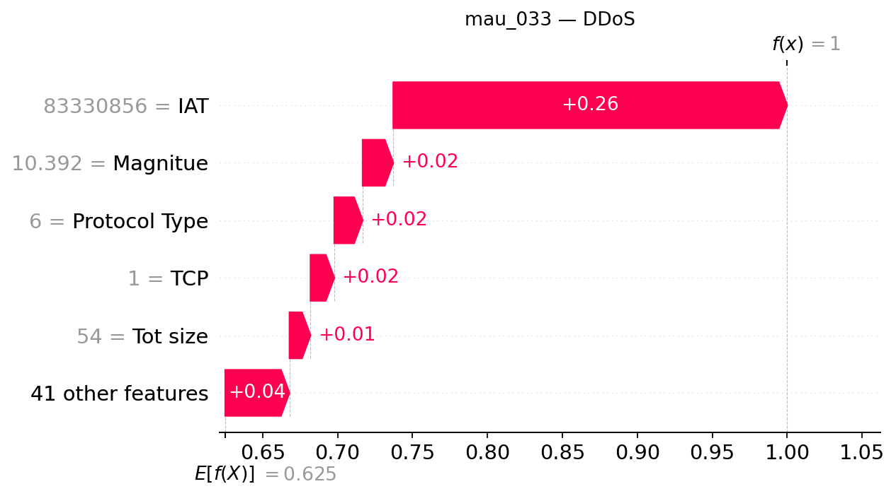

### Diễn giải Gemini

Mô hình dự đoán mẫu dữ liệu này thuộc lớp DDoS với xác suất rất cao, trong đó đặc trưng IAT đóng vai trò hỗ trợ nổi bật nhất làm tăng mạnh đầu ra so với nền tham chiếu. Lớp đứng thứ hai là DoS nhưng có khoảng cách xác suất rất lớn, cho thấy sự cạnh tranh không đáng kể giữa hai lớp dẫn đầu trong trường hợp này.

**So sánh hai lớp:** Cờ khoảng cách nhỏ đang tắt vì chênh lệch xác suất giữa hai lớp đứng đầu rất lớn. Tuy nhiên, việc không có khoảng cách nhỏ không đồng nghĩa với việc đảm bảo dự đoán hoàn toàn chính xác mà chỉ phản ánh khoảng cách giá trị đầu ra tại thời điểm khảo sát.

**Tổng hợp SHAP:** Trong top năm đặc trưng, IAT là yếu tố hỗ trợ mạnh nhất đẩy giá trị dự đoán tăng lên. Không ghi nhận yếu tố nào có tác động phản đối mang giá trị âm trong nhóm này.

- **IAT**: Đây là yếu tố hỗ trợ nổi bật nhất trong top năm, góp phần đáng kể làm tăng giá trị đầu ra của lớp dự đoán.
- **Magnitue**: Tác động này cùng chiều nhưng có độ lớn nhỏ hơn rõ rệt so với yếu tố dẫn đầu.
- **Protocol Type**: Đóng góp mang chiều hướng bổ sung nhằm củng cố thêm cho kết quả phân loại của mô hình.
- **TCP**: Mang lại một mức tác động dương nhỏ hơn các đặc trưng phía trên trong nhóm năm phần tử.
- **Tot size**: Là yếu tố đóng góp theo chiều tăng có quy mô nhỏ nhất trong top năm đặc trưng được tổng hợp.

### Gợi ý kiểm tra có điều kiện

- **Nhật ký lưu lượng mạng**: Kiểm tra sự đồng thời của nhiều nguồn đến cùng dịch vụ nếu hệ thống có ghi nhận địa chỉ và thời gian. Mục đích: Đối chiếu đặc tính lưu lượng thực tế với kết quả phân tích của mô hình.
- **Nhật ký tài nguyên dịch vụ**: Đối chiếu lưu lượng với tình trạng tài nguyên và khả năng phục vụ của hệ thống. Mục đích: Xác minh các biến động tài nguyên đi kèm với hành vi mạng được ghi nhận.

### Giới hạn do Gemini nêu

- Các giá trị SHAP chỉ thể hiện mức độ đóng góp của đặc trưng vào đầu ra của mô hình đối với mẫu hiện tại chứ không chứng minh quan hệ nhân quả ngoài thực tế.
- Xác suất dự đoán của mô hình chưa được kiểm chứng về độ hiệu chỉnh và không đại diện cho nhãn thực tế của dữ liệu.
- Phạm vi giải thích chỉ giới hạn trong top năm đặc trưng và phần dư còn lại, chưa phản ánh toàn bộ cấu trúc phức tạp bên trong mô hình.

SHAP giải thích đầu ra model, chưa chứng minh hành vi tấn công hoặc quan hệ nhân quả. Đánh giá con người tạm hoãn.

---

## mau_034 — dòng CSV 33

**Trạng thái Gemini: accepted**

Đạt kiểm tra bằng chứng có cấu trúc và quy tắc văn bản; chưa đánh giá ngữ nghĩa thủ công.

### Dự đoán và số liệu do chương trình dựng

- Model: `XGB_d4_n200`; dự đoán: **DDoS**, xác suất **99.9981%**.
- Lớp đứng thứ hai: **DoS**, xác suất **0.0011%**.
- Chênh lệch hai lớp: **99.9971 điểm phần trăm**.
- Quy tắc khoảng cách nhỏ: không quá 5 điểm phần trăm, chỉ để trình bày.
- Xác suất nền SHAP: 62.506627%.
- Tổng SHAP: +37.491501 điểm phần trăm; ngoài top 5: +3.475949 điểm phần trăm.
- Hỗ trợ mạnh nhất trong top 5: **IAT**.
- Phản đối mạnh nhất trong top 5: **Không có tác động âm trong top 5**.

| Đặc trưng | Giá trị gốc | SHAP | Tác động (điểm %) |
|---|---:|---:|---:|
| IAT | 83072248 | +0.27685068 | +27.685068 |
| Protocol Type | 6 | +0.02322738 | +2.322738 |
| Magnitue | 10.392304 | +0.01956912 | +1.956912 |
| Number | 9.5 | +0.01192749 | +1.192749 |
| Min | 54 | +0.00858085 | +0.858085 |

### Diễn giải Gemini

Mô hình dự đoán mẫu này thuộc lớp DDoS với xác suất rất cao, trong đó đặc trưng IAT là yếu tố hỗ trợ mạnh nhất giúp đẩy điểm số lên rõ rệt. Lớp đứng thứ hai là DoS nhưng có khoảng cách rất xa về mặt xác suất, cho thấy sự chênh lệch rõ ràng trong quyết định của mô hình.

**So sánh hai lớp:** Có ký hiệu DoS là lớp đứng thứ hai trong bảng chứng tổng hợp. Vì có khoảng cách lớn và cờ tắt, chênh lệch lớn này không được coi là bảo đảm dự đoán đúng vì chúng ta chưa biết nhãn thật và xác suất chưa được xác minh đã hiệu chỉnh.

**Tổng hợp SHAP:** Trong top năm đặc trưng được xét, IAT là yếu tố hỗ trợ mạnh nhất đẩy đầu ra của lớp dự đoán tăng lên so với nền tham chiếu, trong khi không có yếu tố nào trong top này mang lại tác động âm.

- **IAT**: Đây là yếu tố hỗ trợ nổi bật nhất trong top năm và có đóng góp lớn nhất vào đầu ra của lớp dự đoán.
- **Protocol Type**: Tác động này cùng chiều nhưng nhỏ hơn đáng kể so với yếu tố dẫn đầu trong danh sách.
- **Magnitue**: Đặc trưng này mang lại sự hỗ trợ bổ sung ở mức độ thấp hơn để thúc đẩy kết quả phân loại.
- **Number**: Sự đóng góp dương từ đặc trưng này tiếp tục củng cố đầu ra nhưng có giá trị nhỏ.
- **Min**: Đây là tác động nhỏ nhất trong top năm đặc trưng được liệt kê đối với lớp dự đoán.

### Gợi ý kiểm tra có điều kiện

- **Nhật ký lưu lượng mạng**: Kiểm tra sự đồng thời của nhiều nguồn đến cùng dịch vụ nếu hệ thống có lưu trữ địa chỉ và thời gian. Mục đích: Đối chiếu biểu hiện lưu lượng để hỗ trợ việc xem xét nguồn gốc kết nối.
- **Nhật ký tài nguyên dịch vụ**: Đối chiếu lưu lượng với tình trạng tài nguyên và khả năng phục vụ hiện tại của hệ thống. Mục đích: Đánh giá thêm khả năng đáp ứng và trạng thái tài nguyên thực tế khi xử lý.

### Giới hạn do Gemini nêu

- Đây là giải thích đầu ra model, không chứng minh cuộc tấn công thực tế hoặc quan hệ nhân quả.
- Các giá trị SHAP và xác suất chỉ phản ánh trạng thái của mô hình tại thời điểm tính toán và chưa được xác minh là đã hiệu chỉnh.
- Tổng hợp chỉ giới hạn trong năm đặc trưng hàng đầu và không đại diện cho toàn bộ đặc trưng hoặc toàn bộ hệ thống.

SHAP giải thích đầu ra model, chưa chứng minh hành vi tấn công hoặc quan hệ nhân quả. Đánh giá con người tạm hoãn.

---

## mau_035 — dòng CSV 34

**Trạng thái Gemini: accepted**

Đạt kiểm tra bằng chứng có cấu trúc và quy tắc văn bản; chưa đánh giá ngữ nghĩa thủ công.

### Dự đoán và số liệu do chương trình dựng

- Model: `XGB_d4_n200`; dự đoán: **DoS**, xác suất **99.9952%**.
- Lớp đứng thứ hai: **DDoS**, xác suất **0.0034%**.
- Chênh lệch hai lớp: **99.9918 điểm phần trăm**.
- Quy tắc khoảng cách nhỏ: không quá 5 điểm phần trăm, chỉ để trình bày.
- Xác suất nền SHAP: 21.878189%.
- Tổng SHAP: +78.117043 điểm phần trăm; ngoài top 5: +2.014164 điểm phần trăm.
- Hỗ trợ mạnh nhất trong top 5: **IAT**.
- Phản đối mạnh nhất trong top 5: **Không có tác động âm trong top 5**.

| Đặc trưng | Giá trị gốc | SHAP | Tác động (điểm %) |
|---|---:|---:|---:|
| IAT | 83006904 | +0.70583542 | +70.583542 |
| Tot size | 42 | +0.01654549 | +1.654549 |
| Number | 9.5 | +0.01460634 | +1.460634 |
| Magnitue | 9.1651516 | +0.01324965 | +1.324965 |
| Min | 42 | +0.01079189 | +1.079189 |

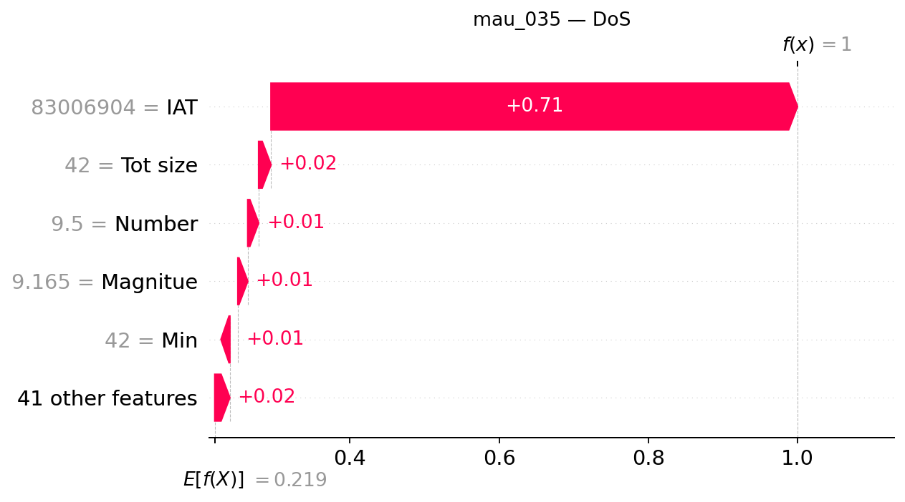

### Diễn giải Gemini

Mô hình dự đoán mẫu thuộc lớp DoS với xác suất rất cao, trong đó đặc trưng IAT đóng vai trò hỗ trợ mạnh nhất đẩy giá trị đầu ra tăng. Lớp đứng thứ hai là DDoS nhưng có khoảng cách xác suất rất lớn so với lớp dẫn đầu.

**So sánh hai lớp:** Cờ khoảng cách nhỏ đang tắt, cho thấy sự chênh lệch giữa hai lớp đứng đầu là lớn; tuy nhiên, điều này không được coi là bảo đảm tuyệt đối cho dự đoán.

**Tổng hợp SHAP:** Trong top năm đặc trưng, IAT đóng vai trò hỗ trợ mạnh nhất làm tăng đầu ra, trong khi không có đặc trưng nào trong nhóm này tạo ra tác động phản đối.

- **IAT**: Đây là yếu tố hỗ trợ nổi bật nhất trong top năm, đóng góp lớn vào giá trị đầu ra của lớp được dự đoán.
- **Tot size**: Tác động này cùng chiều nhưng nhỏ hơn yếu tố dẫn đầu, đóng vai trò hỗ trợ bổ sung cho mô hình.
- **Number**: Đặc trưng này thể hiện mức đóng góp dương ở mức độ thấp hơn so với đặc trưng đứng trước.
- **Magnitue**: Sự gia tăng từ đặc trưng này mang lại một phần hỗ trợ nhỏ cho lớp được giải thích.
- **Min**: Đây là yếu tố có tác động dương nhỏ nhất trong nhóm năm đặc trưng được phân tích.

### Gợi ý kiểm tra có điều kiện

- **Nhật ký kết nối**: Kiểm tra kết nối lặp đến dịch vụ đích và nguồn liên quan nếu có metadata. Mục đích: Đối chiếu xem có các lượt kết nối lặp lại phù hợp với dữ liệu ghi nhận hay không.
- **Nhật ký tài nguyên dịch vụ**: Tìm lỗi, gián đoạn hoặc thay đổi tài nguyên cùng thời điểm để xác minh thêm. Mục đích: Xác thực xem hệ thống có chịu ảnh hưởng hoặc biến động tài nguyên tương ứng hay không.

### Giới hạn do Gemini nêu

- Giải thích SHAP chỉ phản ánh đầu ra của mô hình đối với mẫu hiện tại và không chứng minh quan hệ nhân quả hay tấn công thực tế.
- Giá trị nền tham chiếu không đại diện cho xác suất riêng của thuật toán hay tỷ lệ phân bố lớp thực tế.
- Tổng giá trị SHAP của top năm chưa bao trùm toàn bộ các thành phần thay đổi đầu ra.

SHAP giải thích đầu ra model, chưa chứng minh hành vi tấn công hoặc quan hệ nhân quả. Đánh giá con người tạm hoãn.

---

## mau_036 — dòng CSV 35

**Trạng thái Gemini: accepted**

Đạt kiểm tra bằng chứng có cấu trúc và quy tắc văn bản; chưa đánh giá ngữ nghĩa thủ công.

### Dự đoán và số liệu do chương trình dựng

- Model: `XGB_d4_n200`; dự đoán: **DDoS**, xác suất **99.9981%**.
- Lớp đứng thứ hai: **DoS**, xác suất **0.0011%**.
- Chênh lệch hai lớp: **99.9971 điểm phần trăm**.
- Quy tắc khoảng cách nhỏ: không quá 5 điểm phần trăm, chỉ để trình bày.
- Xác suất nền SHAP: 62.506627%.
- Tổng SHAP: +37.491501 điểm phần trăm; ngoài top 5: +3.081259 điểm phần trăm.
- Hỗ trợ mạnh nhất trong top 5: **IAT**.
- Phản đối mạnh nhất trong top 5: **Không có tác động âm trong top 5**.

| Đặc trưng | Giá trị gốc | SHAP | Tác động (điểm %) |
|---|---:|---:|---:|
| IAT | 83123584 | +0.29828681 | +29.828681 |
| Magnitue | 10 | +0.01314981 | +1.314981 |
| Min | 50 | +0.01288954 | +1.288954 |
| Max | 50 | +0.01119317 | +1.119317 |
| rst_count | 0 | +0.00858308 | +0.858308 |

### Diễn giải Gemini

Mô hình dự đoán mẫu dữ liệu thuộc lớp DDoS với sự hỗ trợ mạnh mẽ từ đặc trưng IAT trong top 5. Lớp đứng thứ hai là DoS nhưng có khoảng cách xác suất rất lớn so với lớp dẫn đầu.

**So sánh hai lớp:** Cờ khoảng cách nhỏ đang tắt, cho thấy chênh lệch giữa lớp đứng đầu và lớp DoS đứng thứ hai là rất lớn. Tuy nhiên, sự chênh lệch này không bảo đảm dự đoán chắc chắn đúng nhãn thật.

**Tổng hợp SHAP:** Trong top 5 đặc trưng, IAT đóng vai trò hỗ trợ mạnh nhất đẩy đầu ra tăng lên, trong khi không ghi nhận yếu tố nào mang giá trị âm để phản đối trong nhóm này.

- **IAT**: Đây là yếu tố hỗ trợ nổi bật nhất trong top năm, góp phần đáng kể làm tăng giá trị đầu ra của lớp dự đoán.
- **Magnitue**: Tác động này cùng chiều nhưng nhỏ hơn yếu tố dẫn đầu, đóng vai trò hỗ trợ bổ sung cho mô hình.
- **Min**: Đặc trưng này mang lại mức đóng góp dương ở mức độ vừa phải trong nhóm.
- **Max**: Sự hiện diện của đặc trưng này tiếp tục củng cố hướng tác động tăng cho đầu ra lớp dự đoán.
- **rst_count**: Đây là yếu tố có tác động nhỏ hơn các đặc trưng còn lại trong top 5 nhưng vẫn mang chiều hướng tăng.

### Gợi ý kiểm tra có điều kiện

- **Nhật ký lưu lượng mạng**: Kiểm tra sự đồng thời của nhiều nguồn đến cùng dịch vụ nếu có địa chỉ và thời gian Mục đích: Đối chiếu sự biến động của lưu lượng để xem xét bối cảnh thực tế.
- **Nhật ký tài nguyên dịch vụ**: Đối chiếu lưu lượng với tình trạng tài nguyên và khả năng phục vụ, không tự đặt ngưỡng Mục đích: Xác thực khả năng chịu tải và phản ứng của hệ thống trước các dấu hiệu bất thường.

### Giới hạn do Gemini nêu

- Giá trị SHAP chỉ phản ánh mức độ đóng góp của đặc trưng vào đầu ra của mô hình đối với mẫu này chứ không chứng minh quan hệ nhân quả.
- Xác suất dự đoán từ mô hình chưa được hiệu chỉnh chính thức và không thể thay thế cho nhãn thực tế.

SHAP giải thích đầu ra model, chưa chứng minh hành vi tấn công hoặc quan hệ nhân quả. Đánh giá con người tạm hoãn.

---

## mau_037 — dòng CSV 36

**Trạng thái Gemini: accepted**

Đạt kiểm tra bằng chứng có cấu trúc và quy tắc văn bản; chưa đánh giá ngữ nghĩa thủ công.

### Dự đoán và số liệu do chương trình dựng

- Model: `XGB_d4_n200`; dự đoán: **DDoS**, xác suất **99.9981%**.
- Lớp đứng thứ hai: **DoS**, xác suất **0.0011%**.
- Chênh lệch hai lớp: **99.9971 điểm phần trăm**.
- Quy tắc khoảng cách nhỏ: không quá 5 điểm phần trăm, chỉ để trình bày.
- Xác suất nền SHAP: 62.506627%.
- Tổng SHAP: +37.491501 điểm phần trăm; ngoài top 5: +2.493733 điểm phần trăm.
- Hỗ trợ mạnh nhất trong top 5: **IAT**.
- Phản đối mạnh nhất trong top 5: **Không có tác động âm trong top 5**.

| Đặc trưng | Giá trị gốc | SHAP | Tác động (điểm %) |
|---|---:|---:|---:|
| IAT | 83128120 | +0.28778067 | +28.778067 |
| Protocol Type | 1 | +0.02825649 | +2.825649 |
| Tot size | 42 | +0.01165286 | +1.165286 |
| Number | 9.5 | +0.01137287 | +1.137287 |
| Magnitue | 9.1651516 | +0.01091479 | +1.091479 |

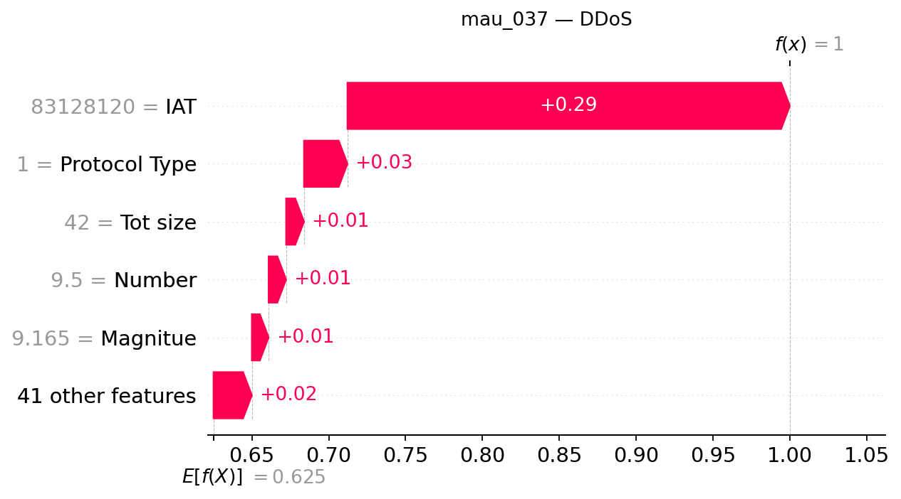

### Diễn giải Gemini

Mẫu được mô hình dự đoán là lớp DDoS với các yếu tố hỗ trợ chủ yếu từ đặc trưng IAT và Protocol Type. Sự chênh lệch giữa lớp đứng đầu và lớp đứng thứ hai là rất lớn.

**So sánh hai lớp:** Cờ khoảng cách nhỏ đang tắt, cho thấy sự chênh lệch lớn giữa hai đầu ra. Tuy nhiên, điều này không bảo đảm dự đoán là đúng hoàn toàn mà cần tiếp tục đối chiếu.

**Tổng hợp SHAP:** Trong năm đặc trưng hàng đầu, IAT đóng vai trò hỗ trợ mạnh nhất đẩy giá trị đầu ra lên, trong khi không ghi nhận tác động phản đối nào từ nhóm này.

- **IAT**: Đây là yếu tố hỗ trợ nổi bật nhất trong top năm, đóng góp tích cực lớn vào đầu ra của lớp.
- **Protocol Type**: Tác động này cùng chiều nhưng nhỏ hơn yếu tố dẫn đầu, đóng vai trò hỗ trợ bổ sung.
- **Tot size**: Ghi nhận mức tác động dương nhỏ hơn, tiếp tục củng cố kết quả dự đoán của mô hình.
- **Number**: Đặc trưng này mang lại một lực đẩy dương nhỏ trong nhóm năm yếu tố quan trọng.
- **Magnitue**: Đóng góp tác động dương thấp nhất trong top năm, kết hợp cùng các yếu tố khác để tạo ra kết quả.

### Gợi ý kiểm tra có điều kiện

- **Nhật ký lưu lượng mạng**: Kiểm tra sự đồng thời của nhiều nguồn đến cùng dịch vụ nếu hệ thống có ghi nhận địa chỉ và thời gian. Mục đích: Đối chiếu hành vi lưu lượng thực tế để hỗ trợ việc phân tích.
- **Nhật ký tài nguyên dịch vụ**: Đối chiếu lưu lượng với tình trạng tài nguyên và khả năng phục vụ. Mục đích: Xác minh khả năng đáp ứng hệ thống và kiểm tra ngữ cảnh vận hành.

### Giới hạn do Gemini nêu

- Giải thích này phản ánh đầu ra của mô hình và không chứng minh quan hệ nhân quả hay sự tồn tại của cuộc tấn công thực tế.
- Giá trị SHAP chỉ thể hiện sự đóng góp tương đối trong top năm đặc trưng, không đại diện cho toàn bộ các yếu tố của hệ thống.
- Xác suất của mô hình chưa được xác minh là đã hiệu chỉnh và không thể coi là độ chắc chắn tuyệt đối.

SHAP giải thích đầu ra model, chưa chứng minh hành vi tấn công hoặc quan hệ nhân quả. Đánh giá con người tạm hoãn.

---

## mau_038 — dòng CSV 37

**Trạng thái Gemini: accepted**

Đạt kiểm tra bằng chứng có cấu trúc và quy tắc văn bản; chưa đánh giá ngữ nghĩa thủ công.

### Dự đoán và số liệu do chương trình dựng

- Model: `XGB_d4_n200`; dự đoán: **Spoofing**, xác suất **99.7711%**.
- Lớp đứng thứ hai: **Recon**, xác suất **0.1396%**.
- Chênh lệch hai lớp: **99.6315 điểm phần trăm**.
- Quy tắc khoảng cách nhỏ: không quá 5 điểm phần trăm, chỉ để trình bày.
- Xác suất nền SHAP: 0.198449%.
- Tổng SHAP: +99.572645 điểm phần trăm; ngoài top 5: +11.780666 điểm phần trăm.
- Hỗ trợ mạnh nhất trong top 5: **IAT**.
- Phản đối mạnh nhất trong top 5: **Không có tác động âm trong top 5**.

| Đặc trưng | Giá trị gốc | SHAP | Tác động (điểm %) |
|---|---:|---:|---:|
| IAT | 1.6685299e+08 | +0.56438600 | +56.438600 |
| Number | 13.5 | +0.13069617 | +13.069617 |
| Protocol Type | 8.8000002 | +0.07240793 | +7.240793 |
| urg_count | 42.5 | +0.06075094 | +6.075094 |
| Header_Length | 8377.2998 | +0.04967875 | +4.967875 |

### Diễn giải Gemini

Mẫu được dự đoán là lớp Spoofing với độ tin cậy vượt trội, trong khi lớp đứng thứ hai là Recon chiếm tỷ lệ rất thấp. Các đặc trưng trong top năm đều đóng vai trò thúc đẩy đầu ra của mô hình, dẫn dắt bởi IAT với mức đóng góp lớn nhất.

**So sánh hai lớp:** Cờ khoảng cách nhỏ đang tắt, cho thấy sự chênh lệch lớn giữa hai lớp đứng đầu; tuy nhiên, điều này không được xem là bảo đảm dự đoán đúng mà chỉ phản ánh trạng thái hiện tại của mô hình.

**Tổng hợp SHAP:** Trong top năm đặc trưng, tất cả đều mang giá trị dương giúp tăng đầu ra của lớp dự đoán so với nền tham chiếu, trong đó không ghi nhận yếu tố nào đóng vai trò phản đối.

- **IAT**: Đây là yếu tố hỗ trợ nổi bật nhất trong top năm, góp phần đáng kể vào kết quả phân loại của mô hình.
- **Number**: Tác động này cùng chiều nhưng có mức độ đóng góp nhỏ hơn yếu tố dẫn đầu.
- **Protocol Type**: Đặc trưng này cung cấp thêm một bước hỗ trợ bổ sung cho xu hướng dự đoán hiện tại.
- **urg_count**: Sự hiện diện của đặc trưng này tiếp tục củng cố đầu ra với một khoản tăng dương nhẹ.
- **Header_Length**: Đóng góp nhỏ hơn từ đặc trưng này hoàn thiện nhóm các yếu tố tác động cùng chiều trong top năm.

### Gợi ý kiểm tra có điều kiện

- **Nhật ký ánh xạ địa chỉ**: Nếu hệ thống có lưu trữ thông tin ánh xạ địa chỉ hoặc định danh thiết bị, cần tìm kiếm các thay đổi bất thường hay mâu thuẫn. Mục đích: Đối chiếu với dữ liệu ghi nhận nhằm xác thực tính nhất quán của định danh nguồn.
- **Nhật ký thiết bị mạng**: Nếu hệ thống ghi lại nhật ký thiết bị mạng, cần tìm đối chiếu định danh nguồn với cấu hình, các thay đổi được phép và cảnh báo liên quan. Mục đích: Xác minh xem có sự kiện cấu hình hoặc cảnh báo nào đi kèm với lưu lượng đang xét hay không.

### Giới hạn do Gemini nêu

- Giải thích này phản ánh đầu ra của mô hình ở mức độ dự đoán, không chứng minh sự tồn tại của một cuộc tấn công thực tế hay quan hệ nhân quả.
- Các giá trị SHAP chỉ thể hiện sự đóng góp so với nền tham chiếu trong top năm đặc trưng và chưa bao hàm toàn bộ phần dư ngoài nhóm.
- Xác suất của mô hình chưa được kiểm chứng về độ hiệu chỉnh và không thể dùng làm thước đo an toàn tuyệt đối.

SHAP giải thích đầu ra model, chưa chứng minh hành vi tấn công hoặc quan hệ nhân quả. Đánh giá con người tạm hoãn.

---

## mau_039 — dòng CSV 38

**Trạng thái Gemini: accepted**

Đạt kiểm tra bằng chứng có cấu trúc và quy tắc văn bản; chưa đánh giá ngữ nghĩa thủ công.

### Dự đoán và số liệu do chương trình dựng

- Model: `XGB_d4_n200`; dự đoán: **DoS**, xác suất **99.9953%**.
- Lớp đứng thứ hai: **DDoS**, xác suất **0.0034%**.
- Chênh lệch hai lớp: **99.9918 điểm phần trăm**.
- Quy tắc khoảng cách nhỏ: không quá 5 điểm phần trăm, chỉ để trình bày.
- Xác suất nền SHAP: 21.878189%.
- Tổng SHAP: +78.117067 điểm phần trăm; ngoài top 5: +1.329150 điểm phần trăm.
- Hỗ trợ mạnh nhất trong top 5: **IAT**.
- Phản đối mạnh nhất trong top 5: **Không có tác động âm trong top 5**.

| Đặc trưng | Giá trị gốc | SHAP | Tác động (điểm %) |
|---|---:|---:|---:|
| IAT | 83015488 | +0.73381875 | +73.381875 |
| Number | 9.5 | +0.01071900 | +1.071900 |
| Variance | 0.13 | +0.00881427 | +0.881427 |
| Weight | 141.55 | +0.00772426 | +0.772426 |
| Magnitue | 10.085241 | +0.00680288 | +0.680288 |

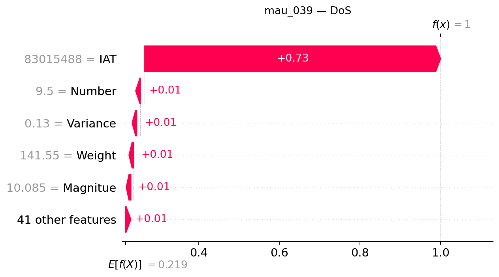

### Diễn giải Gemini

Mẫu dữ liệu được mô hình dự đoán thuộc lớp DoS với mức độ tập trung xác suất rất cao, trong khi lớp DDoS đứng thứ hai có khoảng cách chênh lệch cực lớn. Yếu tố IAT đóng vai trò hỗ trợ mạnh mẽ nhất, đẩy giá trị đầu ra của mô hình tăng cao so với nền tham chiếu.

**So sánh hai lớp:** Cờ khoảng cách nhỏ đang tắt do chênh lệch giữa hai lớp đứng đầu là rất lớn. Tuy nhiên, việc không có khoảng cách nhỏ không bảo đảm dự đoán chính xác tuyệt đối vì đây chỉ là kết quả phân tích đầu ra của mô hình.

**Tổng hợp SHAP:** Trong nhóm năm đặc trưng hàng đầu, đặc trưng IAT tạo ra tác động dương mạnh nhất giúp tăng đầu ra của lớp dự đoán, trong khi không ghi nhận tác động âm nào trong top năm này.

- **IAT**: Đây là yếu tố hỗ trợ nổi bật nhất trong top năm, đóng góp lượng lớn điểm phần trăm làm tăng đầu ra cho lớp dự đoán.
- **Number**: Tác động này cùng chiều với đặc trưng dẫn đầu nhưng có quy mô nhỏ hơn nhiều trong nhóm.
- **Variance**: Đóng góp dương mang tính hỗ trợ bổ sung cho mô hình khi xem xét các đặc trưng tiếp theo.
- **Weight**: Ghi nhận mức tác động tăng nhẹ, tiếp tục góp phần đẩy giá trị đầu ra lệch khỏi nền tham chiếu.
- **Magnitue**: Mang lại tác động dương nhỏ nhất trong top năm đặc trưng được liệt kê.

### Gợi ý kiểm tra có điều kiện

- **Nhật ký kết nối**: Kiểm tra kết nối lặp đến dịch vụ đích và nguồn liên quan nếu có metadata. Mục đích: Đối chiếu tần suất và đặc điểm kết nối thực tế phát sinh trong hệ thống.
- **Nhật ký tài nguyên dịch vụ**: Tìm lỗi, gián đoạn hoặc thay đổi tài nguyên cùng thời điểm để xác minh thêm. Mục đích: Xác thực xem có dấu hiệu ảnh hưởng tài nguyên hệ thống tương ứng hay không.

### Giới hạn do Gemini nêu

- Giá trị SHAP chỉ giải thích cách mô hình đưa ra quyết định dựa trên nền tham chiếu chứ không chứng minh quan hệ nhân quả hay sự tồn tại của cuộc tấn công thực tế.
- Tổng giá trị SHAP chỉ giới hạn trong nhóm năm đặc trưng hàng đầu và phần còn lại ngoài top năm chưa phản ánh toàn bộ không gian dữ liệu.
- Xác suất của mô hình chưa được kiểm chứng hay hiệu chỉnh độ tin cậy thực tế.

SHAP giải thích đầu ra model, chưa chứng minh hành vi tấn công hoặc quan hệ nhân quả. Đánh giá con người tạm hoãn.

---

## mau_040 — dòng CSV 39

**Trạng thái Gemini: accepted**

Đạt kiểm tra bằng chứng có cấu trúc và quy tắc văn bản; chưa đánh giá ngữ nghĩa thủ công.

### Dự đoán và số liệu do chương trình dựng

- Model: `XGB_d4_n200`; dự đoán: **DDoS**, xác suất **99.9981%**.
- Lớp đứng thứ hai: **DoS**, xác suất **0.0011%**.
- Chênh lệch hai lớp: **99.9971 điểm phần trăm**.
- Quy tắc khoảng cách nhỏ: không quá 5 điểm phần trăm, chỉ để trình bày.
- Xác suất nền SHAP: 62.506627%.
- Tổng SHAP: +37.491501 điểm phần trăm; ngoài top 5: +3.516746 điểm phần trăm.
- Hỗ trợ mạnh nhất trong top 5: **IAT**.
- Phản đối mạnh nhất trong top 5: **Không có tác động âm trong top 5**.

| Đặc trưng | Giá trị gốc | SHAP | Tác động (điểm %) |
|---|---:|---:|---:|
| IAT | 83128632 | +0.26946107 | +26.946107 |
| Protocol Type | 1 | +0.03109434 | +3.109434 |
| Magnitue | 9.1651516 | +0.02635457 | +2.635457 |
| Tot size | 42 | +0.00654827 | +0.654827 |
| Min | 42 | +0.00628931 | +0.628931 |

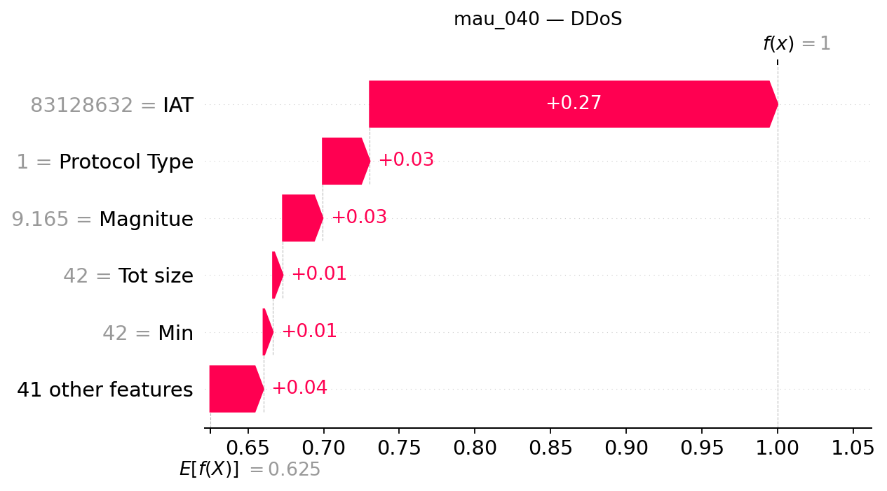

### Diễn giải Gemini

Mô hình dự đoán mẫu dữ liệu thuộc lớp DDoS với mức độ tin cậy rất cao nhờ sự hỗ trợ từ các đặc trưng nổi bật trong top năm. Lớp đứng thứ hai là DoS nhưng có khoảng cách rất lớn so với lớp dẫn đầu, cho thấy mô hình phân định rõ ràng giữa hai lớp này.

**So sánh hai lớp:** Cờ khoảng cách nhỏ đang tắt, cho thấy sự chênh lệch lớn giữa lớp đứng đầu và lớp đứng thứ hai. Tuy nhiên, việc chênh lệch lớn không được coi là bảo đảm dự đoán chính xác vì đây chỉ là giá trị đầu ra của mô hình.

**Tổng hợp SHAP:** Đặc trưng IAT đóng vai trò hỗ trợ mạnh nhất trong nhóm top năm làm tăng giá trị đầu ra của lớp được dự đoán, trong khi không ghi nhận tác động phản đối nào trong nhóm này.

- **IAT**: Đây là yếu tố hỗ trợ nổi bật nhất trong top năm, góp phần đáng kể vào việc đẩy giá trị đầu ra của lớp dự đoán.
- **Protocol Type**: Tác động này cùng chiều nhưng có độ lớn thấp hơn đáng kể so với yếu tố dẫn đầu trong nhóm.
- **Magnitue**: Đặc trưng này mang lại một mức đóng góp dương bổ sung giúp củng cố thêm kết quả phân loại.
- **Tot size**: Đóng góp này tiếp tục đẩy giá trị đầu ra tăng nhẹ theo cùng hướng với các đặc trưng trước đó.
- **Min**: Đây là thành phần có tác động dương nhỏ nhất trong năm đặc trưng đang được xem xét.

### Gợi ý kiểm tra có điều kiện

- **Nhật ký lưu lượng mạng**: Kiểm tra sự đồng thời của nhiều nguồn đến cùng dịch vụ nếu có địa chỉ và thời gian. Mục đích: Đối chiếu sự xuất hiện đồng thời của các yêu cầu từ nhiều nguồn để làm rõ bối cảnh lưu lượng mạng.
- **Nhật ký tài nguyên dịch vụ**: Đối chiếu lưu lượng với tình trạng tài nguyên và khả năng phục vụ, không tự đặt ngưỡng. Mục đích: Xem xét ảnh hưởng của lưu lượng đến khả năng đáp ứng của hệ thống phục vụ.

### Giới hạn do Gemini nêu

- Kết quả SHAP chỉ phản ánh cách mô hình đưa ra quyết định dựa trên giá trị tham chiếu, không chứng minh mối quan hệ nhân quả hay cuộc tấn công thực tế.
- Xác suất dự đoán của mô hình chưa được hiệu chỉnh chính thức và không bảo đảm tuyệt đối về độ chính xác.
- Phạm vi giải thích chỉ giới hạn ở nhóm đặc trưng đang xét và chưa bao gồm toàn bộ sự thay đổi của toàn bộ tập dữ liệu.

SHAP giải thích đầu ra model, chưa chứng minh hành vi tấn công hoặc quan hệ nhân quả. Đánh giá con người tạm hoãn.

---

## mau_041 — dòng CSV 40

**Trạng thái Gemini: accepted**

Đạt kiểm tra bằng chứng có cấu trúc và quy tắc văn bản; chưa đánh giá ngữ nghĩa thủ công.

### Dự đoán và số liệu do chương trình dựng

- Model: `XGB_d4_n200`; dự đoán: **DDoS**, xác suất **99.9981%**.
- Lớp đứng thứ hai: **DoS**, xác suất **0.0011%**.
- Chênh lệch hai lớp: **99.9971 điểm phần trăm**.
- Quy tắc khoảng cách nhỏ: không quá 5 điểm phần trăm, chỉ để trình bày.
- Xác suất nền SHAP: 62.506627%.
- Tổng SHAP: +37.491501 điểm phần trăm; ngoài top 5: +3.404568 điểm phần trăm.
- Hỗ trợ mạnh nhất trong top 5: **IAT**.
- Phản đối mạnh nhất trong top 5: **Không có tác động âm trong top 5**.

| Đặc trưng | Giá trị gốc | SHAP | Tác động (điểm %) |
|---|---:|---:|---:|
| IAT | 83089968 | +0.27383188 | +27.383188 |
| Protocol Type | 6 | +0.02199357 | +2.199357 |
| Magnitue | 10.392304 | +0.02098387 | +2.098387 |
| Tot size | 54 | +0.01489447 | +1.489447 |
| Min | 54 | +0.00916554 | +0.916554 |

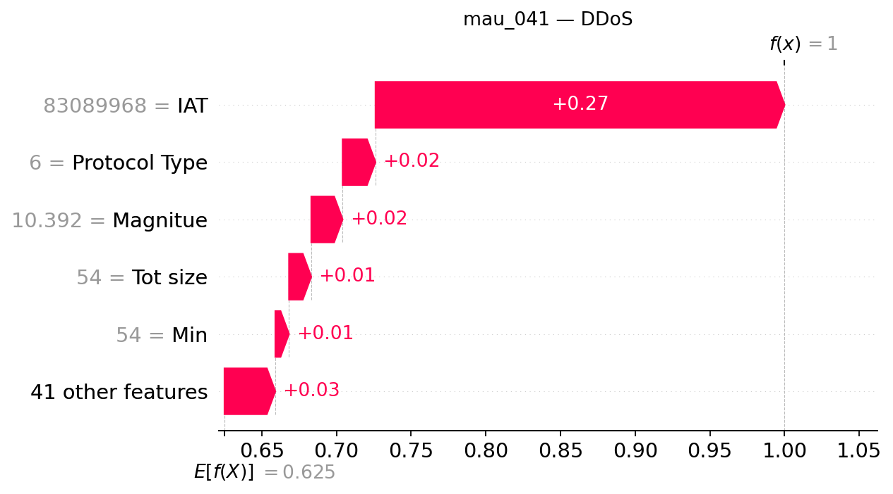

### Diễn giải Gemini

Mô hình dự đoán mẫu này thuộc lớp DDoS với mức xác suất rất cao, trong khi lớp đứng thứ hai là DoS có khoảng cách chênh lệch cực lớn. Đặc trưng IAT đóng vai trò hỗ trợ mạnh mẽ nhất, đẩy giá trị đầu ra tăng lên đáng kể so với nền tham chiếu.

**So sánh hai lớp:** Lớp đứng thứ hai là DoS có xác suất vô cùng nhỏ so với lớp DDoS. Cờ khoảng cách nhỏ đang tắt, cho thấy sự chênh lệch lớn giữa hai đầu ra nhưng điều này không được coi là bảo đảm tuyệt đối về nhãn thật.

**Tổng hợp SHAP:** Trong nhóm năm đặc trưng hàng đầu, tất cả đều tác động theo chiều hướng tăng và không có yếu tố nào mang giá trị âm trong phạm vi này.

- **IAT**: Đây là yếu tố hỗ trợ nổi bật nhất trong top năm, đóng góp mức tăng lớn nhất vào đầu ra của lớp.
- **Protocol Type**: Tác động này cùng chiều nhưng nhỏ hơn yếu tố dẫn đầu, đóng vai trò hỗ trợ bổ sung cho mô hình.
- **Magnitue**: Đặc trưng này tiếp tục thúc đẩy kết quả dự đoán tăng lên với một mức đóng góp dương đáng chú ý.
- **Tot size**: Sự hiện diện của đặc trưng này tạo thêm một khoảng tăng nhỏ giúp củng cố đầu ra của lớp.
- **Min**: Đây là yếu tố có tác động nhỏ hơn trong nhóm năm đặc trưng, góp phần đẩy giá trị đầu ra dịch chuyển tăng.

### Gợi ý kiểm tra có điều kiện

- **Nhật ký lưu lượng mạng**: Kiểm tra sự đồng thời của nhiều nguồn đến cùng dịch vụ nếu có địa chỉ và thời gian. Mục đích: Đối chiếu xem lưu lượng thực tế có dấu hiệu phân tán từ nhiều nguồn hướng về mục tiêu hay không.
- **Nhật ký tài nguyên dịch vụ**: Đối chiếu lưu lượng với tình trạng tài nguyên và khả năng phục vụ, không tự đặt ngưỡng. Mục đích: Đánh giá mức độ ảnh hưởng của tải mạng đối với hệ thống dịch vụ dựa trên dữ liệu ghi nhận.

### Giới hạn do Gemini nêu

- Kết quả SHAP chỉ giải thích đầu ra của mô hình phân loại và không chứng minh được quan hệ nhân quả hay cuộc tấn công thực tế.
- Giá trị xác suất của mô hình chưa được kiểm chứng là đã hiệu chỉnh hoàn toàn.
- Phạm vi phân tích chỉ giới hạn trong top năm đặc trưng được cung cấp và chưa bao gồm toàn bộ mọi thành phần ngoài nhóm.

SHAP giải thích đầu ra model, chưa chứng minh hành vi tấn công hoặc quan hệ nhân quả. Đánh giá con người tạm hoãn.

---

## mau_042 — dòng CSV 41

**Trạng thái Gemini: accepted**

Đạt kiểm tra bằng chứng có cấu trúc và quy tắc văn bản; chưa đánh giá ngữ nghĩa thủ công.

### Dự đoán và số liệu do chương trình dựng

- Model: `XGB_d4_n200`; dự đoán: **DDoS**, xác suất **99.9981%**.
- Lớp đứng thứ hai: **DoS**, xác suất **0.0011%**.
- Chênh lệch hai lớp: **99.9971 điểm phần trăm**.
- Quy tắc khoảng cách nhỏ: không quá 5 điểm phần trăm, chỉ để trình bày.
- Xác suất nền SHAP: 62.506627%.
- Tổng SHAP: +37.491501 điểm phần trăm; ngoài top 5: +3.392034 điểm phần trăm.
- Hỗ trợ mạnh nhất trong top 5: **IAT**.
- Phản đối mạnh nhất trong top 5: **Không có tác động âm trong top 5**.

| Đặc trưng | Giá trị gốc | SHAP | Tác động (điểm %) |
|---|---:|---:|---:|
| IAT | 83149632 | +0.27610052 | +27.610052 |
| Protocol Type | 1 | +0.02689099 | +2.689099 |
| Magnitue | 9.1651516 | +0.02457124 | +2.457124 |
| Max | 42 | +0.00729816 | +0.729816 |
| Min | 42 | +0.00613375 | +0.613375 |

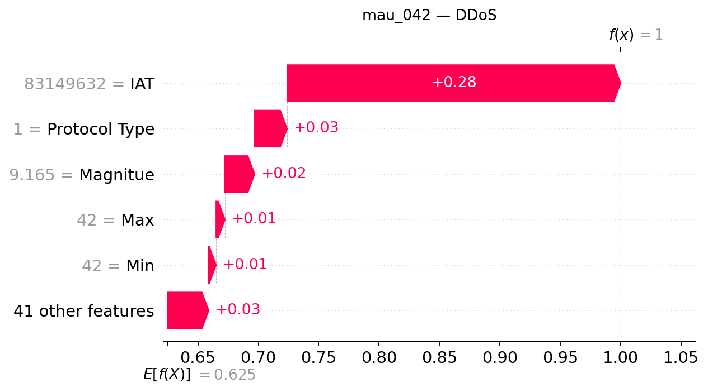

### Diễn giải Gemini

Mẫu dữ liệu được mô hình dự đoán thuộc lớp DDoS với xác suất áp đảo so với các lớp còn lại. Yếu tố IAT đóng vai trò hỗ trợ mạnh nhất, trong khi không ghi nhận yếu tố phản đối nào trong nhóm năm đặc trưng hàng đầu. Khoảng cách với lớp đứng thứ hai DoS rất lớn, thể hiện sự phân tách rõ rệt trong kết quả phân loại của mô hình.

**So sánh hai lớp:** Cờ khoảng cách nhỏ đang tắt, cho thấy không có sự cạnh tranh sát sao giữa lớp đứng đầu và lớp đứng thứ hai là DoS. Tuy nhiên, sự chênh lệch lớn này không phải là bảo đảm tuyệt đối rằng dự đoán là chính xác.

**Tổng hợp SHAP:** Đặc trưng IAT là yếu tố hỗ trợ mạnh nhất đẩy đầu ra về phía lớp DDoS, và không có yếu tố nào trong top năm mang giá trị âm để tạo ra tác động phản đối.

- **IAT**: Đây là yếu tố hỗ trợ nổi bật nhất trong top năm, đóng góp lớn vào giá trị đầu ra của lớp được dự đoán.
- **Protocol Type**: Tác động này cùng chiều nhưng có mức độ đóng góp nhỏ hơn đáng kể so với yếu tố dẫn đầu.
- **Magnitue**: Đặc trưng này tiếp tục bổ trợ cho xu hướng tăng điểm đầu ra với một mức đóng góp dương ở nhóm giữa.
- **Max**: Đóng góp này duy trì chiều hướng hỗ trợ nhưng có giá trị tác động nhỏ hơn các đặc trưng trước đó.
- **Min**: Đây là thành phần có tác động dương nhỏ nhất trong nhóm năm đặc trưng được phân tích.

### Gợi ý kiểm tra có điều kiện

- **Nhật ký lưu lượng mạng**: Kiểm tra sự đồng thời của nhiều nguồn đến cùng dịch vụ nếu có địa chỉ và thời gian. Mục đích: Đối chiếu xem lưu lượng có biểu hiện tập trung từ nhiều nguồn hay không nếu hệ thống có ghi nhận log này.
- **Nhật ký tài nguyên dịch vụ**: Đối chiếu lưu lượng với tình trạng tài nguyên và khả năng phục vụ, không tự đặt ngưỡng. Mục đích: Kiểm tra trạng thái hệ thống để tham khảo thêm bối cảnh vận hành nếu hạ tầng cung cấp thông tin này.

### Giới hạn do Gemini nêu

- Giá trị SHAP chỉ phản ánh mức độ đóng góp của đặc trưng vào đầu ra của mô hình đối với mẫu này, không chứng minh quan hệ nhân quả hay mô tả một cuộc tấn công thực tế.
- Xác suất dự đoán chưa qua kiểm định hiệu chỉnh và không đại diện cho độ chính xác tuyệt đối.
- Phạm vi giải thích chỉ giới hạn trong top năm đặc trưng được chọn và phần còn lại ngoài nhóm, không đại diện cho toàn bộ cấu trúc dữ liệu.

SHAP giải thích đầu ra model, chưa chứng minh hành vi tấn công hoặc quan hệ nhân quả. Đánh giá con người tạm hoãn.

---

## mau_043 — dòng CSV 42

**Trạng thái Gemini: accepted**

Đạt kiểm tra bằng chứng có cấu trúc và quy tắc văn bản; chưa đánh giá ngữ nghĩa thủ công.

### Dự đoán và số liệu do chương trình dựng

- Model: `XGB_d4_n200`; dự đoán: **DoS**, xác suất **99.9953%**.
- Lớp đứng thứ hai: **DDoS**, xác suất **0.0034%**.
- Chênh lệch hai lớp: **99.9918 điểm phần trăm**.
- Quy tắc khoảng cách nhỏ: không quá 5 điểm phần trăm, chỉ để trình bày.
- Xác suất nền SHAP: 21.878189%.
- Tổng SHAP: +78.117067 điểm phần trăm; ngoài top 5: +1.746004 điểm phần trăm.
- Hỗ trợ mạnh nhất trong top 5: **IAT**.
- Phản đối mạnh nhất trong top 5: **Không có tác động âm trong top 5**.

| Đặc trưng | Giá trị gốc | SHAP | Tác động (điểm %) |
|---|---:|---:|---:|
| IAT | 82946384 | +0.72220267 | +72.220267 |
| Number | 9.5 | +0.01363787 | +1.363787 |
| Tot size | 54.119999 | +0.01145372 | +1.145372 |
| Protocol Type | 6 | +0.00851704 | +0.851704 |
| Weight | 141.55 | +0.00789933 | +0.789933 |

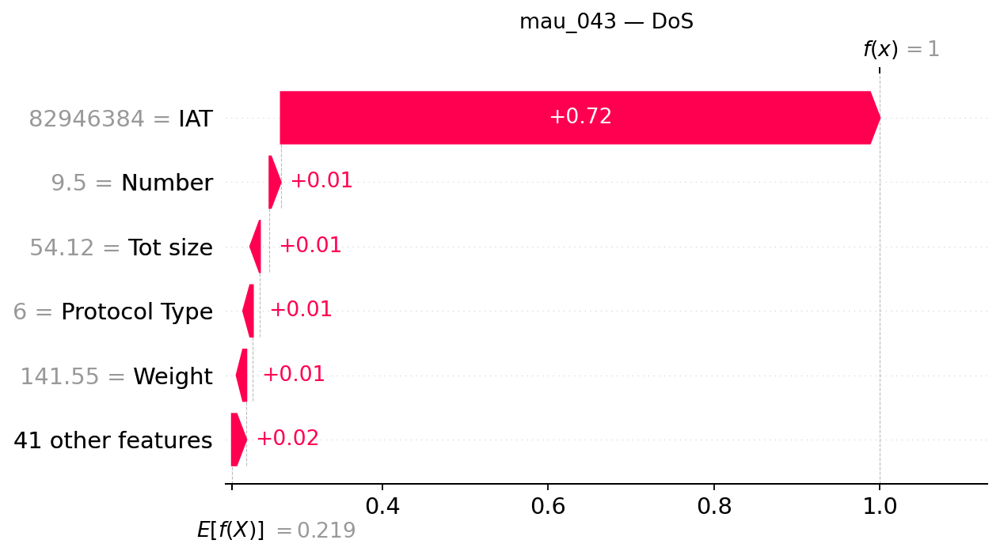

### Diễn giải Gemini

Mẫu dữ liệu được mô hình dự đoán thuộc lớp DoS với sự hỗ trợ mạnh mẽ từ đặc trưng IAT trong nhóm top năm. Khoảng cách chênh lệch lớn giữa lớp đứng đầu và lớp đứng thứ hai cho thấy sự phân tách rõ rệt trong kết quả phân loại hiện tại.

**So sánh hai lớp:** Cờ khoảng cách nhỏ đang tắt, cho thấy sự chênh lệch lớn giữa hai đầu ra. Tuy nhiên, việc khoảng cách lớn không được coi là bảo đảm tuyệt đối rằng dự đoán là chính xác.

**Tổng hợp SHAP:** Trong nhóm top năm đặc trưng, IAT đóng vai trò hỗ trợ mạnh mẽ nhất cho lớp được dự đoán, trong khi không có yếu tố nào trong nhóm này tạo ra tác động phản đối.

- **IAT**: Đây là yếu tố hỗ trợ nổi bật nhất trong top năm, góp phần đáng kể đẩy giá trị đầu ra của lớp được dự đoán.
- **Number**: Tác động này mang chiều hướng hỗ trợ bổ sung cho lớp dự đoán nhưng ở mức độ nhỏ hơn nhiều so với yếu tố dẫn đầu.
- **Tot size**: Đóng góp tiếp theo cùng chiều gia tăng đầu ra, thể hiện vai trò hỗ trợ phụ trợ trong tập hợp đặc trưng.
- **Protocol Type**: Đặc trưng này duy trì xu hướng tác động tăng, bổ sung thêm một phần nhỏ vào tổng điểm của lớp dự đoán.
- **Weight**: Mang lại tác động dương nhỏ nhất trong nhóm top năm, góp phần hoàn thiện bức tranh giải thích của mô hình.

### Gợi ý kiểm tra có điều kiện

- **Nhật ký kết nối**: Kiểm tra kết nối lặp đến dịch vụ đích và nguồn liên quan nếu có metadata. Mục đích: Đối chiếu hành vi kết nối thực tế trong hệ thống với kết quả phân loại của mô hình.
- **Nhật ký tài nguyên dịch vụ**: Tìm lỗi, gián đoạn hoặc thay đổi tài nguyên cùng thời điểm để xác minh thêm. Mục đích: Xác thực xem có dấu hiệu bất thường về tài nguyên tương ứng với dự đoán hiện tại hay không.

### Giới hạn do Gemini nêu

- Giải thích này chỉ phản ánh đầu ra của mô hình dựa trên tập đặc trưng và không chứng minh quan hệ nhân quả hay cuộc tấn công thực tế.
- Các giá trị SHAP chỉ thuộc về lớp được dự đoán và không giải thích tại sao các lớp khác nhận được điểm thấp hơn.
- Xác suất của mô hình chưa được kiểm chứng hiệu chuẩn và tập top năm chưa bao gồm toàn bộ mức thay đổi.

SHAP giải thích đầu ra model, chưa chứng minh hành vi tấn công hoặc quan hệ nhân quả. Đánh giá con người tạm hoãn.

---

## mau_044 — dòng CSV 43

**Trạng thái Gemini: accepted**

Đạt kiểm tra bằng chứng có cấu trúc và quy tắc văn bản; chưa đánh giá ngữ nghĩa thủ công.

### Dự đoán và số liệu do chương trình dựng

- Model: `XGB_d4_n200`; dự đoán: **DoS**, xác suất **99.9953%**.
- Lớp đứng thứ hai: **DDoS**, xác suất **0.0034%**.
- Chênh lệch hai lớp: **99.9918 điểm phần trăm**.
- Quy tắc khoảng cách nhỏ: không quá 5 điểm phần trăm, chỉ để trình bày.
- Xác suất nền SHAP: 21.878189%.
- Tổng SHAP: +78.117067 điểm phần trăm; ngoài top 5: +1.566404 điểm phần trăm.
- Hỗ trợ mạnh nhất trong top 5: **IAT**.
- Phản đối mạnh nhất trong top 5: **Không có tác động âm trong top 5**.

| Đặc trưng | Giá trị gốc | SHAP | Tác động (điểm %) |
|---|---:|---:|---:|
| IAT | 83011848 | +0.72878078 | +72.878078 |
| Magnitue | 10 | +0.01423209 | +1.423209 |
| Number | 9.5 | +0.01121373 | +1.121373 |
| Max | 50 | +0.00571902 | +0.571902 |
| Tot sum | 525 | +0.00556102 | +0.556102 |

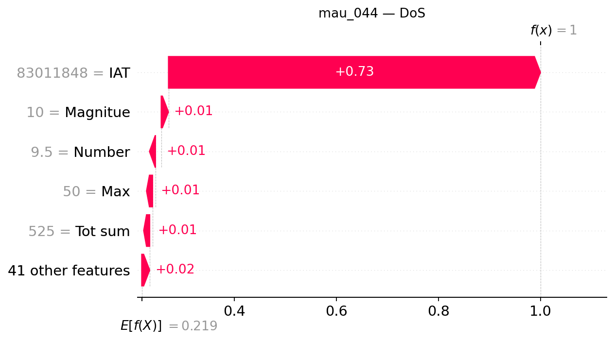

### Diễn giải Gemini

Mẫu được dự đoán là lớp DoS với mức độ ưu tiên vượt trội so với các lớp còn lại. Đặc trưng IAT đóng vai trò hỗ trợ mạnh nhất, trong khi không có yếu tố nào trong top năm phản đối kết quả này. Khoảng cách với lớp đứng thứ hai là rất lớn.

**So sánh hai lớp:** Cờ khoảng cách nhỏ tắt, thể hiện khoảng cách lớn giữa hai đầu ra. Tuy nhiên, điều này không bảo đảm dự đoán hoàn toàn chính xác do thiếu nhãn thực tế.

**Tổng hợp SHAP:** IAT là yếu tố hỗ trợ mạnh nhất trong nhóm, đồng thời không ghi nhận yếu tố phản đối nào trong top năm đặc trưng.

- **IAT**: Đây là yếu tố hỗ trợ nổi bật nhất trong top năm, góp phần đáng kể vào đầu ra của mô hình.
- **Magnitue**: Tác động này cùng chiều nhưng có độ lớn nhỏ hơn nhiều so với yếu tố dẫn đầu.
- **Number**: Đóng góp bổ sung tiếp theo theo chiều dương cho lớp được dự đoán.
- **Max**: Mang lại một mức hỗ trợ dương nhỏ hơn trong nhóm đặc trưng đang xét.
- **Tot sum**: Tác động dương cuối cùng trong top năm với mức đóng góp thấp nhất.

### Gợi ý kiểm tra có điều kiện

- **Nhật ký kết nối**: Kiểm tra kết nối lặp đến dịch vụ đích và nguồn liên quan nếu có metadata. Mục đích: Đối chiếu sự xuất hiện của các kết nối lặp trong hệ thống.
- **Nhật ký tài nguyên dịch vụ**: Tìm lỗi, gián đoạn hoặc thay đổi tài nguyên cùng thời điểm để xác minh thêm. Mục đích: Xác minh các dấu hiệu bất thường về tài nguyên nếu có log.

### Giới hạn do Gemini nêu

- Kết quả giải thích chỉ phản ánh đầu ra của mô hình đối với mẫu dữ liệu hiện tại, không chứng minh quan hệ nhân quả.
- Giá trị SHAP chỉ đại diện cho một phần thay đổi và chưa bao gồm toàn bộ không gian đặc trưng.
- Xác suất dự đoán chưa qua bước hiệu chỉnh xác suất thực tế.

SHAP giải thích đầu ra model, chưa chứng minh hành vi tấn công hoặc quan hệ nhân quả. Đánh giá con người tạm hoãn.

---

## mau_045 — dòng CSV 44

**Trạng thái Gemini: accepted**

Đạt kiểm tra bằng chứng có cấu trúc và quy tắc văn bản; chưa đánh giá ngữ nghĩa thủ công.

### Dự đoán và số liệu do chương trình dựng

- Model: `XGB_d4_n200`; dự đoán: **DDoS**, xác suất **99.9981%**.
- Lớp đứng thứ hai: **DoS**, xác suất **0.0011%**.
- Chênh lệch hai lớp: **99.9971 điểm phần trăm**.
- Quy tắc khoảng cách nhỏ: không quá 5 điểm phần trăm, chỉ để trình bày.
- Xác suất nền SHAP: 62.506627%.
- Tổng SHAP: +37.491501 điểm phần trăm; ngoài top 5: +3.000884 điểm phần trăm.
- Hỗ trợ mạnh nhất trong top 5: **IAT**.
- Phản đối mạnh nhất trong top 5: **Không có tác động âm trong top 5**.

| Đặc trưng | Giá trị gốc | SHAP | Tác động (điểm %) |
|---|---:|---:|---:|
| IAT | 83124696 | +0.29193434 | +29.193434 |
| Magnitue | 9.1651516 | +0.02246774 | +2.246774 |
| Protocol Type | 1 | +0.01263095 | +1.263095 |
| Tot size | 42 | +0.00946906 | +0.946906 |
| Min | 42 | +0.00840407 | +0.840407 |

### Diễn giải Gemini

Mô hình dự đoán mẫu này thuộc lớp DDoS với xác suất rất cao, trong đó đặc trưng IAT đóng vai trò hỗ trợ mạnh mẽ nhất còn các đặc trưng còn lại trong top năm đều góp phần củng cố xu hướng tăng. Lớp đứng thứ hai là DoS nhưng có khoảng cách xác suất rất lớn so với lớp dẫn đầu, cho thấy mô hình phân loại cực kỳ tập trung vào quyết định này.

**So sánh hai lớp:** Cờ khoảng cách nhỏ đang tắt vì chênh lệch giữa hai lớp rất lớn. Việc này không đảm bảo dự đoán hoàn toàn chính xác mà chỉ phản ánh đầu ra của lớp thứ hai thấp hơn nhiều so với lớp dẫn đầu.

**Tổng hợp SHAP:** Đặc trưng IAT là yếu tố hỗ trợ mạnh nhất trong nhóm top năm, trong khi không có đặc trưng nào trong nhóm mang lại tác động phản đối. Phần thay đổi còn lại đến từ các yếu tố bên ngoài top năm và giá trị nền tham chiếu.

- **IAT**: Đây là yếu tố hỗ trợ nổi bật nhất trong top năm, góp phần nâng cao đầu ra của lớp được dự đoán so với nền tham chiếu.
- **Magnitue**: Tác động này cùng chiều tăng nhưng có mức độ đóng góp nhỏ hơn đáng kể so với yếu tố dẫn đầu.
- **Protocol Type**: Đặc trưng này cung cấp thêm một lực đẩy dương bổ sung vào xu hướng chung của mô hình.
- **Tot size**: Sự hiện diện của giá trị này tạo ra một đóng góp hỗ trợ nhỏ hơn trong nhóm.
- **Min**: Đây là tác động dương cuối cùng trong top năm với mức ảnh hưởng hạn chế nhất.

### Gợi ý kiểm tra có điều kiện

- **Nhật ký lưu lượng mạng**: Kiểm tra sự đồng thời của nhiều nguồn đến cùng dịch vụ nếu hệ thống ghi nhận địa chỉ và thời gian. Mục đích: Đối chiếu mô hình với dữ liệu thực tế phát sinh trên mạng.
- **Nhật ký tài nguyên dịch vụ**: Đối chiếu lưu lượng với tình trạng tài nguyên và khả năng phục vụ của hệ thống. Mục đích: Kiểm tra xem các biến động có phản ánh đúng trạng thái tải thực tế hay không.

### Giới hạn do Gemini nêu

- Kết quả SHAP chỉ giải thích đầu ra của mô hình phân loại đối với mẫu hiện tại, không chứng minh cuộc tấn công thực tế hoặc quan hệ nhân quả.
- Xác suất dự đoán từ mô hình chưa được xác minh là đã hiệu chỉnh và không thể xem là độ tin cậy tuyệt đối.
- Giá trị SHAP trong top năm chỉ phản ánh một phần sự thay đổi so với nền tham chiếu, không đại diện cho toàn bộ các đặc trưng của hệ thống.

SHAP giải thích đầu ra model, chưa chứng minh hành vi tấn công hoặc quan hệ nhân quả. Đánh giá con người tạm hoãn.

---

## mau_046 — dòng CSV 45

**Trạng thái Gemini: accepted**

Đạt kiểm tra bằng chứng có cấu trúc và quy tắc văn bản; chưa đánh giá ngữ nghĩa thủ công.

### Dự đoán và số liệu do chương trình dựng

- Model: `XGB_d4_n200`; dự đoán: **DDoS**, xác suất **99.9981%**.
- Lớp đứng thứ hai: **DoS**, xác suất **0.0011%**.
- Chênh lệch hai lớp: **99.9971 điểm phần trăm**.
- Quy tắc khoảng cách nhỏ: không quá 5 điểm phần trăm, chỉ để trình bày.
- Xác suất nền SHAP: 62.506627%.
- Tổng SHAP: +37.491501 điểm phần trăm; ngoài top 5: +2.642092 điểm phần trăm.
- Hỗ trợ mạnh nhất trong top 5: **IAT**.
- Phản đối mạnh nhất trong top 5: **Không có tác động âm trong top 5**.

| Đặc trưng | Giá trị gốc | SHAP | Tác động (điểm %) |
|---|---:|---:|---:|
| IAT | 83107448 | +0.28266464 | +28.266464 |
| Min | 50 | +0.02393627 | +2.393627 |
| Magnitue | 10 | +0.01864661 | +1.864661 |
| Max | 50 | +0.01342327 | +1.342327 |
| Tot size | 50 | +0.00982331 | +0.982331 |

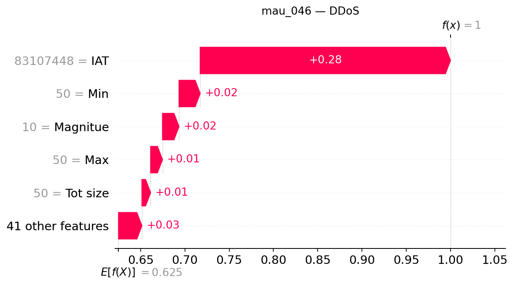

### Diễn giải Gemini

Mô hình dự đoán mẫu dữ liệu thuộc lớp DDoS với sự hỗ trợ mạnh mẽ từ đặc trưng IAT trong top năm. Lớp đứng thứ hai là DoS nhưng có khoảng cách xác suất rất lớn so với lớp dẫn đầu.

**So sánh hai lớp:** Cờ khoảng cách nhỏ tắt do chênh lệch xác suất giữa DDoS và DoS rất lớn, tuy nhiên mức chênh lệch cao không được coi là bảo đảm tuyệt đối cho dự đoán.

**Tổng hợp SHAP:** Trong top năm đặc trưng, IAT đóng vai trò hỗ trợ mạnh nhất cho lớp dự đoán trong khi không ghi nhận tác động phản đối nào từ nhóm này.

- **IAT**: Đây là yếu tố hỗ trợ nổi bật nhất trong top năm, góp phần đáng kể vào đầu ra của lớp dự đoán.
- **Min**: Tác động này cùng chiều nhưng có quy mô nhỏ hơn yếu tố dẫn đầu.
- **Magnitue**: Sự đóng góp dương tiếp tục bổ sung bằng chứng củng cố cho đầu ra mô hình.
- **Max**: Thành phần này mang lại một mức tác động dương bổ trợ ở mức độ thấp hơn.
- **Tot size**: Đóng góp dương ở vị trí này có ảnh hưởng nhỏ nhất trong top năm đặc trưng.

### Gợi ý kiểm tra có điều kiện

- **Nhật ký lưu lượng mạng**: Kiểm tra sự đồng thời của nhiều nguồn đến cùng dịch vụ nếu hệ thống ghi nhận địa chỉ và thời gian. Mục đích: Đối chiếu tính chất lưu lượng mạng thực tế với kết quả phân tích của mô hình.
- **Nhật ký tài nguyên dịch vụ**: Đối chiếu lưu lượng với tình trạng tài nguyên và khả năng phục vụ của hệ thống. Mục đích: Kiểm tra ảnh hưởng của tải công việc lên hệ thống dịch vụ dựa trên dữ liệu nhật ký.

### Giới hạn do Gemini nêu

- Các giá trị SHAP chỉ phản ánh mức đóng góp vào đầu ra của mô hình đối với mẫu hiện tại, không chứng minh quan hệ nhân quả hay xác nhận cuộc tấn công thực tế.
- Xác suất dự đoán chưa được hiệu chỉnh chính thức và không đại diện cho độ chính xác tuyệt đối của nhãn.
- Tổng hợp SHAP chỉ giới hạn trong top năm đặc trưng và phần còn lại ngoài nhóm, không đại diện cho toàn bộ không gian dữ liệu.

SHAP giải thích đầu ra model, chưa chứng minh hành vi tấn công hoặc quan hệ nhân quả. Đánh giá con người tạm hoãn.

---

## mau_047 — dòng CSV 46

**Trạng thái Gemini: accepted**

Đạt kiểm tra bằng chứng có cấu trúc và quy tắc văn bản; chưa đánh giá ngữ nghĩa thủ công.

### Dự đoán và số liệu do chương trình dựng

- Model: `XGB_d4_n200`; dự đoán: **DoS**, xác suất **99.9953%**.
- Lớp đứng thứ hai: **DDoS**, xác suất **0.0034%**.
- Chênh lệch hai lớp: **99.9918 điểm phần trăm**.
- Quy tắc khoảng cách nhỏ: không quá 5 điểm phần trăm, chỉ để trình bày.
- Xác suất nền SHAP: 21.878189%.
- Tổng SHAP: +78.117067 điểm phần trăm; ngoài top 5: +1.196529 điểm phần trăm.
- Hỗ trợ mạnh nhất trong top 5: **IAT**.
- Phản đối mạnh nhất trong top 5: **Không có tác động âm trong top 5**.

| Đặc trưng | Giá trị gốc | SHAP | Tác động (điểm %) |
|---|---:|---:|---:|
| IAT | 82951088 | +0.73616025 | +73.616025 |
| Weight | 141.55 | +0.01110684 | +1.110684 |
| Number | 9.5 | +0.00755435 | +0.755435 |
| Tot size | 54 | +0.00731982 | +0.731982 |
| Min | 54 | +0.00706413 | +0.706413 |

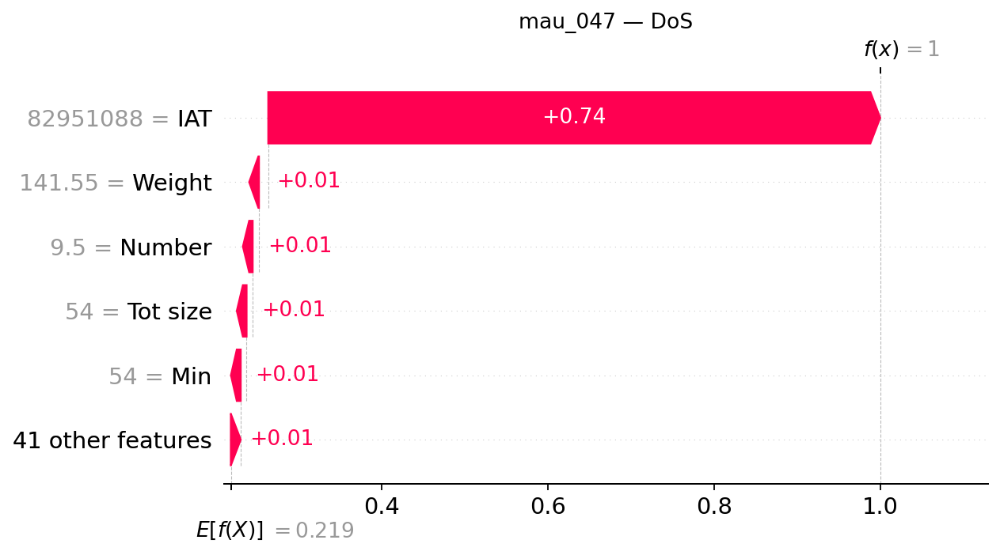

### Diễn giải Gemini

Mẫu dữ liệu được mô hình dự đoán thuộc lớp DoS với sự hỗ trợ mạnh mẽ từ đặc trưng IAT trong nhóm năm yếu tố dẫn đầu. Sự cạnh tranh giữa lớp đứng đầu và lớp đứng thứ hai có khoảng cách lớn, trong đó lớp DDoS đứng ở vị trí tiếp theo nhưng có xác suất vô cùng nhỏ.

**So sánh hai lớp:** Lớp đứng thứ hai là DDoS có chênh lệch rất lớn so với lớp được dự đoán và cờ khoảng cách nhỏ đang tắt, tuy nhiên chênh lệch lớn này không phải là sự bảo đảm tuyệt đối rằng dự đoán là chính xác.

**Tổng hợp SHAP:** Trong top năm đặc trưng, IAT đóng vai trò hỗ trợ mạnh nhất đẩy giá trị đầu ra tăng cao, trong khi không ghi nhận tác động phản đối nào từ nhóm này.

- **IAT**: Đây là yếu tố hỗ trợ nổi bật nhất trong top năm với mức đóng góp lớn nhất vào đầu ra của lớp được dự đoán.
- **Weight**: Tác động này cùng chiều với yếu tố dẫn đầu nhưng có độ lớn nhỏ hơn đáng kể, đóng vai trò hỗ trợ bổ sung.
- **Number**: Đặc trưng này mang lại mức gia tăng dương nhỏ, tiếp tục củng cố thêm cho kết quả phân loại.
- **Tot size**: Sự hiện diện của đặc trưng này tạo ra một tác động dương thấp hơn, góp phần nhỏ vào tổng điểm SHAP.
- **Min**: Đây là yếu tố có đóng góp dương nhỏ nhất trong nhóm năm đặc trưng hàng đầu đang được xem xét.

### Gợi ý kiểm tra có điều kiện

- **Nhật ký kết nối**: Kiểm tra kết nối lặp đến dịch vụ đích và nguồn liên quan nếu hệ thống có ghi nhận metadata này. Mục đích: Đối chiếu hành vi lưu lượng mạng thực tế với kết quả phân loại của mô hình.
- **Nhật ký tài nguyên dịch vụ**: Tìm các dấu hiệu lỗi, gián đoạn hoặc biến động tài nguyên diễn ra cùng thời điểm. Mục đích: Xác minh xem có sự cố hệ thống tương ứng đi kèm hay không.

### Giới hạn do Gemini nêu

- Giá trị SHAP chỉ phản ánh mức độ đóng góp của đặc trưng đối với đầu ra của mô hình ở mẫu hiện tại chứ không chứng minh quan hệ nhân quả trong thực tế.
- Xác suất dự đoán của mô hình chưa qua bước kiểm định hiệu chỉnh xác suất chính thức.
- Phạm vi giải thích chỉ giới hạn ở top năm đặc trưng và phần còn lại ngoài top năm chưa được phân tích chi tiết từng yếu tố riêng lẻ.

SHAP giải thích đầu ra model, chưa chứng minh hành vi tấn công hoặc quan hệ nhân quả. Đánh giá con người tạm hoãn.

---

## mau_048 — dòng CSV 47

**Trạng thái Gemini: accepted**

Đạt kiểm tra bằng chứng có cấu trúc và quy tắc văn bản; chưa đánh giá ngữ nghĩa thủ công.

### Dự đoán và số liệu do chương trình dựng

- Model: `XGB_d4_n200`; dự đoán: **DDoS**, xác suất **99.9981%**.
- Lớp đứng thứ hai: **DoS**, xác suất **0.0011%**.
- Chênh lệch hai lớp: **99.9971 điểm phần trăm**.
- Quy tắc khoảng cách nhỏ: không quá 5 điểm phần trăm, chỉ để trình bày.
- Xác suất nền SHAP: 62.506627%.
- Tổng SHAP: +37.491513 điểm phần trăm; ngoài top 5: +3.586859 điểm phần trăm.
- Hỗ trợ mạnh nhất trong top 5: **IAT**.
- Phản đối mạnh nhất trong top 5: **Không có tác động âm trong top 5**.

| Đặc trưng | Giá trị gốc | SHAP | Tác động (điểm %) |
|---|---:|---:|---:|
| IAT | 83089128 | +0.28077676 | +28.077676 |
| Magnitue | 10.392304 | +0.02498581 | +2.498581 |
| Number | 9.5 | +0.01591242 | +1.591242 |
| Protocol Type | 6 | +0.01014956 | +1.014956 |
| Min | 54 | +0.00722199 | +0.722199 |

### Diễn giải Gemini

Hệ thống dự đoán mẫu thuộc lớp DDoS với mức độ tin cậy áp đảo, nhờ sự đóng góp tích cực từ các đặc trưng trong top năm. Trong khi đó, lớp đứng thứ hai là DoS có xác suất vô cùng nhỏ, tạo khoảng cách biệt rất lớn với lớp dẫn đầu.

**So sánh hai lớp:** Cờ khoảng cách nhỏ đang tắt, cho thấy chênh lệch giữa hai lớp rất lớn; tuy nhiên việc này không coi là bảo đảm dự đoán chính xác tuyệt đối và không kết luận đã biết nhãn thật.

**Tổng hợp SHAP:** Trong nhóm năm đặc trưng đang xét, IAT đóng vai trò hỗ trợ mạnh mẽ nhất giúp đẩy cao đầu ra của lớp dự đoán. Không có đặc trưng nào trong top năm mang lại tác động phản đối âm.

- **IAT**: Đây là yếu tố hỗ trợ nổi bật nhất trong top năm, góp phần đáng kể vào việc nâng cao giá trị đầu ra.
- **Magnitue**: Tác động này cùng chiều nhưng có quy mô nhỏ hơn yếu tố dẫn đầu trong nhóm.
- **Number**: Đặc trưng này cung cấp thêm một mức hỗ trợ bổ sung theo hướng tăng đầu ra.
- **Protocol Type**: Sự hiện diện của yếu tố này tiếp tục củng cố kết quả với một đóng góp dương nhỏ hơn.
- **Min**: Đây là thành phần có tác động nhỏ nhất trong số năm đặc trưng hàng đầu nhưng vẫn duy trì chiều tăng.

### Gợi ý kiểm tra có điều kiện

- **Nhật ký lưu lượng mạng**: Kiểm tra sự đồng thời của nhiều nguồn đến cùng dịch vụ nếu có địa chỉ và thời gian. Mục đích: Đối chiếu mô hình lưu lượng thực tế với các đặc trưng đã ghi nhận để phục vụ việc phân tích.
- **Nhật ký tài nguyên dịch vụ**: Đối chiếu lưu lượng với tình trạng tài nguyên và khả năng phục vụ, không tự đặt ngưỡng. Mục đích: Xác thực tác động của các biến số đối với hệ thống trong điều kiện vận hành.

### Giới hạn do Gemini nêu

- Giá trị SHAP chỉ giải thích đầu ra của mô hình đối với mẫu hiện tại, không chứng minh quan hệ nhân quả hay hành vi tấn công thực tế.
- Các mức giá trị SHAP và xác suất chưa qua hiệu chỉnh chuẩn hóa tuyệt đối.
- Tổng các đặc trưng trong top năm chưa phải là toàn bộ thành phần tạo nên đầu ra cuối cùng của mô hình.

SHAP giải thích đầu ra model, chưa chứng minh hành vi tấn công hoặc quan hệ nhân quả. Đánh giá con người tạm hoãn.

---

## mau_049 — dòng CSV 48

**Trạng thái Gemini: accepted**

Đạt kiểm tra bằng chứng có cấu trúc và quy tắc văn bản; chưa đánh giá ngữ nghĩa thủ công.

### Dự đoán và số liệu do chương trình dựng

- Model: `XGB_d4_n200`; dự đoán: **DoS**, xác suất **99.9953%**.
- Lớp đứng thứ hai: **DDoS**, xác suất **0.0034%**.
- Chênh lệch hai lớp: **99.9918 điểm phần trăm**.
- Quy tắc khoảng cách nhỏ: không quá 5 điểm phần trăm, chỉ để trình bày.
- Xác suất nền SHAP: 21.878189%.
- Tổng SHAP: +78.117067 điểm phần trăm; ngoài top 5: +2.383467 điểm phần trăm.
- Hỗ trợ mạnh nhất trong top 5: **IAT**.
- Phản đối mạnh nhất trong top 5: **Không có tác động âm trong top 5**.

| Đặc trưng | Giá trị gốc | SHAP | Tác động (điểm %) |
|---|---:|---:|---:|
| IAT | 82925800 | +0.71359732 | +71.359732 |
| Protocol Type | 6 | +0.01652637 | +1.652637 |
| Number | 9.5 | +0.00957996 | +0.957996 |
| Magnitue | 10.392304 | +0.00927431 | +0.927431 |
| Weight | 141.55 | +0.00835804 | +0.835804 |

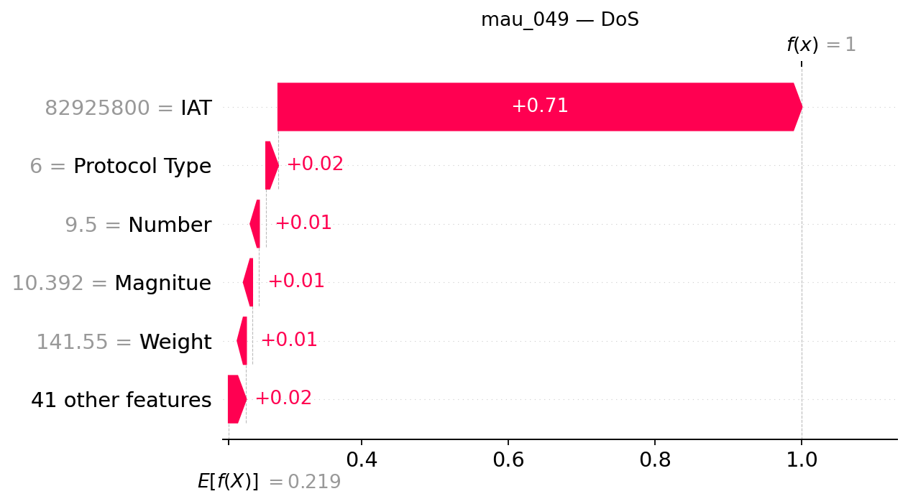

### Diễn giải Gemini

Mẫu dữ liệu được mô hình dự đoán là lớp DoS với sự hỗ trợ mạnh mẽ từ đặc trưng IAT trong nhóm top năm. Trong khi đó, lớp DDoS xếp ở vị trí thứ hai nhưng có khoảng cách rất lớn về xác suất đầu ra so với lớp dẫn đầu.

**So sánh hai lớp:** Cờ khoảng cách nhỏ đang tắt, cho thấy sự chênh lệch giữa lớp DoS đứng đầu và lớp DDoS đứng thứ hai là khá lớn nhưng không được xem là bảo đảm tuyệt đối cho độ chính xác của dự đoán.

**Tổng hợp SHAP:** Yếu tố IAT đóng góp mức hỗ trợ dương lớn nhất đẩy mạnh đầu ra của lớp dự đoán trong top năm, trong khi không ghi nhận tác động phản đối nào từ nhóm đặc trưng này.

- **IAT**: Đây là yếu tố hỗ trợ nổi bật nhất trong top năm, mang lại mức tác động dương đáng kể làm tăng giá trị đầu ra của lớp được giải thích.
- **Protocol Type**: Đặc trưng này đóng vai trò hỗ trợ bổ sung cùng chiều với yếu tố dẫn đầu nhưng có độ lớn thấp hơn.
- **Number**: Sự hiện diện của đặc trưng này tiếp tục củng cố kết quả dự đoán thông qua một khoảng đóng góp dương nhỏ.
- **Magnitue**: Đặc trưng này tham gia hỗ trợ dự đoán với mức gia tăng điểm phần trăm ở mức trung bình trong nhóm.
- **Weight**: Đóng góp nhỏ nhất trong top năm nhưng vẫn duy trì xu hướng tác động cùng chiều để đẩy giá trị đầu ra lên.

### Gợi ý kiểm tra có điều kiện

- **Nhật ký kết nối**: Kiểm tra kết nối lặp đến dịch vụ đích và nguồn liên quan nếu có metadata. Mục đích: Đối chiếu tần suất và đặc điểm kết nối mạng nhằm tìm kiếm các dấu hiệu liên quan đến lưu lượng bất thường.
- **Nhật ký tài nguyên dịch vụ**: Tìm lỗi, gián đoạn hoặc thay đổi tài nguyên cùng thời điểm để xác minh thêm. Mục đích: Xác định xem hệ thống có chịu ảnh hưởng về hiệu năng hay ghi nhận sự cố phần cứng/phần mềm nào tương ứng hay không.

### Giới hạn do Gemini nêu

- Các giá trị SHAP chỉ thể hiện mức độ đóng góp của đặc trưng đối với đầu ra của mô hình, không phải bằng chứng xác thực về mặt nhân quả hay sự tồn tại của một cuộc tấn công thực tế.
- Phạm vi phân tích chỉ giới hạn trong top năm đặc trưng của lớp được dự đoán và chưa phản ánh toàn bộ tác động từ các yếu tố còn lại.
- Xác suất dự đoán và các giá trị đầu ra chưa qua quá trình hiệu chỉnh chính thức nên chỉ mang tính tham khảo từ mô hình.

SHAP giải thích đầu ra model, chưa chứng minh hành vi tấn công hoặc quan hệ nhân quả. Đánh giá con người tạm hoãn.

---

## mau_050 — dòng CSV 49

**Trạng thái Gemini: accepted**

Đạt kiểm tra bằng chứng có cấu trúc và quy tắc văn bản; chưa đánh giá ngữ nghĩa thủ công.

### Dự đoán và số liệu do chương trình dựng

- Model: `XGB_d4_n200`; dự đoán: **DDoS**, xác suất **99.9981%**.
- Lớp đứng thứ hai: **DoS**, xác suất **0.0011%**.
- Chênh lệch hai lớp: **99.9971 điểm phần trăm**.
- Quy tắc khoảng cách nhỏ: không quá 5 điểm phần trăm, chỉ để trình bày.
- Xác suất nền SHAP: 62.506627%.
- Tổng SHAP: +37.491501 điểm phần trăm; ngoài top 5: +3.614196 điểm phần trăm.
- Hỗ trợ mạnh nhất trong top 5: **IAT**.
- Phản đối mạnh nhất trong top 5: **Không có tác động âm trong top 5**.

| Đặc trưng | Giá trị gốc | SHAP | Tác động (điểm %) |
|---|---:|---:|---:|
| IAT | 83124880 | +0.26923641 | +26.923641 |
| Protocol Type | 1 | +0.02222695 | +2.222695 |
| Magnitue | 9.1651516 | +0.02213061 | +2.213061 |
| Min | 42 | +0.01435591 | +1.435591 |
| AVG | 42 | +0.01082316 | +1.082316 |

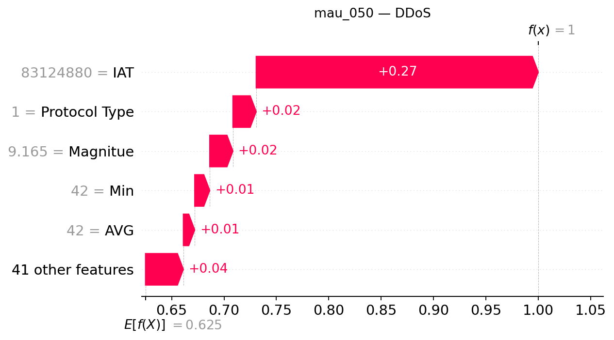

### Diễn giải Gemini

Mẫu này được dự đoán là lớp DDoS với xác suất rất cao, vượt trội hoàn toàn so với lớp đứng thứ hai là DoS. Đặc trưng IAT đóng vai trò hỗ trợ mạnh nhất đẩy giá trị đầu ra lên cao, trong khi không có yếu tố nào trong top năm mang tính phản đối.

**So sánh hai lớp:** Cờ khoảng cách nhỏ tắt vì khoảng cách giữa hai lớp rất lớn. Tuy nhiên, sự chênh lệch lớn này không được coi là bảo đảm dự đoán chính xác tuyệt đối mà cần tiếp tục đối chiếu.

**Tổng hợp SHAP:** Trong top năm đặc trưng, IAT là yếu tố hỗ trợ mạnh nhất làm tăng giá trị đầu ra của lớp DDoS, trong khi không ghi nhận tác động phản đối nào từ nhóm này.

- **IAT**: Đây là yếu tố hỗ trợ nổi bật nhất trong top năm, đóng góp lớn nhất vào việc nâng cao giá trị đầu ra cho lớp dự đoán.
- **Protocol Type**: Tác động này cùng chiều nhưng nhỏ hơn yếu tố dẫn đầu, đóng vai trò hỗ trợ bổ sung cho mô hình.
- **Magnitue**: Đặc trưng này mang lại mức đóng góp dương tương tự, củng cố thêm cho kết quả phân loại.
- **Min**: Sự hiện diện của giá trị này tiếp tục góp phần đẩy đầu ra tăng lên ở mức độ thấp hơn.
- **AVG**: Đây là đóng góp có tác động nhỏ nhất trong nhóm top năm, nhưng vẫn giữ xu hướng tăng cho lớp được giải thích.

### Gợi ý kiểm tra có điều kiện

- **Nhật ký lưu lượng mạng**: Kiểm tra sự đồng thời của nhiều nguồn đến cùng dịch vụ nếu có địa chỉ và thời gian. Mục đích: Đối chiếu xem có hiện tượng lưu lượng dồn dập từ nhiều hướng hay không.
- **Nhật ký tài nguyên dịch vụ**: Đối chiếu lưu lượng với tình trạng tài nguyên và khả năng phục vụ, không tự đặt ngưỡng. Mục đích: Xem xét mức độ ảnh hưởng thực tế lên hệ thống trong điều kiện vận hành.

### Giới hạn do Gemini nêu

- Giá trị SHAP chỉ thể hiện mức độ đóng góp của đặc trưng vào đầu ra của mô hình đối với mẫu này, không chứng minh quan hệ nhân quả hay cuộc tấn công thực tế.
- Tổng các giá trị SHAP trong top năm chưa phải là toàn bộ mức thay đổi, phần còn lại đến từ các đặc trưng ngoài top năm.
- Xác suất dự đoán từ mô hình chưa được xác minh là đã hiệu chỉnh và không đại diện cho nhãn thật.

SHAP giải thích đầu ra model, chưa chứng minh hành vi tấn công hoặc quan hệ nhân quả. Đánh giá con người tạm hoãn.
