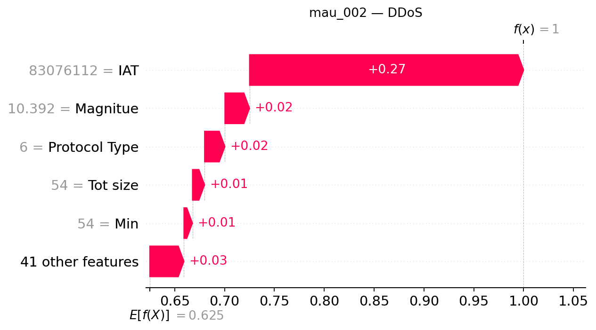

## mau_002 — dòng CSV 1

**Trạng thái Gemini: accepted**

Đạt kiểm tra bằng chứng có cấu trúc và quy tắc văn bản; chưa đánh giá ngữ nghĩa thủ công.

### Dự đoán và số liệu do chương trình dựng

- Model: `XGB_d4_n200`; dự đoán: **DDoS**, xác suất **99.9981%**.
- Lớp đứng thứ hai: **DoS**, xác suất **0.0011%**.
- Chênh lệch hai lớp: **99.9971 điểm phần trăm**.
- Quy tắc khoảng cách nhỏ: không quá 5 điểm phần trăm, chỉ để trình bày.
- Xác suất nền SHAP: 62.506627%.
- Tổng SHAP: +37.491501 điểm phần trăm; ngoài top 5: +3.423365 điểm phần trăm.
- Hỗ trợ mạnh nhất trong top 5: **IAT**.
- Phản đối mạnh nhất trong top 5: **Không có tác động âm trong top 5**.

| Đặc trưng | Giá trị gốc | SHAP | Tác động (điểm %) |
|---|---:|---:|---:|
| IAT | 83076112 | +0.27487559 | +27.487559 |
| Magnitue | 10.392304 | +0.02471108 | +2.471108 |
| Protocol Type | 6 | +0.02039206 | +2.039206 |
| Tot size | 54 | +0.01215702 | +1.215702 |
| Min | 54 | +0.00854561 | +0.854561 |

### Diễn giải Gemini

Mô hình dự đoán mẫu thuộc lớp DDoS với xác suất áp đảo nhờ sự hỗ trợ mạnh mẽ từ các đặc trưng như IAT và Magnitue. Lớp đứng thứ hai là DoS có khoảng cách chênh lệch rất lớn và không tạo ra sự cạnh tranh đáng kể trong trường hợp này.

**So sánh hai lớp:** Cờ khoảng cách nhỏ đang tắt cho thấy khoảng cách giữa hai lớp đứng đầu là rất lớn, tuy nhiên sự chênh lệch lớn này không được coi là bảo đảm tuyệt đối rằng dự đoán đã chính xác.

**Tổng hợp SHAP:** Trong top năm đặc trưng, IAT đóng vai trò hỗ trợ mạnh nhất đẩy giá trị đầu ra lên cao, trong khi không ghi nhận bất kỳ tác động phản đối nào do toàn bộ đặc trưng trong nhóm đều mang chiều hướng tăng.

- **IAT**: Đây là yếu tố hỗ trợ nổi bật nhất trong top năm, góp phần đáng kể vào kết quả phân loại của mô hình.
- **Magnitue**: Tác động này cùng chiều nhưng nhỏ hơn yếu tố dẫn đầu, đóng vai trò là nguồn hỗ trợ bổ sung cho lớp dự đoán.
- **Protocol Type**: Đặc trưng này tiếp tục cung cấp lực đẩy dương củng cố cho đầu ra của mô hình.
- **Tot size**: Sự hiện diện của giá trị này mang lại một mức đóng góp dương nhỏ hơn trong nhóm.
- **Min**: Đóng góp này tạo ra tác động dương nhẹ và thấp nhất trong số năm đặc trưng được xem xét.

### Gợi ý kiểm tra có điều kiện

- **Nhật ký lưu lượng mạng**: Kiểm tra sự đồng thời của nhiều nguồn đến cùng dịch vụ nếu có địa chỉ và thời gian. Mục đích: Đối chiếu sự đồng thời của các nguồn truy cập để có thêm góc nhìn về cấu trúc lưu lượng thực tế.
- **Nhật ký tài nguyên dịch vụ**: Đối chiếu lưu lượng với tình trạng tài nguyên và khả năng phục vụ, không tự đặt ngưỡng. Mục đích: So sánh lưu lượng hiện tại với khả năng đáp ứng của hệ thống nhằm kiểm chứng bối cảnh vận hành.

### Giới hạn do Gemini nêu

- Giá trị SHAP chỉ thể hiện mức độ đóng góp của đặc trưng vào đầu ra của mô hình đối với mẫu hiện tại, không chứng minh mối quan hệ nhân quả hay xác nhận sự tồn tại của một cuộc tấn công thực tế.
- Xác suất dự đoán của mô hình chưa được kiểm chứng hay hiệu chỉnh độc lập, do đó không đại diện cho độ tin cậy tuyệt đối.
- Tổng hợp SHAP chỉ giới hạn trong top năm đặc trưng được liệt kê và phần ngoài nhóm, chưa phản ánh toàn bộ không gian dữ liệu của mô hình.

SHAP giải thích đầu ra model, chưa chứng minh hành vi tấn công hoặc quan hệ nhân quả. Đánh giá con người tạm hoãn.
