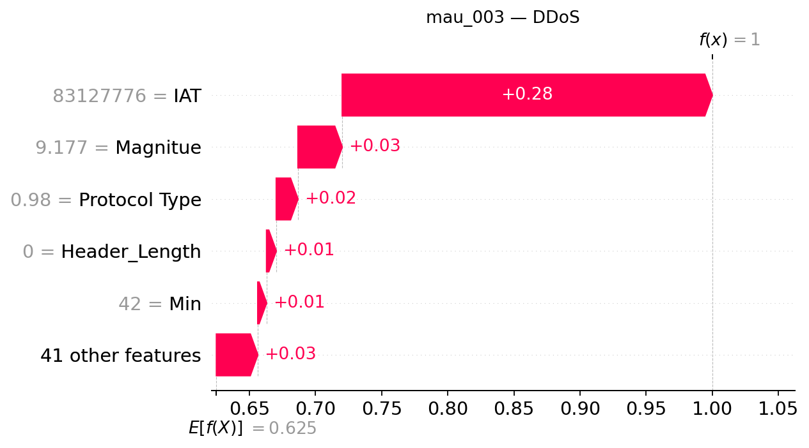

## mau_003 — dòng CSV 2

**Trạng thái Gemini: accepted**

Đạt kiểm tra bằng chứng có cấu trúc và quy tắc văn bản; chưa đánh giá ngữ nghĩa thủ công.

### Dự đoán và số liệu do chương trình dựng

- Model: `XGB_d4_n200`; dự đoán: **DDoS**, xác suất **99.9981%**.
- Lớp đứng thứ hai: **DoS**, xác suất **0.0011%**.
- Chênh lệch hai lớp: **99.9971 điểm phần trăm**.
- Quy tắc khoảng cách nhỏ: không quá 5 điểm phần trăm, chỉ để trình bày.
- Xác suất nền SHAP: 62.506627%.
- Tổng SHAP: +37.491501 điểm phần trăm; ngoài top 5: +3.127248 điểm phần trăm.
- Hỗ trợ mạnh nhất trong top 5: **IAT**.
- Phản đối mạnh nhất trong top 5: **Không có tác động âm trong top 5**.

| Đặc trưng | Giá trị gốc | SHAP | Tác động (điểm %) |
|---|---:|---:|---:|
| IAT | 83127776 | +0.27978975 | +27.978975 |
| Magnitue | 9.1774025 | +0.03345408 | +3.345408 |
| Protocol Type | 0.98000002 | +0.01642456 | +1.642456 |
| Header_Length | 0 | +0.00731986 | +0.731986 |
| Min | 42 | +0.00665428 | +0.665428 |

### Diễn giải Gemini

Hệ thống dự đoán mẫu thuộc lớp DDoS với xác suất rất cao, trong đó đặc trưng IAT đóng vai trò hỗ trợ mạnh mẽ nhất trong top năm. Lớp đứng thứ hai là DoS nhưng có khoảng cách xác suất rất lớn so với lớp dẫn đầu.

**So sánh hai lớp:** Cờ khoảng cách nhỏ đang tắt, cho thấy sự chênh lệch giữa lớp dự đoán và lớp đứng thứ hai là lớn. Tuy nhiên, việc chênh lệch lớn không bảo đảm dự đoán chắc chắn đúng nhãn thật.

**Tổng hợp SHAP:** Trong top năm đặc trưng, IAT là yếu tố hỗ trợ mạnh nhất đẩy giá trị đầu ra lên, trong khi không có đặc trưng nào trong nhóm này mang tác động phản đối. Các đóng góp còn lại cùng phần ngoài nhóm phối hợp tạo nên kết quả cuối cùng.

- **IAT**: Đây là yếu tố hỗ trợ nổi bật nhất trong top năm, góp phần đáng kể nâng cao đầu ra của mô hình.
- **Magnitue**: Tác động này cùng chiều nhưng nhỏ hơn yếu tố dẫn đầu, đóng vai trò hỗ trợ bổ sung cho dự đoán.
- **Protocol Type**: Đặc trưng này cung cấp thêm một lực đẩy dương mức độ vừa phải vào tổng giá trị SHAP.
- **Header_Length**: Sự hiện diện của tác động dương này tiếp tục củng cố hướng đi của lớp được giải thích.
- **Min**: Đây là yếu tố có đóng góp dương nhỏ nhất trong nhóm năm đặc trưng hàng đầu.

### Gợi ý kiểm tra có điều kiện

- **Nhật ký lưu lượng mạng**: Kiểm tra sự đồng thời của nhiều nguồn đến cùng dịch vụ nếu hệ thống có ghi nhận địa chỉ và thời gian. Mục đích: Đối chiếu mô hình với các dấu hiệu lưu lượng thực tế đi qua hệ thống mạng.
- **Nhật ký tài nguyên dịch vụ**: Đối chiếu lưu lượng với tình trạng tài nguyên và khả năng phục vụ của hệ thống. Mục đích: Xác thực mức độ ảnh hưởng của tải lưu lượng lên các dịch vụ đích một cách khách quan.

### Giới hạn do Gemini nêu

- Các giá trị SHAP chỉ thể hiện mức độ đóng góp vào đầu ra của mô hình đối với mẫu hiện tại, không chứng minh được quan hệ nhân quả hay mô tả một cuộc tấn công thực tế.
- Xác suất của mô hình chưa được kiểm chứng về độ hiệu chỉnh và không phản ánh tỷ lệ chính xác tuyệt đối.
- Phạm vi phân tích chỉ giới hạn trong top năm đặc trưng và phần dư ngoài nhóm, chưa bao quát toàn bộ không gian dữ liệu phức tạp.

SHAP giải thích đầu ra model, chưa chứng minh hành vi tấn công hoặc quan hệ nhân quả. Đánh giá con người tạm hoãn.
