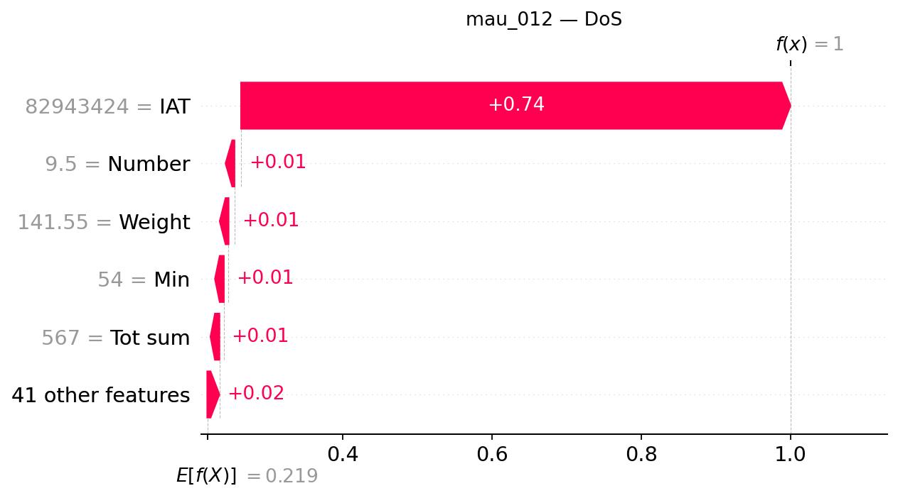

## mau_012 — dòng CSV 11

**Trạng thái Gemini: accepted**

Đạt kiểm tra bằng chứng có cấu trúc và quy tắc văn bản; chưa đánh giá ngữ nghĩa thủ công.

### Dự đoán và số liệu do chương trình dựng

- Model: `XGB_d4_n200`; dự đoán: **DoS**, xác suất **99.9953%**.
- Lớp đứng thứ hai: **DDoS**, xác suất **0.0034%**.
- Chênh lệch hai lớp: **99.9918 điểm phần trăm**.
- Quy tắc khoảng cách nhỏ: không quá 5 điểm phần trăm, chỉ để trình bày.
- Xác suất nền SHAP: 21.878189%.
- Tổng SHAP: +78.117067 điểm phần trăm; ngoài top 5: +1.622307 điểm phần trăm.
- Hỗ trợ mạnh nhất trong top 5: **IAT**.
- Phản đối mạnh nhất trong top 5: **Không có tác động âm trong top 5**.

| Đặc trưng | Giá trị gốc | SHAP | Tác động (điểm %) |
|---|---:|---:|---:|
| IAT | 82943424 | +0.73586673 | +73.586673 |
| Number | 9.5 | +0.00893431 | +0.893431 |
| Weight | 141.55 | +0.00781267 | +0.781267 |
| Min | 54 | +0.00638679 | +0.638679 |
| Tot sum | 567 | +0.00594710 | +0.594710 |

### Diễn giải Gemini

Mô hình dự đoán mẫu dữ liệu thuộc lớp DoS với xác suất rất cao, trong đó đặc trưng IAT đóng vai trò hỗ trợ nổi bật nhất làm tăng mạnh giá trị đầu ra. Lớp đứng thứ hai là DDoS có xác suất vô cùng nhỏ, cho thấy sự chênh lệch rõ rệt và không có sự cạnh tranh đáng kể trong trường hợp này.

**So sánh hai lớp:** Cờ khoảng cách nhỏ đang tắt và chênh lệch giữa hai lớp rất lớn, tuy nhiên điều này không bảo đảm dự đoán hoàn toàn chính xác. Lớp DDoS đứng thứ hai nhưng có đầu ra thấp hơn nhiều so với lớp được dự đoán.

**Tổng hợp SHAP:** Trong top năm đặc trưng, IAT là yếu tố hỗ trợ mạnh nhất đẩy giá trị đầu ra lên cao, trong khi không ghi nhận bất kỳ tác động phản đối nào do toàn bộ đặc trưng trong nhóm đều mang chiều hướng tăng.

- **IAT**: Đây là yếu tố hỗ trợ nổi bật nhất trong top năm, đóng góp mức tăng lớn nhất cho đầu ra của lớp được giải thích.
- **Number**: Tác động này mang chiều hướng cùng chiều nhưng có độ lớn nhỏ hơn đáng kể so với yếu tố dẫn đầu.
- **Weight**: Đặc trưng này cung cấp thêm một mức hỗ trợ bổ sung với giá trị đóng góp ở mức trung bình trong nhóm.
- **Min**: Sự hiện diện của đặc trưng này tạo ra một tác động dương nhỏ hơn để thúc đẩy đầu ra dự đoán.
- **Tot sum**: Đóng góp này mang lại ảnh hưởng dương thấp nhất trong số năm đặc trưng được xem xét của mẫu.

### Gợi ý kiểm tra có điều kiện

- **Nhật ký kết nối**: Kiểm tra kết nối lặp đến dịch vụ đích và nguồn liên quan nếu có metadata. Mục đích: Đối chiếu xem hệ thống có ghi nhận các lượt truy cập lặp lại tương ứng hay không.
- **Nhật ký tài nguyên dịch vụ**: Tìm lỗi, gián đoạn hoặc thay đổi tài nguyên cùng thời điểm để xác minh thêm. Mục đích: Kiểm tra xem dịch vụ có dấu hiệu quá tải hoặc gián đoạn tài nguyên hay không.

### Giới hạn do Gemini nêu

- Các giá trị SHAP chỉ thể hiện mức độ đóng góp của đặc trưng đối với đầu ra của mô hình cho mẫu này và không chứng minh quan hệ nhân quả hay sự tồn tại chắc chắn của một cuộc tấn công thực tế.
- Xác suất dự đoán từ mô hình chưa qua bước hiệu chỉnh xác suất, do đó không đại diện cho độ tin cậy tuyệt đối.
- Tổng hợp SHAP chỉ giới hạn trong top năm đặc trưng được liệt kê và không phản ánh toàn bộ các yếu tố khác ngoài nhóm.

SHAP giải thích đầu ra model, chưa chứng minh hành vi tấn công hoặc quan hệ nhân quả. Đánh giá con người tạm hoãn.
