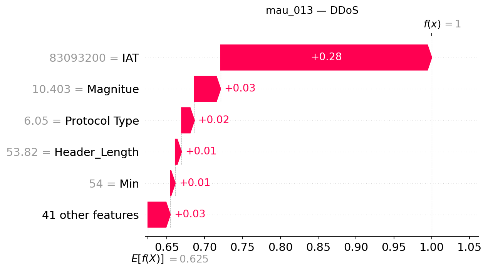

## mau_013 — dòng CSV 12

**Trạng thái Gemini: accepted**

Đạt kiểm tra bằng chứng có cấu trúc và quy tắc văn bản; chưa đánh giá ngữ nghĩa thủ công.

### Dự đoán và số liệu do chương trình dựng

- Model: `XGB_d4_n200`; dự đoán: **DDoS**, xác suất **99.9981%**.
- Lớp đứng thứ hai: **DoS**, xác suất **0.0011%**.
- Chênh lệch hai lớp: **99.9971 điểm phần trăm**.
- Quy tắc khoảng cách nhỏ: không quá 5 điểm phần trăm, chỉ để trình bày.
- Xác suất nền SHAP: 62.506627%.
- Tổng SHAP: +37.491501 điểm phần trăm; ngoài top 5: +2.960217 điểm phần trăm.
- Hỗ trợ mạnh nhất trong top 5: **IAT**.
- Phản đối mạnh nhất trong top 5: **Không có tác động âm trong top 5**.

| Đặc trưng | Giá trị gốc | SHAP | Tác động (điểm %) |
|---|---:|---:|---:|
| IAT | 83093200 | +0.27882852 | +27.882852 |
| Magnitue | 10.402575 | +0.03461878 | +3.461878 |
| Protocol Type | 6.0500002 | +0.01707940 | +1.707940 |
| Header_Length | 53.82 | +0.00825582 | +0.825582 |
| Min | 54 | +0.00653033 | +0.653033 |

### Diễn giải Gemini

Mẫu được mô hình XGB_d4_n200 phân loại vào lớp DDoS với mức xác suất rất cao, vượt trội hoàn toàn so với lớp đứng thứ hai là DoS. Các đặc trưng trong top năm đều thể hiện chiều hướng củng cố kết quả này mà không có yếu tố phản đối trực tiếp.

**So sánh hai lớp:** Lớp đứng thứ hai là DoS có xác suất vô cùng nhỏ so với lớp dự đoán và cờ khoảng cách nhỏ đang tắt, cho thấy khoảng cách giữa hai đầu ra rất lớn. Tuy nhiên, chênh lệch lớn này không phải là sự bảo đảm tuyệt đối rằng dự đoán là đúng.

**Tổng hợp SHAP:** Yếu tố IAT đóng vai trò hỗ trợ mạnh nhất đẩy giá trị đầu ra lên cao, trong khi không có yếu tố nào trong top năm mang giá trị âm để tạo ra tác động phản đối.

- **IAT**: Đây là yếu tố hỗ trợ nổi bật nhất trong top năm, góp phần đáng kể vào việc gia tăng đầu ra của lớp được dự đoán.
- **Magnitue**: Tác động này cùng chiều hướng tăng nhưng có quy mô nhỏ hơn yếu tố dẫn đầu.
- **Protocol Type**: Đặc trưng này cung cấp một mức hỗ trợ bổ sung với giá trị đóng góp ở mức trung bình trong nhóm.
- **Header_Length**: Sự góp mặt của đặc trưng này mang lại thêm một phần tác động dương nhỏ hơn để củng cố đầu ra.
- **Min**: Đây là thành phần có đóng góp dương thấp nhất trong top năm đặc trưng đang xét.

### Gợi ý kiểm tra có điều kiện

- **Nhật ký lưu lượng mạng**: Kiểm tra sự đồng thời của nhiều nguồn đến cùng dịch vụ nếu có địa chỉ và thời gian Mục đích: Đối chiếu mô hình với dữ liệu ghi nhận thực tế trên hệ thống mạng nếu log này tồn tại.
- **Nhật ký tài nguyên dịch vụ**: Đối chiếu lưu lượng với tình trạng tài nguyên và khả năng phục vụ, không tự đặt ngưỡng Mục đích: Xem xét trạng thái tải của hệ thống để hỗ trợ quá trình phân tích nếu hệ thống lưu trữ log này.

### Giới hạn do Gemini nêu

- Giá trị SHAP chỉ giải thích đầu ra của mô hình đối với mẫu hiện tại, không chứng minh được quan hệ nhân quả hay hành vi tấn công thực tế.
- Tổng giá trị SHAP trong top năm chưa bao trùm toàn bộ các thành phần thay đổi từ giá trị nền tham chiếu.
- Xác suất dự đoán của mô hình chưa được kiểm chứng về độ hiệu chỉnh và không thể xem là độ tin cậy tuyệt đối.

SHAP giải thích đầu ra model, chưa chứng minh hành vi tấn công hoặc quan hệ nhân quả. Đánh giá con người tạm hoãn.
