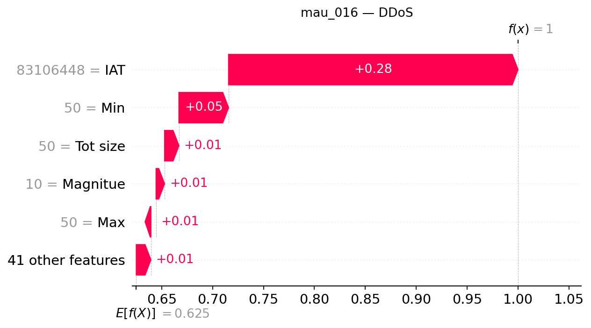

## mau_016 — dòng CSV 15

**Trạng thái Gemini: accepted**

Đạt kiểm tra bằng chứng có cấu trúc và quy tắc văn bản; chưa đánh giá ngữ nghĩa thủ công.

### Dự đoán và số liệu do chương trình dựng

- Model: `XGB_d4_n200`; dự đoán: **DDoS**, xác suất **99.9981%**.
- Lớp đứng thứ hai: **DoS**, xác suất **0.0011%**.
- Chênh lệch hai lớp: **99.9971 điểm phần trăm**.
- Quy tắc khoảng cách nhỏ: không quá 5 điểm phần trăm, chỉ để trình bày.
- Xác suất nền SHAP: 62.506627%.
- Tổng SHAP: +37.491501 điểm phần trăm; ngoài top 5: +1.431623 điểm phần trăm.
- Hỗ trợ mạnh nhất trong top 5: **IAT**.
- Phản đối mạnh nhất trong top 5: **Không có tác động âm trong top 5**.

| Đặc trưng | Giá trị gốc | SHAP | Tác động (điểm %) |
|---|---:|---:|---:|
| IAT | 83106448 | +0.28428393 | +28.428393 |
| Min | 50 | +0.04877121 | +4.877121 |
| Tot size | 50 | +0.01410406 | +1.410406 |
| Magnitue | 10 | +0.00833341 | +0.833341 |
| Max | 50 | +0.00510617 | +0.510617 |

### Diễn giải Gemini

Mô hình dự đoán mẫu dữ liệu thuộc lớp DDoS với xác suất rất cao, trong đó đặc trưng IAT đóng vai trò hỗ trợ mạnh mẽ nhất còn các đặc trưng khác trong top năm đều cùng chiều tăng. Khoảng cách với lớp đứng thứ hai là rất lớn và không có cờ khoảng cách nhỏ bật sáng.

**So sánh hai lớp:** Cờ khoảng cách nhỏ đang tắt, cho thấy sự chênh lệch giữa lớp dự đoán và lớp đứng thứ hai là đáng kể nhưng điều này không được xem là bảo đảm dự đoán chính xác tuyệt đối.

**Tổng hợp SHAP:** Trong top năm đặc trưng, IAT là yếu tố hỗ trợ mạnh nhất đẩy đầu ra tăng, trong khi không ghi nhận yếu tố nào có tác động phản đối trong nhóm này.

- **IAT**: Đây là yếu tố hỗ trợ nổi bật nhất trong top năm, làm gia tăng đáng kể giá trị đầu ra của lớp được giải thích so với nền tham chiếu.
- **Min**: Đặc trưng này cung cấp sự hỗ trợ bổ sung cùng chiều với mức tác động nhỏ hơn so với yếu tố dẫn đầu.
- **Tot size**: Đóng góp tiếp theo theo chiều tăng giá trị đầu ra, góp phần củng cố kết quả phân loại.
- **Magnitue**: Tác động này tiếp tục đẩy đầu ra tăng nhưng ở mức độ thấp hơn các đặc trưng trước đó.
- **Max**: Đây là yếu tố có đóng góp dương nhỏ nhất trong nhóm top năm đặc trưng đang xét.

### Gợi ý kiểm tra có điều kiện

- **Nhật ký lưu lượng mạng**: Kiểm tra sự đồng thời của nhiều nguồn đến cùng dịch vụ nếu hệ thống ghi nhận địa chỉ và thời gian. Mục đích: Đối chiếu mô hình với các dấu hiệu lưu lượng thực tế trên mạng.
- **Nhật ký tài nguyên dịch vụ**: Đối chiếu lưu lượng với tình trạng tài nguyên và khả năng phục vụ. Mục đích: Kiểm tra ảnh hưởng của tải lưu lượng lên hệ thống dịch vụ.

### Giới hạn do Gemini nêu

- Giá trị SHAP chỉ thể hiện sự đóng góp của đặc trưng vào đầu ra của mô hình đối với mẫu này và không chứng minh quan hệ nhân quả hay cuộc tấn công thực tế.
- Các giá trị xác suất từ mô hình chưa được hiệu chỉnh và chỉ phản ánh kết quả tính toán dựa trên tập dữ liệu huấn luyện.
- Phân tích SHAP trong top năm chưa bao gồm toàn bộ các yếu tố thay đổi vì vẫn còn phần đóng góp nằm ngoài nhóm này.

SHAP giải thích đầu ra model, chưa chứng minh hành vi tấn công hoặc quan hệ nhân quả. Đánh giá con người tạm hoãn.
