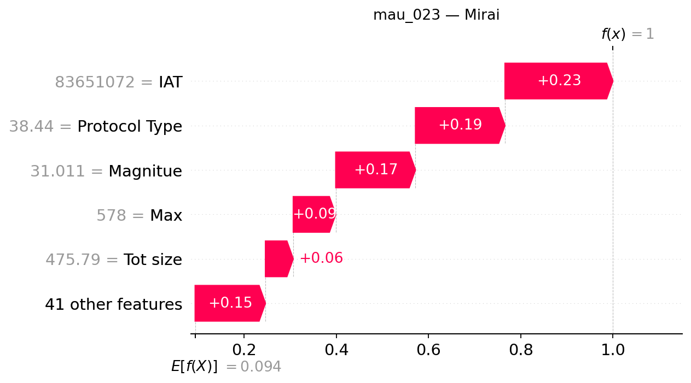

## mau_023 — dòng CSV 22

**Trạng thái Gemini: accepted**

Đạt kiểm tra bằng chứng có cấu trúc và quy tắc văn bản; chưa đánh giá ngữ nghĩa thủ công.

### Dự đoán và số liệu do chương trình dựng

- Model: `XGB_d4_n200`; dự đoán: **Mirai**, xác suất **99.9931%**.
- Lớp đứng thứ hai: **DDoS**, xác suất **0.0040%**.
- Chênh lệch hai lớp: **99.9891 điểm phần trăm**.
- Quy tắc khoảng cách nhỏ: không quá 5 điểm phần trăm, chỉ để trình bày.
- Xác suất nền SHAP: 9.376009%.
- Tổng SHAP: +90.617053 điểm phần trăm; ngoài top 5: +15.245427 điểm phần trăm.
- Hỗ trợ mạnh nhất trong top 5: **IAT**.
- Phản đối mạnh nhất trong top 5: **Không có tác động âm trong top 5**.

| Đặc trưng | Giá trị gốc | SHAP | Tác động (điểm %) |
|---|---:|---:|---:|
| IAT | 83651072 | +0.23416209 | +23.416209 |
| Protocol Type | 38.439999 | +0.19411302 | +19.411302 |
| Magnitue | 31.011297 | +0.17295307 | +17.295307 |
| Max | 578 | +0.09216753 | +9.216753 |
| Tot size | 475.79001 | +0.06032056 | +6.032056 |

### Diễn giải Gemini

Mẫu dữ liệu được mô hình dự đoán thuộc lớp Mirai với sự hỗ trợ từ các đặc trưng nổi bật trong top năm, trong đó IAT đóng vai trò đóng góp dương lớn nhất. Khoảng cách giữa hai lớp đứng đầu khá lớn và không kích hoạt cờ khoảng cách nhỏ, cho thấy sự chênh lệch rõ rệt về đầu ra trong lần phân loại này.

**So sánh hai lớp:** Lớp đứng thứ hai là DDoS với xác suất thấp hơn đáng kể so với lớp dẫn đầu. Cờ khoảng cách nhỏ đang tắt, do đó chênh lệch lớn không phải là sự đảm bảo tuyệt đối rằng dự đoán đã hoàn toàn chính xác.

**Tổng hợp SHAP:** Trong top năm đặc trưng, IAT là yếu tố hỗ trợ mạnh mẽ nhất làm tăng đầu ra của lớp dự đoán. Không có đặc trưng nào trong top năm mang lại tác động phản đối âm, đồng thời phần còn lại ngoài nhóm tiếp tục đóng góp vào kết quả chung.

- **IAT**: Đây là yếu tố hỗ trợ nổi bật nhất trong top năm, đóng góp giá trị dương lớn nhất vào đầu ra của lớp.
- **Protocol Type**: Tác động này mang chiều hướng hỗ trợ nhưng có mức đóng góp nhỏ hơn yếu tố dẫn đầu.
- **Magnitue**: Đặc trưng này thể hiện sự gia tăng đầu ra với mức đóng góp đứng ở vị trí thứ ba trong nhóm.
- **Max**: Sự hiện diện của đặc trưng này tiếp tục hỗ trợ bổ sung cho lớp được dự đoán với quy mô nhỏ hơn các yếu tố trước.
- **Tot size**: Đây là tác động có chiều hướng tăng nhỏ nhất trong top năm đặc trưng đang được xem xét.

### Gợi ý kiểm tra có điều kiện

- **Nhật ký kết nối thiết bị**: Đối chiếu đích kết nối và hoạt động lặp với hành vi được phép của thiết bị IoT. Mục đích: Nếu hệ thống có log này, việc đối chiếu giúp kiểm tra xem các phiên kết nối có khớp với cấu hình chuẩn hay không.
- **Nhật ký tiến trình thiết bị**: Nếu truy cập được thiết bị, tìm tiến trình hoặc cảnh báo liên quan; chưa kết luận đã nhiễm mã độc. Mục đích: Nếu hệ thống lưu trữ log tiến trình, việc kiểm tra nhằm tìm kiếm các dấu hiệu bất thường trên hệ thống mà không vội khẳng định sự tồn tại của mã độc.

### Giới hạn do Gemini nêu

- Giải thích này phản ánh đầu ra của mô hình máy học dựa trên các giá trị SHAP cục bộ, không chứng minh mối quan hệ nhân quả hay xác nhận một cuộc tấn công thực tế.
- Xác suất của mô hình chưa được kiểm chứng hay hiệu chỉnh độ tin cậy, do đó kết quả dự đoán chỉ mang tính tham khảo.
- Các giá trị SHAP trong top năm chưa bao trùm toàn bộ tổng mức thay đổi, và phần còn lại ngoài nhóm vẫn chiếm một tỷ trọng đáng kể trong kết quả.

SHAP giải thích đầu ra model, chưa chứng minh hành vi tấn công hoặc quan hệ nhân quả. Đánh giá con người tạm hoãn.
