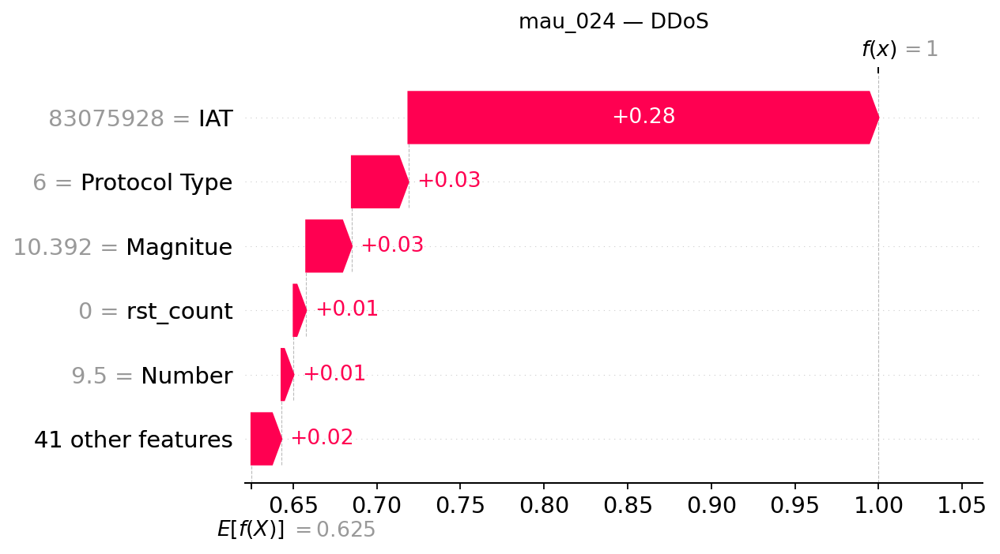

## mau_024 — dòng CSV 23

**Trạng thái Gemini: accepted**

Đạt kiểm tra bằng chứng có cấu trúc và quy tắc văn bản; chưa đánh giá ngữ nghĩa thủ công.

### Dự đoán và số liệu do chương trình dựng

- Model: `XGB_d4_n200`; dự đoán: **DDoS**, xác suất **99.9981%**.
- Lớp đứng thứ hai: **DoS**, xác suất **0.0011%**.
- Chênh lệch hai lớp: **99.9971 điểm phần trăm**.
- Quy tắc khoảng cách nhỏ: không quá 5 điểm phần trăm, chỉ để trình bày.
- Xác suất nền SHAP: 62.506627%.
- Tổng SHAP: +37.491501 điểm phần trăm; ngoài top 5: +1.800564 điểm phần trăm.
- Hỗ trợ mạnh nhất trong top 5: **IAT**.
- Phản đối mạnh nhất trong top 5: **Không có tác động âm trong top 5**.

| Đặc trưng | Giá trị gốc | SHAP | Tác động (điểm %) |
|---|---:|---:|---:|
| IAT | 83075928 | +0.28109085 | +28.109085 |
| Protocol Type | 6 | +0.03380246 | +3.380246 |
| Magnitue | 10.392304 | +0.02726307 | +2.726307 |
| rst_count | 0 | +0.00750749 | +0.750749 |
| Number | 9.5 | +0.00724551 | +0.724551 |

### Diễn giải Gemini

Mẫu dữ liệu được mô hình dự đoán là DDoS với xác suất rất cao, vượt trội hoàn toàn so với lớp đứng thứ hai là DoS. Đặc trưng IAT đóng vai trò hỗ trợ mạnh mẽ nhất, trong khi tất cả các yếu tố nằm trong top năm đều mang chiều hướng gia tăng đầu ra.

**So sánh hai lớp:** Khoảng cách xác suất giữa lớp DDoS và lớp DoS rất lớn và cờ khoảng cách nhỏ đang tắt, cho thấy hai đầu ra không nằm gần nhau. Tuy nhiên, điều này không được coi là sự bảo đảm tuyệt đối rằng dự đoán đã chính xác.

**Tổng hợp SHAP:** Trong nhóm năm đặc trưng đang xét, IAT là yếu tố hỗ trợ mạnh nhất cho lớp dự đoán, không ghi nhận tác động phản đối nào do toàn bộ các đặc trưng trong top năm đều cùng chiều tăng.

- **IAT**: Đây là yếu tố hỗ trợ nổi bật nhất trong top năm, đóng góp mức tăng đáng kể cho đầu ra của lớp.
- **Protocol Type**: Tác động này cùng chiều tăng nhưng có độ lớn nhỏ hơn đáng kể so với yếu tố dẫn đầu.
- **Magnitue**: Đặc trưng này cung cấp thêm một lực đẩy bổ sung cùng chiều với mức đóng góp ở mức trung bình trong nhóm.
- **rst_count**: Đóng góp mang chiều hướng thúc đẩy đầu ra với giá trị SHAP nhỏ hơn các đặc trưng trước đó.
- **Number**: Đây là yếu tố có tác động dương nhỏ nhất trong top năm đặc trưng được xem xét.

### Gợi ý kiểm tra có điều kiện

- **Nhật ký lưu lượng mạng**: Kiểm tra sự đồng thời của nhiều nguồn đến cùng dịch vụ nếu có địa chỉ và thời gian. Mục đích: Đối chiếu sự xuất hiện đồng thời của các nguồn lưu lượng để củng cố bối cảnh ghi nhận.
- **Nhật ký tài nguyên dịch vụ**: Đối chiếu lưu lượng với tình trạng tài nguyên và khả năng phục vụ, không tự đặt ngưỡng. Mục đích: Xem xét phản ứng của hệ thống và tài nguyên dịch vụ nhằm phục vụ cho việc kiểm chứng.

### Giới hạn do Gemini nêu

- Giá trị SHAP và xác suất chỉ phản ánh đầu ra của mô hình máy học đối với mẫu dữ liệu này, không phải là bằng chứng xác thực về một cuộc tấn công thực tế hay quan hệ nhân quả.
- Tổng giá trị SHAP của năm đặc trưng chưa bao phủ toàn bộ sự thay đổi, phần còn lại đến từ các yếu tố ngoài top năm và giá trị nền tham chiếu.
- Các mức xác suất chưa được kiểm chứng về độ hiệu chỉnh và không đại diện cho tỷ lệ chính xác tuyệt đối của mô hình.

SHAP giải thích đầu ra model, chưa chứng minh hành vi tấn công hoặc quan hệ nhân quả. Đánh giá con người tạm hoãn.
