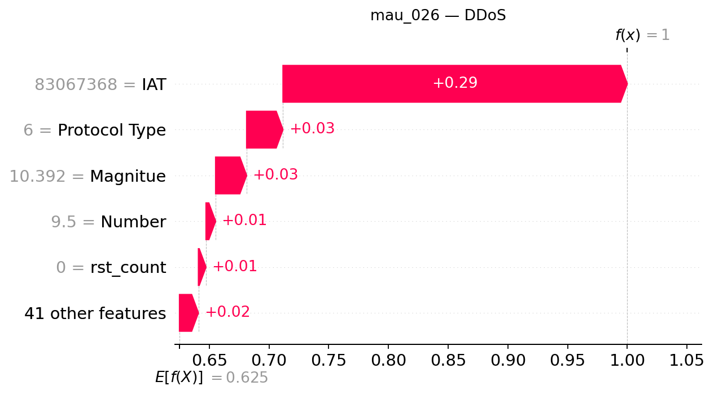

## mau_026 — dòng CSV 25

**Trạng thái Gemini: accepted**

Đạt kiểm tra bằng chứng có cấu trúc và quy tắc văn bản; chưa đánh giá ngữ nghĩa thủ công.

### Dự đoán và số liệu do chương trình dựng

- Model: `XGB_d4_n200`; dự đoán: **DDoS**, xác suất **99.9981%**.
- Lớp đứng thứ hai: **DoS**, xác suất **0.0011%**.
- Chênh lệch hai lớp: **99.9971 điểm phần trăm**.
- Quy tắc khoảng cách nhỏ: không quá 5 điểm phần trăm, chỉ để trình bày.
- Xác suất nền SHAP: 62.506627%.
- Tổng SHAP: +37.491501 điểm phần trăm; ngoài top 5: +1.586430 điểm phần trăm.
- Hỗ trợ mạnh nhất trong top 5: **IAT**.
- Phản đối mạnh nhất trong top 5: **Không có tác động âm trong top 5**.

| Đặc trưng | Giá trị gốc | SHAP | Tác động (điểm %) |
|---|---:|---:|---:|
| IAT | 83067368 | +0.28826675 | +28.826675 |
| Protocol Type | 6 | +0.03042855 | +3.042855 |
| Magnitue | 10.392304 | +0.02597244 | +2.597244 |
| Number | 9.5 | +0.00803594 | +0.803594 |
| rst_count | 0 | +0.00634704 | +0.634704 |

### Diễn giải Gemini

Mô hình dự đoán mẫu này thuộc lớp DDoS với mức độ tự tin rất cao, trong khi lớp DoS đứng ở vị trí thứ hai nhưng có khoảng cách chênh lệch rất lớn. Đặc trưng IAT đóng vai trò hỗ trợ mạnh nhất làm tăng giá trị đầu ra của lớp này.

**So sánh hai lớp:** Khoảng cách chênh lệch giữa hai lớp đứng đầu rất lớn và có cờ khoảng cách nhỏ tắt, tuy nhiên điều này không có nghĩa là đảm bảo dự đoán chính xác mà chỉ phản ánh đầu ra hiện tại của mô hình.

**Tổng hợp SHAP:** Trong năm đặc trưng hàng đầu, IAT là yếu tố hỗ trợ mạnh nhất làm tăng giá trị dự đoán, trong khi không có đặc trưng nào trong nhóm này mang lại tác động phản đối âm.

- **IAT**: Đây là yếu tố hỗ trợ nổi bật nhất trong top năm, đóng góp lớn vào việc thúc đẩy đầu ra của lớp được giải thích.
- **Protocol Type**: Tác động này cùng chiều nhưng có giá trị nhỏ hơn đáng kể so với yếu tố dẫn đầu.
- **Magnitue**: Đóng góp dương bổ sung giúp tăng cường xác suất dự đoán theo hướng tích cực.
- **Number**: Yếu tố này mang lại một sự hỗ trợ nhỏ hơn trong nhóm năm đặc trưng hàng đầu.
- **rst_count**: Đây là đặc trưng có tác động tăng nhỏ nhất trong nhóm các yếu tố đang được xem xét.

### Gợi ý kiểm tra có điều kiện

- **Nhật ký lưu lượng mạng**: Kiểm tra sự đồng thời của nhiều nguồn đến cùng dịch vụ nếu hệ thống có ghi nhận địa chỉ và thời gian. Mục đích: Đối chiếu biểu hiện của lưu lượng để làm rõ bộ phận dữ liệu đang được xử lý.
- **Nhật ký tài nguyên dịch vụ**: Đối chiếu lưu lượng với tình trạng tài nguyên và khả năng phục vụ của hệ thống. Mục đích: Đánh giá thêm ngữ cảnh hoạt động mà không tự đặt ra các ngưỡng phát hiện mới.

### Giới hạn do Gemini nêu

- Các giá trị SHAP chỉ giải thích đầu ra của mô hình cho mẫu hình này và không chứng minh quan hệ nhân quả hay tấn công thực tế.
- Xác suất của mô hình chưa được xác minh là đã hiệu chỉnh và tổng top năm đặc trưng chưa phải là toàn bộ sự thay đổi.
- Giải thích này không được dùng để thực hiện các hành động tự động như chặn IP hay thay đổi cấu hình hệ thống.

SHAP giải thích đầu ra model, chưa chứng minh hành vi tấn công hoặc quan hệ nhân quả. Đánh giá con người tạm hoãn.
