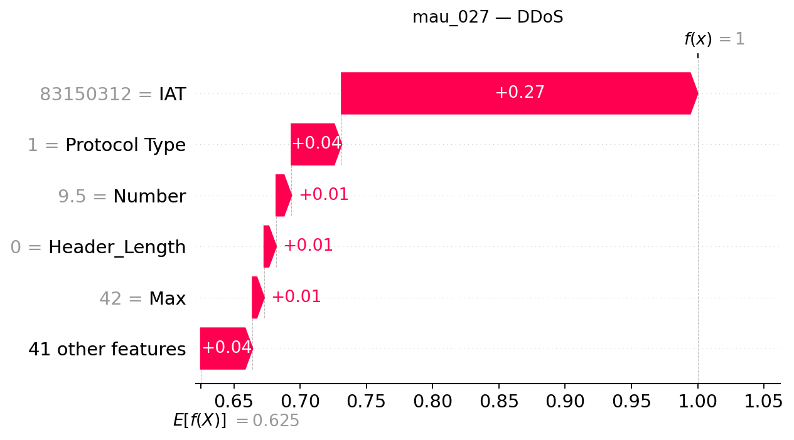

## mau_027 — dòng CSV 26

**Trạng thái Gemini: accepted**

Đạt kiểm tra bằng chứng có cấu trúc và quy tắc văn bản; chưa đánh giá ngữ nghĩa thủ công.

### Dự đoán và số liệu do chương trình dựng

- Model: `XGB_d4_n200`; dự đoán: **DDoS**, xác suất **99.9981%**.
- Lớp đứng thứ hai: **DoS**, xác suất **0.0011%**.
- Chênh lệch hai lớp: **99.9971 điểm phần trăm**.
- Quy tắc khoảng cách nhỏ: không quá 5 điểm phần trăm, chỉ để trình bày.
- Xác suất nền SHAP: 62.506627%.
- Tổng SHAP: +37.491501 điểm phần trăm; ngoài top 5: +3.907056 điểm phần trăm.
- Hỗ trợ mạnh nhất trong top 5: **IAT**.
- Phản đối mạnh nhất trong top 5: **Không có tác động âm trong top 5**.

| Đặc trưng | Giá trị gốc | SHAP | Tác động (điểm %) |
|---|---:|---:|---:|
| IAT | 83150312 | +0.26863356 | +26.863356 |
| Protocol Type | 1 | +0.03785083 | +3.785083 |
| Number | 9.5 | +0.01148986 | +1.148986 |
| Header_Length | 0 | +0.00907236 | +0.907236 |
| Max | 42 | +0.00879785 | +0.879785 |

### Diễn giải Gemini

Mô hình dự đoán mẫu dữ liệu thuộc lớp DDoS với sự hỗ trợ nổi bật từ đặc trưng IAT trong top 5. Lớp đứng thứ hai là DoS có khoảng cách chênh lệch lớn và cờ khoảng cách nhỏ tắt, thể hiện sự phân tách rõ rệt trong đầu ra hiện tại.

**So sánh hai lớp:** Cờ khoảng cách nhỏ đang tắt, cho thấy hai đầu ra có sự chênh lệch rõ rệt và không nằm trong diện cần đối chiếu gần; tuy nhiên điều này không bảo đảm dự đoán là đúng.

**Tổng hợp SHAP:** Trong năm đặc trưng hàng đầu, IAT đóng vai trò hỗ trợ mạnh nhất đẩy giá trị đầu ra lên, trong khi không có yếu tố nào trong nhóm này tạo ra tác động phản đối mang giá trị âm.

- **IAT**: Đây là yếu tố hỗ trợ nổi bật nhất trong top năm, góp phần đáng kể vào việc đẩy giá trị dự đoán của lớp.
- **Protocol Type**: Tác động này cùng chiều nhưng nhỏ hơn yếu tố dẫn đầu, đóng vai trò hỗ trợ bổ sung cho mô hình.
- **Number**: Sự hiện diện của đặc trưng này mang lại thêm một mức đóng góp dương ở mức độ thấp hơn.
- **Header_Length**: Đặc trưng này tiếp tục cung cấp một hướng tác động tăng nhỏ đối với đầu ra của mô hình.
- **Max**: Đây là đóng góp dương nhỏ nhất trong nhóm năm đặc trưng hàng đầu được xem xét.

### Gợi ý kiểm tra có điều kiện

- **Nhật ký lưu lượng mạng**: Kiểm tra sự đồng thời của nhiều nguồn đến cùng dịch vụ nếu có địa chỉ và thời gian. Mục đích: Đối chiếu mô hình với các bản ghi lưu lượng thực tế nếu hệ thống có thu thập.
- **Nhật ký tài nguyên dịch vụ**: Đối chiếu lưu lượng với tình trạng tài nguyên và khả năng phục vụ, không tự đặt ngưỡng. Mục đích: So sánh đầu ra với trạng thái tải của hệ thống trong điều kiện có dữ liệu.

### Giới hạn do Gemini nêu

- Giải thích SHAP chỉ phản ánh cách mô hình XGBoost tính toán trên mẫu này, không chứng minh quan hệ nhân quả hay sự tồn tại của tấn công thực tế.
- Xác suất dự đoán chưa qua kiểm định hiệu chỉnh và các giá trị đặc trưng chỉ là dữ liệu đầu vào, không mang ý nghĩa chuẩn mực tuyệt đối.

SHAP giải thích đầu ra model, chưa chứng minh hành vi tấn công hoặc quan hệ nhân quả. Đánh giá con người tạm hoãn.
