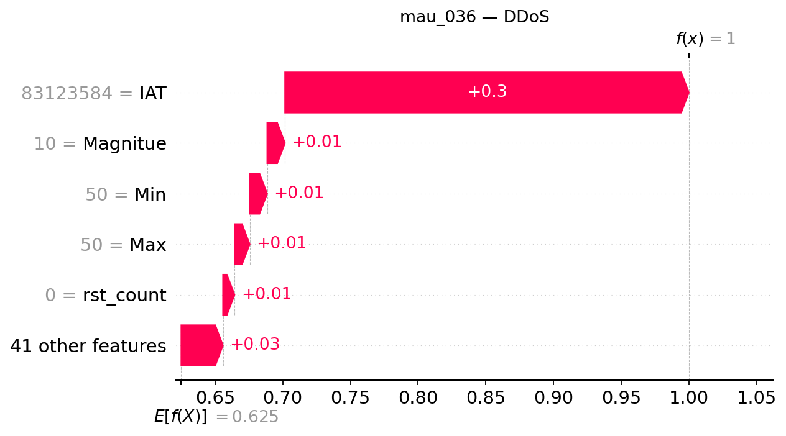

## mau_036 — dòng CSV 35

**Trạng thái Gemini: accepted**

Đạt kiểm tra bằng chứng có cấu trúc và quy tắc văn bản; chưa đánh giá ngữ nghĩa thủ công.

### Dự đoán và số liệu do chương trình dựng

- Model: `XGB_d4_n200`; dự đoán: **DDoS**, xác suất **99.9981%**.
- Lớp đứng thứ hai: **DoS**, xác suất **0.0011%**.
- Chênh lệch hai lớp: **99.9971 điểm phần trăm**.
- Quy tắc khoảng cách nhỏ: không quá 5 điểm phần trăm, chỉ để trình bày.
- Xác suất nền SHAP: 62.506627%.
- Tổng SHAP: +37.491501 điểm phần trăm; ngoài top 5: +3.081259 điểm phần trăm.
- Hỗ trợ mạnh nhất trong top 5: **IAT**.
- Phản đối mạnh nhất trong top 5: **Không có tác động âm trong top 5**.

| Đặc trưng | Giá trị gốc | SHAP | Tác động (điểm %) |
|---|---:|---:|---:|
| IAT | 83123584 | +0.29828681 | +29.828681 |
| Magnitue | 10 | +0.01314981 | +1.314981 |
| Min | 50 | +0.01288954 | +1.288954 |
| Max | 50 | +0.01119317 | +1.119317 |
| rst_count | 0 | +0.00858308 | +0.858308 |

### Diễn giải Gemini

Mô hình dự đoán mẫu dữ liệu thuộc lớp DDoS với sự hỗ trợ mạnh mẽ từ đặc trưng IAT trong top 5. Lớp đứng thứ hai là DoS nhưng có khoảng cách xác suất rất lớn so với lớp dẫn đầu.

**So sánh hai lớp:** Cờ khoảng cách nhỏ đang tắt, cho thấy chênh lệch giữa lớp đứng đầu và lớp DoS đứng thứ hai là rất lớn. Tuy nhiên, sự chênh lệch này không bảo đảm dự đoán chắc chắn đúng nhãn thật.

**Tổng hợp SHAP:** Trong top 5 đặc trưng, IAT đóng vai trò hỗ trợ mạnh nhất đẩy đầu ra tăng lên, trong khi không ghi nhận yếu tố nào mang giá trị âm để phản đối trong nhóm này.

- **IAT**: Đây là yếu tố hỗ trợ nổi bật nhất trong top năm, góp phần đáng kể làm tăng giá trị đầu ra của lớp dự đoán.
- **Magnitue**: Tác động này cùng chiều nhưng nhỏ hơn yếu tố dẫn đầu, đóng vai trò hỗ trợ bổ sung cho mô hình.
- **Min**: Đặc trưng này mang lại mức đóng góp dương ở mức độ vừa phải trong nhóm.
- **Max**: Sự hiện diện của đặc trưng này tiếp tục củng cố hướng tác động tăng cho đầu ra lớp dự đoán.
- **rst_count**: Đây là yếu tố có tác động nhỏ hơn các đặc trưng còn lại trong top 5 nhưng vẫn mang chiều hướng tăng.

### Gợi ý kiểm tra có điều kiện

- **Nhật ký lưu lượng mạng**: Kiểm tra sự đồng thời của nhiều nguồn đến cùng dịch vụ nếu có địa chỉ và thời gian Mục đích: Đối chiếu sự biến động của lưu lượng để xem xét bối cảnh thực tế.
- **Nhật ký tài nguyên dịch vụ**: Đối chiếu lưu lượng với tình trạng tài nguyên và khả năng phục vụ, không tự đặt ngưỡng Mục đích: Xác thực khả năng chịu tải và phản ứng của hệ thống trước các dấu hiệu bất thường.

### Giới hạn do Gemini nêu

- Giá trị SHAP chỉ phản ánh mức độ đóng góp của đặc trưng vào đầu ra của mô hình đối với mẫu này chứ không chứng minh quan hệ nhân quả.
- Xác suất dự đoán từ mô hình chưa được hiệu chỉnh chính thức và không thể thay thế cho nhãn thực tế.

SHAP giải thích đầu ra model, chưa chứng minh hành vi tấn công hoặc quan hệ nhân quả. Đánh giá con người tạm hoãn.
