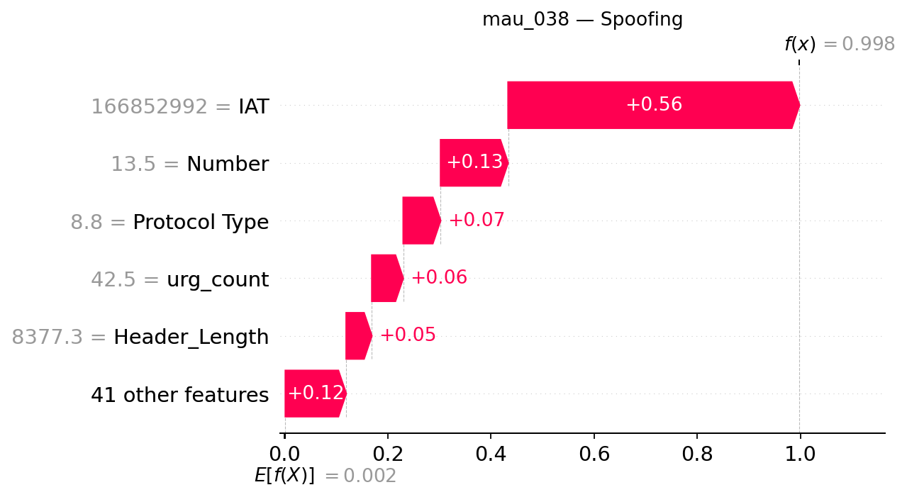

## mau_038 — dòng CSV 37

**Trạng thái Gemini: accepted**

Đạt kiểm tra bằng chứng có cấu trúc và quy tắc văn bản; chưa đánh giá ngữ nghĩa thủ công.

### Dự đoán và số liệu do chương trình dựng

- Model: `XGB_d4_n200`; dự đoán: **Spoofing**, xác suất **99.7711%**.
- Lớp đứng thứ hai: **Recon**, xác suất **0.1396%**.
- Chênh lệch hai lớp: **99.6315 điểm phần trăm**.
- Quy tắc khoảng cách nhỏ: không quá 5 điểm phần trăm, chỉ để trình bày.
- Xác suất nền SHAP: 0.198449%.
- Tổng SHAP: +99.572645 điểm phần trăm; ngoài top 5: +11.780666 điểm phần trăm.
- Hỗ trợ mạnh nhất trong top 5: **IAT**.
- Phản đối mạnh nhất trong top 5: **Không có tác động âm trong top 5**.

| Đặc trưng | Giá trị gốc | SHAP | Tác động (điểm %) |
|---|---:|---:|---:|
| IAT | 1.6685299e+08 | +0.56438600 | +56.438600 |
| Number | 13.5 | +0.13069617 | +13.069617 |
| Protocol Type | 8.8000002 | +0.07240793 | +7.240793 |
| urg_count | 42.5 | +0.06075094 | +6.075094 |
| Header_Length | 8377.2998 | +0.04967875 | +4.967875 |

### Diễn giải Gemini

Mẫu được dự đoán là lớp Spoofing với độ tin cậy vượt trội, trong khi lớp đứng thứ hai là Recon chiếm tỷ lệ rất thấp. Các đặc trưng trong top năm đều đóng vai trò thúc đẩy đầu ra của mô hình, dẫn dắt bởi IAT với mức đóng góp lớn nhất.

**So sánh hai lớp:** Cờ khoảng cách nhỏ đang tắt, cho thấy sự chênh lệch lớn giữa hai lớp đứng đầu; tuy nhiên, điều này không được xem là bảo đảm dự đoán đúng mà chỉ phản ánh trạng thái hiện tại của mô hình.

**Tổng hợp SHAP:** Trong top năm đặc trưng, tất cả đều mang giá trị dương giúp tăng đầu ra của lớp dự đoán so với nền tham chiếu, trong đó không ghi nhận yếu tố nào đóng vai trò phản đối.

- **IAT**: Đây là yếu tố hỗ trợ nổi bật nhất trong top năm, góp phần đáng kể vào kết quả phân loại của mô hình.
- **Number**: Tác động này cùng chiều nhưng có mức độ đóng góp nhỏ hơn yếu tố dẫn đầu.
- **Protocol Type**: Đặc trưng này cung cấp thêm một bước hỗ trợ bổ sung cho xu hướng dự đoán hiện tại.
- **urg_count**: Sự hiện diện của đặc trưng này tiếp tục củng cố đầu ra với một khoản tăng dương nhẹ.
- **Header_Length**: Đóng góp nhỏ hơn từ đặc trưng này hoàn thiện nhóm các yếu tố tác động cùng chiều trong top năm.

### Gợi ý kiểm tra có điều kiện

- **Nhật ký ánh xạ địa chỉ**: Nếu hệ thống có lưu trữ thông tin ánh xạ địa chỉ hoặc định danh thiết bị, cần tìm kiếm các thay đổi bất thường hay mâu thuẫn. Mục đích: Đối chiếu với dữ liệu ghi nhận nhằm xác thực tính nhất quán của định danh nguồn.
- **Nhật ký thiết bị mạng**: Nếu hệ thống ghi lại nhật ký thiết bị mạng, cần tìm đối chiếu định danh nguồn với cấu hình, các thay đổi được phép và cảnh báo liên quan. Mục đích: Xác minh xem có sự kiện cấu hình hoặc cảnh báo nào đi kèm với lưu lượng đang xét hay không.

### Giới hạn do Gemini nêu

- Giải thích này phản ánh đầu ra của mô hình ở mức độ dự đoán, không chứng minh sự tồn tại của một cuộc tấn công thực tế hay quan hệ nhân quả.
- Các giá trị SHAP chỉ thể hiện sự đóng góp so với nền tham chiếu trong top năm đặc trưng và chưa bao hàm toàn bộ phần dư ngoài nhóm.
- Xác suất của mô hình chưa được kiểm chứng về độ hiệu chỉnh và không thể dùng làm thước đo an toàn tuyệt đối.

SHAP giải thích đầu ra model, chưa chứng minh hành vi tấn công hoặc quan hệ nhân quả. Đánh giá con người tạm hoãn.
