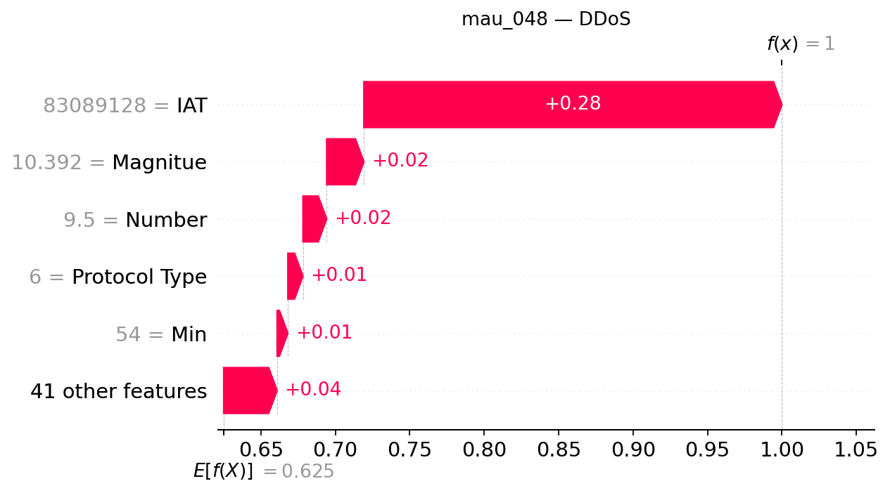

## mau_048 — dòng CSV 47

**Trạng thái Gemini: accepted**

Đạt kiểm tra bằng chứng có cấu trúc và quy tắc văn bản; chưa đánh giá ngữ nghĩa thủ công.

### Dự đoán và số liệu do chương trình dựng

- Model: `XGB_d4_n200`; dự đoán: **DDoS**, xác suất **99.9981%**.
- Lớp đứng thứ hai: **DoS**, xác suất **0.0011%**.
- Chênh lệch hai lớp: **99.9971 điểm phần trăm**.
- Quy tắc khoảng cách nhỏ: không quá 5 điểm phần trăm, chỉ để trình bày.
- Xác suất nền SHAP: 62.506627%.
- Tổng SHAP: +37.491513 điểm phần trăm; ngoài top 5: +3.586859 điểm phần trăm.
- Hỗ trợ mạnh nhất trong top 5: **IAT**.
- Phản đối mạnh nhất trong top 5: **Không có tác động âm trong top 5**.

| Đặc trưng | Giá trị gốc | SHAP | Tác động (điểm %) |
|---|---:|---:|---:|
| IAT | 83089128 | +0.28077676 | +28.077676 |
| Magnitue | 10.392304 | +0.02498581 | +2.498581 |
| Number | 9.5 | +0.01591242 | +1.591242 |
| Protocol Type | 6 | +0.01014956 | +1.014956 |
| Min | 54 | +0.00722199 | +0.722199 |

### Diễn giải Gemini

Hệ thống dự đoán mẫu thuộc lớp DDoS với mức độ tin cậy áp đảo, nhờ sự đóng góp tích cực từ các đặc trưng trong top năm. Trong khi đó, lớp đứng thứ hai là DoS có xác suất vô cùng nhỏ, tạo khoảng cách biệt rất lớn với lớp dẫn đầu.

**So sánh hai lớp:** Cờ khoảng cách nhỏ đang tắt, cho thấy chênh lệch giữa hai lớp rất lớn; tuy nhiên việc này không coi là bảo đảm dự đoán chính xác tuyệt đối và không kết luận đã biết nhãn thật.

**Tổng hợp SHAP:** Trong nhóm năm đặc trưng đang xét, IAT đóng vai trò hỗ trợ mạnh mẽ nhất giúp đẩy cao đầu ra của lớp dự đoán. Không có đặc trưng nào trong top năm mang lại tác động phản đối âm.

- **IAT**: Đây là yếu tố hỗ trợ nổi bật nhất trong top năm, góp phần đáng kể vào việc nâng cao giá trị đầu ra.
- **Magnitue**: Tác động này cùng chiều nhưng có quy mô nhỏ hơn yếu tố dẫn đầu trong nhóm.
- **Number**: Đặc trưng này cung cấp thêm một mức hỗ trợ bổ sung theo hướng tăng đầu ra.
- **Protocol Type**: Sự hiện diện của yếu tố này tiếp tục củng cố kết quả với một đóng góp dương nhỏ hơn.
- **Min**: Đây là thành phần có tác động nhỏ nhất trong số năm đặc trưng hàng đầu nhưng vẫn duy trì chiều tăng.

### Gợi ý kiểm tra có điều kiện

- **Nhật ký lưu lượng mạng**: Kiểm tra sự đồng thời của nhiều nguồn đến cùng dịch vụ nếu có địa chỉ và thời gian. Mục đích: Đối chiếu mô hình lưu lượng thực tế với các đặc trưng đã ghi nhận để phục vụ việc phân tích.
- **Nhật ký tài nguyên dịch vụ**: Đối chiếu lưu lượng với tình trạng tài nguyên và khả năng phục vụ, không tự đặt ngưỡng. Mục đích: Xác thực tác động của các biến số đối với hệ thống trong điều kiện vận hành.

### Giới hạn do Gemini nêu

- Giá trị SHAP chỉ giải thích đầu ra của mô hình đối với mẫu hiện tại, không chứng minh quan hệ nhân quả hay hành vi tấn công thực tế.
- Các mức giá trị SHAP và xác suất chưa qua hiệu chỉnh chuẩn hóa tuyệt đối.
- Tổng các đặc trưng trong top năm chưa phải là toàn bộ thành phần tạo nên đầu ra cuối cùng của mô hình.

SHAP giải thích đầu ra model, chưa chứng minh hành vi tấn công hoặc quan hệ nhân quả. Đánh giá con người tạm hoãn.
